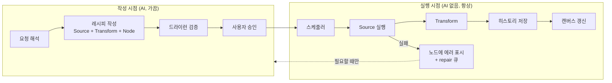
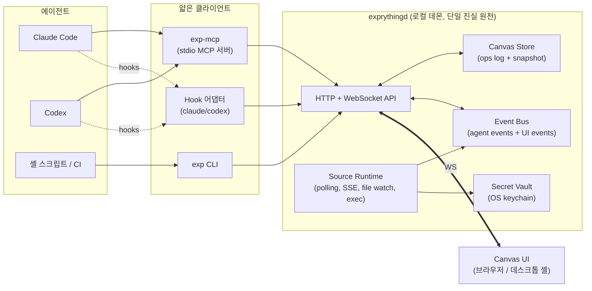
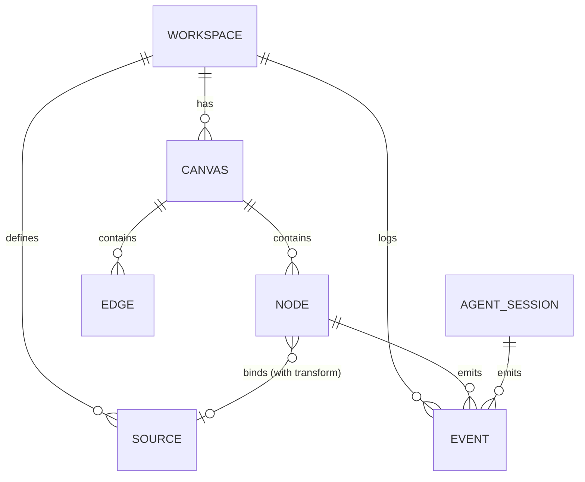

# Exprything — 기획 및 설계 초안 (v0.1)

> 코딩 에이전트(Claude Code, Codex 등)가 MCP/CLI로 접근해 그림을 그리는 **표현 계층(Expression Layer)**.
> 에이전트는 **한 번 그려두고 떠난다.** 그 뒤로는 AI 없이 Exprything이 스스로 데이터를 가져와 캔버스를 계속 갱신한다.

---

## 0. 제1원칙: Author once, run forever



AI는 **컴파일러**, Exprything은 **런타임**이다.

| | 작성 시점 (Authoring) | 실행 시점 (Runtime) |
|---|---|---|
| 주체 | Claude Code / Codex | `exprythingd` |
| 빈도 | 처음 한 번 + 고장/변경 시 | 스케줄마다 영원히 |
| 비용 | 토큰 | 0 (LLM 호출 없음) |
| 산출물 | 결정적인 레시피(JSON + 필요 시 작은 스크립트) | 갱신된 데이터, 히스토리, 렌더링 |

이 원칙에서 나오는 규칙:
1. **AI는 결과가 아니라 "구하는 방법"을 쓴다.** "오늘 커밋 23개"라는 숫자를 박는 게 아니라 `git log` 명령 + 집계식 + 갱신 주기를 쓴다. 숫자를 인라인으로 넣는 `static` 소스는 메모·주석 용도로만 쓴다.
2. **런타임에는 LLM이 끼지 않는다.** 그래서 싸고, 빠르고, 결과가 매번 같다. (요약·분류처럼 LLM이 꼭 필요한 단계는 비용이 명시된 별도 `llm` 소스로 분리하고 기본은 끈다.)
3. **작성 시점에 검증을 끝낸다.** 레시피는 반드시 드라이런으로 실제 데이터를 한 번 가져와 결과 미리보기를 확인한 뒤에 저장된다.
4. **고장은 조용히 넘어가지 않는다.** 토큰 만료, API 스키마 변경 등으로 실패하면 노드가 "stale/error" 상태를 드러내고, repair 큐에 쌓인다. 다음에 에이전트가 들어오면 그때 고친다.
5. **데몬은 에이전트·브라우저와 무관하게 상주한다.** Claude Code를 끄고, 브라우저 탭을 닫아도 데이터는 계속 쌓인다.

---

## 1. 한 줄 정의와 포지셔닝

**"에이전트가 쓰는 화면."**
터미널 텍스트로는 표현이 안 되는 것(차트, 실시간 API 상태, 에이전트 행동 타임라인, 사람의 승인 버튼)을
에이전트가 직접 캔버스 위에 배치하고, 사람은 그것을 보고 조작하며, 그 조작이 다시 에이전트에게 돌아간다.

| 비교 대상 | 차이 |
|---|---|
| Claude Artifacts / v0 | 일회성 결과물. Exprything은 **지속되는 캔버스 + 실시간 데이터 바인딩 + 양방향 이벤트** |
| Grafana / Retool | 사람이 GUI로 조립. Exprything은 **에이전트가 선언으로 조립**, 사람은 보고 다듬음 |
| Langfuse / AgentOps | 에이전트 관측 전용 SaaS. Exprything은 관측도 **위젯 중 하나**일 뿐, 로컬 우선 |
| tldraw / Excalidraw | 자유 드로잉 캔버스. Exprything은 **데이터가 흐르는 구조화된 노드** 중심 |

### 핵심 원칙
0. **한 번 그리면 계속 산다** — 0장 참조. 모든 노드는 스스로 갱신되는 레시피다.
1. **선언형(Declarative)** — 에이전트는 코드가 아니라 JSON 스펙을 보낸다. LLM이 가장 잘 생성하는 형태.
2. **데이터와 뷰의 분리** — `Source`(데이터가 어디서 오나)와 `Node`(어떻게 보여주나)를 분리. 하나의 소스를 여러 뷰가 공유.
3. **멱등성(Idempotent)** — 모든 객체는 에이전트가 지정한 `id`로 upsert. 같은 명령을 다시 실행해도 중복되지 않는다.
4. **양방향** — 캔버스는 출력만이 아니라 입력 장치. 버튼/폼/승인/코멘트가 이벤트로 에이전트에게 전달된다.
5. **로컬 우선** — 기본은 내 머신의 데몬 + 브라우저. 시크릿은 절대 캔버스 파일에 남지 않는다.

---

## 2. 핵심 사용 시나리오

| # | 시나리오 | 에이전트가 하는 일 | 필요한 기능 |
|---|---|---|---|
| S1 | **API 붙이기** | "GitHub PR 목록을 표로 띄우고 30초마다 갱신해" | HTTP Source(폴링, 시크릿 참조), Table 노드, 변환식 |
| S2 | **차트 그리기** | 벤치마크 결과 CSV를 읽어 라인 차트로 | Static/File Source, Chart 노드 |
| S3 | **에이전트 감시** | 내 Claude Code 세션이 지금 무슨 툴을 쓰는지 타임라인으로 | Hook 수집기, Agent Event Stream, Timeline/Monitor 노드 |
| S4 | **사람 개입(HITL)** | "배포 전 승인 받아" → 캔버스에 버튼, 에이전트는 대기 | Action 노드, `events.wait` |
| S5 | **작업 대시보드** | 장시간 작업(마이그레이션, 학습)의 진행률/로그를 실시간 표시 | Push Source(CLI 파이프), Progress/Log 노드 |
| S6 | **멀티 에이전트 관제** | 여러 세션/워크트리의 상태를 한 캔버스에 | 세션별 그룹(Frame), 이벤트 필터 |

---

## 3. 시스템 아키텍처



### 컴포넌트 책임
- **exprythingd (데몬)**: 모든 상태의 주인. 127.0.0.1 바인딩 + 토큰 인증. 캔버스 상태, 소스 실행, 이벤트 버스, 시크릿 관리.
- **exp-mcp**: stdio MCP 서버. 로직 없음 — 데몬 API의 얇은 래퍼. 데몬이 없으면 자동 기동.
- **exp CLI**: 같은 API의 CLI 표면. 파이프 친화적(`curl ... | exp push sales`). MCP를 못 쓰는 환경/스크립트/CI용.
- **Hook 어댑터**: Claude Code·Codex hooks 이벤트를 표준 `AgentEvent`로 정규화해 데몬에 전송(`exp hook`).
- **Canvas UI**: 렌더러. WebSocket으로 상태 diff를 구독. 사용자 조작(이동, 클릭, 입력)은 op/event로 데몬에 전송.

> **왜 MCP 서버가 직접 상태를 갖지 않나?** MCP 서버는 에이전트 세션마다 하나씩 뜬다.
> 여러 에이전트·CLI·UI가 같은 캔버스를 공유하려면 상태는 별도 장기 프로세스에 있어야 한다.

---

## 4. 도메인 모델



### 4.1 Node (뷰)
```jsonc
{
  "id": "pr-table",                 // 에이전트 지정, upsert 키
  "type": "table",                  // 위젯 카탈로그의 타입
  "title": "Open PRs",
  "layout": { "slot": "auto" },     // 좌표 대신 의도 표현 (4.4 참조)
  "bind": {                          // 선택: 데이터 바인딩
    "source": "github-prs",
    "transform": "$.[{ 'title': title, 'author': user.login, 'age': $age(created_at) }]"
  },
  "props": { "columns": ["title", "author", "age"] },
  "owner": "agent:claude-code:abc123" // 누가 만들었나 (감사/필터용)
}
```

### 4.2 Source (데이터) — 스스로 갱신되는 레시피의 심장
```jsonc
{
  "id": "repo-commits",
  "kind": "exec",
  "run": { "cmd": ["git", "log", "--since=30.days", "--pretty=%cI"], "cwd": "~/code/my-repo", "parse": "lines" },
  "refresh": { "every": "10m" },          // 또는 { "cron": "0 9 * * *" }, { "on": "file-change" }
  "transform": "$count($) ...",            // JSONata, 결정적
  "history": { "keep": "90d", "mode": "snapshot" }, // 매 갱신 결과를 시계열로 축적
  "approvedBy": "user@2026-11-03"          // exec/http 레시피는 최초 1회 사용자 승인
}
```

| kind | 설명 | 갱신 방식 |
|---|---|---|
| `http` | REST 호출, 헤더에 `{{secret.GITHUB_TOKEN}}` 참조 | 주기 폴링 |
| `stream` | SSE / WebSocket 구독 | 푸시(상시 연결, 자동 재연결) |
| `file` | 파일 감시 (CSV/JSON/JSONL) | 파일 변경 시 |
| `exec` | 명령 실행 후 stdout 파싱 (`git`, `kubectl`, `gh` …) | 주기 / cron |
| `script` | AI가 작성해 `.exprything/scripts/`에 저장한 작은 TS/Python 스크립트. 복잡한 계산의 탈출구 | 주기 / cron |
| `agent` | 에이전트 이벤트 스트림 필터 | 이벤트 발생 시 |
| `push` | 외부가 밀어넣음 (CLI/MCP/CI) | 외부 주도 |
| `static` | 인라인 데이터. 메모·주석 용도로만 | 없음 |
| `llm` *(선택, 기본 off)* | LLM 요약/분류. 호출당 비용·한도 명시 | cron, 저빈도 |

변환식은 **JSONata**를 1순위로 제안 (표현력 + 샌드박스 안전 + LLM이 비교적 잘 씀).

**히스토리가 핵심이다.** "현재 열린 PR 수"처럼 API가 현재 값만 주는 경우에도, 데몬이 매 갱신 결과를 저장해두면
추세 차트가 저절로 생긴다. 한 번 그려둔 대시보드가 시간이 지날수록 더 가치 있어지는 이유가 여기에 있다.

### 4.2.1 신선도(Freshness)와 건강 상태
모든 Source는 상태를 가진다: `fresh` → `stale`(예정 시각을 넘겨도 갱신 안 됨) → `error`(연속 실패).
- 노드 모서리에 "3분 전 갱신 · 다음 7분 후"를 표시하고, stale/error면 시각적으로 흐리게 + 사유 표시.
- 실패는 지수 백오프로 재시도, N회 연속 실패 시 `source.error` 이벤트 + **repair 큐** 등록.
- 에러 유형 분류: `auth`(토큰 만료 → 사용자에게 재입력 요청), `schema`(응답 형태 변경 → AI 수리 필요), `network`(일시적, 재시도만).

### 4.2.2 Repair 루프 — AI는 고장 났을 때만 돌아온다
1. 데몬이 repair 큐에 `{ source, error, lastGoodSample, currentSample }`를 쌓는다.
2. 다음에 에이전트가 MCP에 연결되면 `canvas_open` 응답에 "고칠 것 2건"이 함께 온다. (또는 사용자가 `exp doctor`로 요청)
3. 에이전트는 실패 원인과 샘플을 보고 레시피를 수정 → 드라이런 → 사용자 승인 → 런타임 복귀.

### 4.3 위젯 카탈로그 (v0)
| type | 용도 | 스펙 기반 |
|---|---|---|
| `markdown` | 설명, 노트, 리포트 | Markdown + Mermaid |
| `chart` | 모든 차트 | **ECharts option** 또는 **Vega-Lite** (결정 필요, 6장) |
| `table` | 표, 정렬/필터 | 컬럼 정의 |
| `stat` | KPI 숫자 + 델타 + 스파크라인 | |
| `log` | 스트리밍 로그 tail | |
| `timeline` | 에이전트 행동 / 이벤트 타임라인 | AgentEvent |
| `agent-monitor` | 세션 상태, 현재 툴, 토큰, 비용, 경과시간 | AgentEvent 집계 |
| `progress` | 진행률/단계 | |
| `action` | 버튼, 폼, 승인/거절 → 이벤트 발생 | JSON Schema 폼 |
| `frame` | 그룹 컨테이너 (세션별/주제별 구역) | |
| `html` | 탈출구. 샌드박스 iframe, 데이터는 postMessage로 주입 | 임의 HTML |

모든 타입은 **JSON Schema로 기술**되어 `catalog.get`으로 에이전트에게 제공 → 에이전트가 스스로 학습.

### 4.4 레이아웃: 에이전트는 좌표에 약하다
- 에이전트는 `layout`에 **의도**만 기술: `{ "slot": "auto" }`, `{ "near": "pr-table", "side": "right" }`, `{ "in": "frame-session-1" }`, `{ "row": 0, "col": 2 }`(그리드).
- 데몬/UI가 자동 배치 후 실제 좌표를 저장.
- **사용자가 드래그한 노드는 `pinned`** → 이후 에이전트의 upsert가 위치를 덮어쓰지 않음. (사람의 결정이 에이전트보다 우선)

### 4.5 Event
```jsonc
{ "seq": 1042, "ts": "...", "kind": "ui.action", "node": "deploy-approve",
  "payload": { "choice": "approve", "comment": "LGTM" }, "actor": "user" }

{ "seq": 1043, "ts": "...", "kind": "agent.tool.pre", "session": "cc:abc123",
  "payload": { "tool": "Bash", "input": { "command": "npm test" } }, "actor": "agent:claude-code" }
```
- 단조 증가 `seq` → 에이전트는 `events.poll(after=seq)`로 놓친 이벤트 없이 읽음.
- 종류: `ui.*` (사람 조작), `agent.*` (훅 수집), `source.*` (갱신/에러), `canvas.*` (변경).

---

## 5. 인터페이스 설계

### 5.1 MCP 툴 (적고 굵게)
툴 수가 많으면 에이전트 컨텍스트를 낭비하고 선택 정확도가 떨어진다. **6~8개로 제한**하고 배치를 기본으로.

| 툴 | 설명 |
|---|---|
| `canvas_open(name?)` | 캔버스 열기/생성, UI URL 반환 |
| `canvas_apply(ops[], dryRun?)` | 노드/소스/엣지의 upsert·delete를 **한 번에 배치** (원자적). `dryRun`이면 저장하지 않고 소스를 실제로 1회 실행해 **변환 결과 샘플·렌더 미리보기·에러**를 반환 → AI가 검증 후 확정 |
| `canvas_read(filter?)` | 현재 상태를 요약 JSON으로 (선택: 스크린샷 이미지) |
| `catalog_get(type?)` | 위젯/소스 타입의 JSON Schema와 예시 |
| `source_push(id, data, mode=append\|replace)` | push 소스에 데이터 주입 |
| `events_poll(after?, kinds?, wait_ms?)` | 이벤트 읽기. `wait_ms`로 롱폴링 → HITL 대기 |
| `secret_request(name, reason)` | 사용자에게 시크릿 입력을 UI로 요청 (값은 에이전트에게 노출 안 됨) |
| `repair_list()` | 고장 난 소스 목록과 진단 정보(에러, 마지막 정상 샘플, 현재 응답) |

**작성 흐름의 표준 형태**: `catalog_get` → `canvas_apply(dryRun)` → 샘플 확인·수정 반복 → `canvas_apply` 확정 → (exec/http면) 사용자 승인 → 이후 AI는 퇴장.

### 5.2 CLI (`exp`)
```bash
exp open                               # 데몬 기동 + 브라우저 열기
exp apply -f dashboard.json            # MCP canvas_apply와 동일
exp push build-log --append < out.txt  # 파이프로 데이터 주입
exp events --follow --kind ui.action   # 이벤트 tail (스크립트에서 대기용)
exp wait deploy-approve                # 특정 action 응답까지 블로킹, 결과를 stdout
exp connect claude|codex --activity    # MCP 등록 + 에이전트 감시 훅 설치
exp service install                    # 데몬을 launchd/systemd 서비스로 등록 (로그인 시 자동 기동)
exp status                             # 모든 소스의 신선도/다음 갱신/에러 요약
exp doctor                             # repair 큐 확인
exp refresh repo-commits               # 수동 즉시 갱신
exp secret set GITHUB_TOKEN            # 키체인에 저장
```
CLI와 MCP는 **동일한 op 스키마**를 공유 → 에이전트가 MCP를 못 쓰는 상황에서도 `exp apply`로 같은 결과.

### 5.3 에이전트 감시 (Hook 어댑터)
- **Claude Code**: `~/.claude/settings.json`의 hooks(`SessionStart`, `UserPromptSubmit`, `PreToolUse`, `PermissionRequest`, `PostToolUse`, `PostToolUseFailure`, `Notification`, `Subagent*`, `Stop`, `PreCompact`, `SessionEnd`)에 `exp hook --agent claude-code`를 async로 등록 → stdin JSON을 정규화해 데몬으로.
- **Codex**: `~/.codex/hooks.json`에 같은 방식(Claude와 거의 같은 형식)으로 등록하고 `PostModelRequest`(토큰 수)를 더 받는다. 새 훅은 사람이 `/hooks`에서 신뢰해야 실행된다. `notify`는 턴 완료 하나뿐인 레거시이고 제거 예정이라 쓰지 않는다.
- **보조 경로(보류)**: 세션 트랜스크립트 JSONL(`~/.claude/projects/**`, `~/.codex/sessions/**`)은 두 회사 모두 안정 인터페이스가 아니라고 명시해 쓰지 않는다. Claude의 토큰·비용은 옵트인 OTel로 받는 것을 검토한다. 근거는 [research/agent-integrations.md](research/agent-integrations.md).
- **감시 → 개입**으로 확장: `PreToolUse` 훅이 데몬에 질의 → 캔버스의 정책/승인 노드 결과에 따라 허용/차단. (v2, 안전장치 필수)

> 정확한 훅 이벤트 이름과 페이로드는 구현 시점에 각 도구의 최신 문서로 확인할 것.

---

## 6. 기술 스택 제안

| 영역 | 제안 | 대안 / 이유 |
|---|---|---|
| 언어 | TypeScript 모노레포 (pnpm workspaces) | 데몬·CLI·MCP·UI가 스키마 타입 공유 |
| 런타임 | Node 22+ (또는 Bun) | MCP TS SDK 성숙 |
| 데몬 API | Hono + ws | 가볍고 타입 친화적 |
| 스키마 | Zod → JSON Schema 자동 생성 | 한 곳에서 정의, MCP 툴 스키마/catalog/검증에 재사용 |
| 캔버스 | **Excalidraw (MIT)**, 위젯은 `embeddable` 요소 | 처음엔 React Flow였으나 기본 드로잉 기능 때문에 교체([research/excalidraw.md](research/excalidraw.md)). tldraw는 production 라이선스 키 필요 |
| 차트 | **ECharts** (실시간·대용량 강함, option JSON) | Vega-Lite (문법적, 선언성 최고). → 결정 필요 |
| 변환식 | JSONata | JMESPath(단순), jq(익숙하지만 브라우저 바인딩 무거움) |
| 저장 | `.exprything/` 폴더: `canvas/*.json`(스냅샷, git 친화) + SQLite(이벤트 로그) | 프로젝트별 캔버스를 레포에 커밋 가능 |
| 시크릿 | OS 키체인 (keytar 계열) | 캔버스 JSON엔 `{{secret.X}}` 참조만 |
| 데스크톱 | v0은 브라우저, 이후 Tauri 셸 | 메뉴바 상주, 알림 |
| 동기화 | v0: 서버 권위 ops + WS 브로드캐스트 | 팀 공유 단계에서 Yjs(CRDT) 도입 |

---

## 7. 보안 모델
1. 데몬은 `127.0.0.1`만 바인딩, 실행 시 생성되는 토큰 필수 (`~/.exprything/token`, 0600).
2. **시크릿은 에이전트에게도 보이지 않는다**: 에이전트는 이름만 참조, 실제 주입은 데몬의 HTTP 프록시 단계에서.
3. `http` 소스는 **데몬 프록시 경유** (CORS 해결 + 시크릿 주입 + 도메인 허용 목록).
4. `exec` 소스는 기본 비활성, 명령 허용 목록 + 사용자 최초 승인.
5. `html` 위젯은 `sandbox` iframe(별도 origin, `allow-scripts`만), 네트워크는 CSP로 차단, 데이터는 postMessage로만.
6. 모든 op에 `actor` 기록 → "어떤 에이전트가 무엇을 그렸나" 감사 가능, 에이전트별 되돌리기.

---

## 8. 로드맵

"스스로 갱신"이 제품의 정체성이므로 **스케줄러·히스토리·상주 데몬은 v0부터** 들어간다.

| 단계 | 목표 | 범위 |
|---|---|---|
| **v0 — 한 번 그리면 산다** (3~4주) | 레시피가 AI 없이 계속 돈다 | 상주 데몬(`exp service install`), 스케줄러, `exec`·`file`·`push` 소스, JSONata, 히스토리(SQLite), 신선도 표시, `canvas_apply(dryRun)`, 위젯: markdown·chart·table·stat·log, 자동 레이아웃, 캔버스 파일 저장 |
| **v1 — API 연결** | 외부 서비스 | `http`·`stream`·`script` 소스, 시크릿 볼트, 데몬 프록시, exec/http 승인 UI, 노드 pin |
| **v2 — 자가 진단** | 고장 나도 믿을 수 있게 | 에러 분류, 백오프, repair 큐, `repair_list`/`exp doctor`, 실패 알림(OS 알림) |
| **v3 — 감시하기** | 에이전트 관측 | Claude/Codex 훅 어댑터, timeline·agent-monitor 위젯, 트랜스크립트 재생 |
| **v4 — 상호작용** | 사람↔에이전트 루프 | action 위젯, `events_poll` 롱폴링, `exp wait`, 승인 게이트 |
| **v5 — 공유** | 팀 | CRDT, 원격 데몬/릴레이, 캔버스 공유 링크, 레시피 템플릿 |

**v0 성공 기준(데모 시나리오)**: Claude Code에게 "이 레포의 일별 커밋 수를 차트로, TODO 개수를 KPI로 보여줘"라고 한 번 요청한다.
→ Claude Code를 종료하고 브라우저도 닫는다.
→ **다음 날** 캔버스를 열면 어제 이후 커밋이 반영되어 있고, TODO KPI 옆에 하루치 추세 스파크라인이 생겨 있다. 그 사이 LLM 호출은 0회.

---

## 9. 리포지토리 구조 (제안)
```
exprything/
├─ packages/
│  ├─ schema/      # Zod 스키마: Node, Source, Event, Op — 모든 패키지의 공통 계약
│  ├─ daemon/      # exprythingd: API, store, source runtime, event bus
│  ├─ mcp/         # exp-mcp: stdio MCP 서버 (daemon 클라이언트)
│  ├─ cli/         # exp CLI (daemon 클라이언트 + hooks 어댑터)
│  ├─ client/      # daemon용 TS SDK (mcp/cli/외부 스크립트가 공유)
│  └─ ui/          # React + Excalidraw 캔버스, 위젯 렌더러
├─ widgets/        # 위젯별 렌더러 + 스키마 + 예시 (catalog의 원천)
├─ examples/       # 데모 캔버스 JSON
└─ docs/
```

---

## 10. 결정이 필요한 질문
1. **타깃 사용자**: 개인 개발자용 로컬 툴인가, 처음부터 팀 공유(SaaS)를 염두에 두는가? → 동기화·인증 설계가 크게 달라짐.
2. **차트 엔진**: ECharts(실시간/성능) vs Vega-Lite(선언성/문법). 둘 다 지원하면 카탈로그가 복잡해짐.
3. **캔버스 성격**: 노드형 대시보드(React Flow) vs 자유 드로잉까지 포함(tldraw 계열)?
4. **감시의 깊이**: 관측만(v3)인가, 에이전트 행동 차단/승인(가드레일)까지 핵심 가치로 보는가?
7. **`exec`/`script` 신뢰 모델**: AI가 작성한 명령이 사용자 머신에서 무인 반복 실행된다. 최초 승인 1회로 충분한가, 명령 변경 시마다 재승인인가, 샌드박스(읽기 전용 FS 등)를 강제할 것인가?
8. **`llm` 소스를 허용할 것인가**: "매일 아침 이슈를 요약" 같은 수요는 분명하지만 "런타임엔 AI 없음" 원칙과 충돌한다.
5. **캔버스 저장 위치**: 프로젝트 레포 안(`.exprything/`, 커밋 가능) vs 사용자 전역(`~/.exprything/`).
6. **이름/브랜딩**: "Expr + Everything" — CLI 명령어 `exp`는 충돌 가능성 확인 필요.

---

## 11. v0 구현 현황 (2026-11-03)

구현된 것과, 설계 문서와 다르게 잠정 결정한 부분.

| 항목 | 상태 |
|---|---|
| 상주 데몬 + 스케줄러 + 히스토리 | 구현. 히스토리는 `node:sqlite`, 값이 같으면 1시간에 한 번만 기록 |
| 소스 | `static`·`push`·`exec`·`file`·`agent` 구현. `http`·`stream`·`script`·`llm`은 v1 이후 |
| 재시작 복원 | 데몬 재시작 시 마지막 값을 히스토리에서 즉시 복원, 남은 주기만큼 기다렸다 실행 |
| 실패 처리 | 실패 시 `error` 상태 + 마지막 정상 값 유지, 5s→10s→… 백오프(정상 주기 상한). repair 목록은 `source_status`/`exp status`로 노출 |
| MCP 툴 | `catalog_get`, `canvas_apply(dryRun)`, `canvas_read`, `canvas_open`, `canvas_selection`, `source_push`, `source_status`. `repair_list`는 `source_status`에 흡수. `events_poll`·`secret_request`는 v1 이후. 서버 `instructions`(언제 쓰는지와 작성 절차)와 툴 annotations(읽기 전용, `canvas_apply`는 멱등)를 준다 |
| 선택 공유 | 사이드바는 보내는 순간의 선택을 요소 id와 함께 메시지 앞에 붙이고, 에이전트는 캔버스가 그 뒤로 바뀌어도 그것을 기준으로 삼는다. 선택이 메시지에 없을 때만 `canvas_selection`을 쓴다. 열린 캔버스 페이지가 사람의 선택을 기존 WebSocket으로 데몬에 보낸다. 위젯은 노드 id·타입·제목·소스, 그린 것은 Excalidraw 요소 종류·글자(도형 라벨, 프레임 이름 포함)·위치·화살표가 잇는 대상(`node:<id>`는 위젯)으로 요약한다. 데몬은 페이지마다 마지막 보고를 연결이 살아 있는 동안만 들고 있고, `canvas_selection`/`exp selection`은 캔버스를 지정하지 않으면 가장 최근 것(선택을 바꿨거나 그 탭으로 돌아온 페이지)을 돌려준다. 브라우저가 열려 있지 않으면 `open: false` |
| 에이전트 연결 | `exp connect claude\|codex`, AI 사이드바의 설정, 데스크탑 Help > Connect an Agent…가 같은 일을 한다. 데스크탑 앱은 처음 찾은 에이전트를 시작할 때 한 번 연결하고(활동 기록은 켜지 않는다), 연결했거나 끊은 에이전트를 `agents-seen.json`에 남겨 다시 건드리지 않는다. 소스에서 띄운 앱, App Translocation, 사용자 지정 `EXPRYTHING_HOME`에서는 하지 않는다: 에이전트 설정은 홈과 상관없이 하나라서 테스트가 실제 설정을 바꾸게 된다. 각 에이전트의 CLI로만 등록하고(Claude는 `mcp add-json --scope user`, Codex는 `mcp add`), 설정 파일은 읽기만 한다. 등록하는 명령은 `~/.exprything/bin/exp` 셔임이어서 앱을 옮기거나 체크아웃으로 바꿔도 셔임만 다시 쓴다(셔임에 `EXPRYTHING_HOME`·포트를 넣어 Codex의 환경변수 허용 목록도 넘는다). 이미 맞으면 아무것도 바꾸지 않는다. 예전 README대로 프로젝트에만 등록된(local scope) 항목이 가리면 지우는 명령을 알려 준다. Claude Code 2.1.317, Codex 0.165.0으로 실측 |
| 에이전트 활동 | 옵트인. 위 hooks가 `POST /api/agent-events`로 보내고, 데몬이 꺼져 있으면 스풀 파일에 남겼다가 시작할 때 읽는다. 훅은 데몬을 띄우지 않고, 아무것도 출력하지 않으며, 항상 exit 0. 이벤트는 hook 안에서 줄여서 보낸다: 툴 이름과 대상(명령 첫 줄, 파일 경로, 패턴, URL), 성공 여부, 걸린 시간, 프롬프트 길이. 프롬프트·파일 내용·툴 출력·트랜스크립트는 보내지 않는다. `history.db`의 `agent_events`에 30일 보관. `agent` 소스가 최근 이벤트(`view: events`)나 세션별 상태(`view: sessions`: working·waiting·idle·ended)를 값으로 주고, 히스토리 스냅샷은 남기지 않는다. 처음 켜면 `agent-activity` 캔버스를 만든다(이미 있으면 두기). `-p` 세션은 끝날 때 아직 돌던 async 훅을 끊어서 마지막 `Stop`이 빠질 수 있다(`SessionEnd`는 동기여서 남는다) |
| AI 사이드바 | 캔버스 오른쪽에서 Claude Code나 Codex와 대화한다(우측 상단 AI 버튼, ⌘J, 캔버스 메뉴). 데몬이 에이전트를 자식 프로세스로 띄우고 대화를 `~/.exprything/chats/<id>.json`에 남긴다. 대화는 언제나 `~/.exprything/workspace`에서 시작하고 폴더를 고르지 않는다. 고르게 하면 대화마다 먼저 결정해야 하고, 홈이나 바탕화면에서 시작하면 macOS 폴더 권한 창이 뜬다. 작업 폴더는 샌드박스가 아니므로, 다른 폴더는 대화에서 알려 주면 에이전트의 권한 규칙에 따라 쓸 수 있다. 시스템 지시로 이 폴더가 프로젝트가 아니라고 알린다. Claude Code는 `-p` 스트림 JSON 양방향(Agent SDK가 쓰는 방식)으로, 권한 요청은 `--permission-prompt-tool stdio`의 `can_use_tool` 제어 요청으로 받는다. Codex는 IDE 확장이 쓰는 `codex app-server` JSON-RPC로, 승인은 서버 요청(`item/*/requestApproval`)으로 받는다. 둘 다 사용자 자신의 CLI·로그인·설정·권한 규칙을 그대로 쓰고, 물을 때만 사이드바에 허용/거부 카드가 뜬다. Exprything MCP 서버는 그 대화에만 붙인다(Claude `--mcp-config`·`--allowedTools mcp__exprything`, Codex 스레드 `config.mcp_servers`, Codex의 exprything 도구 승인 요청은 자동 수락). 캔버스 id·제목은 시스템 지시(`--append-system-prompt`, `developerInstructions`)로, 사람의 선택은 메시지 앞에 붙여 보낸다. 대화는 에이전트의 세션 id로 이어 가며(`--resume`, `thread/resume`), 10분 놀면 프로세스를 끄고 다음 메시지에서 다시 띄운다. 터미널 임베드(pty)는 좁은 패널에서 TUI가 답답하고 한글 IME가 불안정해 택하지 않았다. 에이전트 연결과 활동 기록은 사이드바의 설정에 둔다: 사이드바는 연결 없이 동작하는데, 버튼을 따로 두면 자주 쓰는 대화와 어쩌다 여는 설정이 나란히 서고 "Not connected"가 고장처럼 보인다 |
| 그림 편집 | 에이전트도 사람이 그리는 요소를 만들고 고치고 지운다. `canvas_apply`의 `drawing.upsert`·`drawing.delete`이고, 같은 id면 준 필드만 바꾼다. 스타일은 위젯과 같은 NodeStyle 어휘를 쓴다. 요소는 Excalidraw 형식 그대로 데몬이 쓰고(`drawings.ts`), 나머지는 페이지가 불러올 때 `restoreElements`가 채운다. 라벨은 도형에 묶인 글자 요소이고, 화살표는 양 끝에 묶이며(`node:<id>`면 위젯), 도형을 옮기면 라벨과 묶인 화살표 끝이 따라간다. 글자 폭은 데몬이 측정할 수 없고 Excalidraw가 폭에서 글자를 자르므로 넉넉하게 어림한다. 요청 전체를 먼저 계산해서 하나라도 안 되면 아무것도 바꾸지 않는다. 페이지는 장면 전체를 저장하므로, 데몬이 파일을 쓴 뒤 변경분을 `drawing` 메시지로 열린 페이지에 보내 장면에 합친다. 드래그 중이면 끝난 뒤에 합친다. 이 변경으로 페이지가 저장하지는 않는다. 열린 페이지가 모두 받으므로, 저장하면 페이지마다 가진 오래된 사본이 다른 페이지에서 저장한 내용을 덮어쓴다. 기다리거나 진행 중인 저장이 있을 때만 변경을 합쳐 다시 저장한다. 위젯과 달리 그림은 사람의 것이라 실행 취소 기록에 넣어 ⌘Z로 되돌릴 수 있다. `canvas_read`가 요소를 id와 함께 요약해 준다. 사람이 두 창에서 각각 고치면 마지막 저장이 이기는 것은 그대로다 |
| 한글화 | UI 문구는 `packages/ui/src/i18n.ts`의 `t()`를 거치고 영어 원문이 키다. 없는 키는 영어로 보이므로 영어 UI는 그대로다. 언어는 Excalidraw와 같이 `navigator.language`로 정하고, 패키지된 앱은 macOS 언어를 따른다. 데몬이 만드는 문구(`Stopped.`, `3 selected` 등)는 영어 패턴으로 맞춰 바꾸고, 명령의 오류처럼 맞지 않는 것은 그대로 둔다. 에이전트에게 주는 지시와 도구 설명, CLI 출력은 영어로 둔다. Electron은 표준 메뉴를 영어로만 붙여서, 역할의 기본 항목을 읽어 macOS 번역어로 바꾼다. UI의 한글 글꼴은 Poor Story(YoonDesign, OFL 1.1)다. `@fontsource/poor-story`의 조각 일부에 영문과 숫자가 섞여 있어, `scripts/hangul-font.mjs`가 한글 범위만 남겨 `Exprything Hangul`로 다시 선언하고 118%로 키운다. 이 이름을 글꼴 스택 맨 앞에 두므로 영문과 숫자는 원래 글꼴로 남는다. 필요한 조각만 앱 안에서 불러오고 밖으로 나가는 요청은 없다. ECharts는 캔버스에 그려서 글꼴이 도착해도 다시 그리지 않으므로 먼저 불러온 뒤 그린다. 굵기가 하나뿐이라 브라우저가 흉내 낸 굵은 글씨는 13px에서 잉크가 14%만 늘어 강조로 보이지 않으므로, 한국어 UI의 `strong`과 `b`에 0.2px 외곽선을 더한다(시스템 글꼴의 진짜 굵은 글씨와 비슷한 42%). 캔버스에 직접 쓴 글자와 스타일을 지정한 위젯의 한글은 Excalidraw의 Xiaolai로 둔다 |
| 에이전트 커서와 잠금 | 캔버스를 읽거나 바꾸는 에이전트의 커서를 열린 캔버스에 보여 주고, 바꾸는 것은 사람이 건드리지 못하게 한다. MCP 서버는 세션마다 id를 만들고 MCP `clientInfo`로 이름을 정한다(`exp`는 셸의 `CLAUDECODE`, `CODEX_THREAD_ID`로 판단). 둘 다 `x-exprything-agent*` 헤더로 데몬에 알리고, 헤더가 없는 요청(캔버스 페이지, 사람이 터미널에서 쓰는 `exp`)은 커서를 만들지 않는다. `canvas_apply`는 순간에 끝나므로 드라이런을 작업 의도로 본다: 드라이런이 건드리는 노드(쓰거나 지우는 노드, 쓰는 소스를 읽는 노드, 캔버스 스타일을 바꾸면 전부)와 새 노드가 놓일 자리를 20초 점유하고, 실제 적용 후에는 1.5초 + 대상당 0.5초(최대 6초) 더 붙든다. 마지막 호출 뒤 10초면 커서가 사라진다. 점유는 데몬 메모리에만 있고 WebSocket `presence` 메시지로 알린다. 막는 쪽은 UI다: 점유 영역에서 시작한 클릭·드래그·우클릭·더블클릭은 캡처 단계에서 끊어 Excalidraw와 위젯에 닿지 않게 하고(휠과 패닝은 통과), 전체 선택이나 드래그 박스로 들어온 것은 선택에서 뺐다가 끝나면 돌려준다. Excalidraw의 `locked`를 쓰지 않은 이유는 사람이 컨텍스트 메뉴로 풀 수 있고, 드로잉과 함께 저장되며, 사람이 직접 잠근 것과 구분되지 않기 때문이다. 이미 시작한 드래그는 끝까지 두고, 겹치면 기존처럼 pinned가 이긴다. 에이전트는 아직 Excalidraw 도형을 그릴 수 없으므로 영역은 위젯 단위다 |
| 저장 위치 (결정 5, 잠정) | 사용자 전역 `~/.exprything/` (`canvases/*.json`, `sources.json`, `history.db`) |
| exec 신뢰 모델 (결정 7, 잠정) | `cmd`+`cwd` 해시 단위 승인. 명령이 바뀌면 재승인 필요. 드라이런은 승인 없이 1회 실행(에이전트 자신의 권한으로 호출되므로). 승인하면 첫 실행이 끝날 때까지 `pending` |
| 레이아웃 | `near`/`side` 또는 자동 배치. 사용자가 옮기거나 크기를 바꾼 노드는 pinned |
| 차트 (결정 2, 잠정) | ECharts option + `dataset.source` 주입 |
| 패키지 | `widgets/` 폴더 없이 카탈로그는 `schema`, 렌더러는 `ui`에 둠. MCP 서버는 `exp mcp`로 CLI에 포함 |
| 위젯 스타일 | Excalidraw 요소 속성과 같은 이름의 `style`(노드별, 캔버스 기본값). 테두리는 Excalidraw가 그리고, 글꼴·잉크 색은 HTML에, `roughness > 0`이면 막대·선 차트를 rough.js로 그린다. 사람이 스타일 패널로 바꾼 필드는 `stylePins`로 고정. [research/excalidraw.md](research/excalidraw.md) 10.6 |
| 로딩 스켈레톤 | 값이 없는 위젯(새 레시피, 명령이 바뀌어 값을 잃은 위젯)은 제목 줄까지 카드 전체를 [Skullet](https://skullet.lochie.me) 0.0.3이 스켈레톤으로 그린다. 소스가 실행 중이면 반짝이고, 승인 대기나 실패 후 재시도 중에는 멈춰 있다. 승인처럼 사람이 눌러야 하는 배너는 스켈레톤 위에 그대로 남는다. 타입별 샘플 데이터를 보이지 않게 렌더해 측정하고, 한 번 내용을 보인 위젯은 그 모양을 `localStorage`에 기억해 다음 스켈레톤에 쓴다. 차트 본문은 측정하지 않고 플롯 영역 하나를 블록으로 그린다. Skullet은 내용을 보이는 동안에도 모양을 계속 다시 재므로, 값이 없던 적이 없는 위젯에는 붙이지 않는다. 열려 있는 위젯도 값을 잃으면 그때부터 붙는다 |
| 캔버스 (결정 3, 스파이크) | Excalidraw 0.18.1. 위젯은 `embeddable` 요소로 투영, 사람의 드로잉은 `~/.exprything/drawings/`에 저장. React Flow는 제거. 근거와 결과는 [research/excalidraw.md](research/excalidraw.md) 10장 |
| 데스크탑 앱 (macOS) | Electron 45(Node 24), `packages/desktop`. 창은 데몬이 서빙하는 캔버스를 띄운다. 데몬은 그대로 별도 백그라운드 프로세스여서, 실행 중이면 붙고 없으면 앱이 자기 Node(Electron을 Node로 실행)로 띄우며, 앱을 종료해도 계속 돈다. 데몬·CLI·MCP를 esbuild로 묶어 앱에 넣고 `Resources/exprything/bin/exp`로 내보내므로 Node 설치가 필요 없다. Finder에서 연 앱은 PATH가 비어 있어, 데몬을 띄울 때 로그인 셸의 PATH를 넘긴다. 실행할 때마다 셔임을 앱 위치로 다시 쓴다(체크아웃을 가리키는 셔임은 두고, App Translocation 경로에서는 쓰지 않는다). 서명은 hardened runtime + 엔타이틀먼트이고 공증은 없다. 키체인에 자가 서명 인증서 `Exprything Local Signing`(`pnpm desktop:signing-identity`)이 있으면 그것으로, 없으면 ad-hoc으로 서명한다. macOS의 폴더 권한은 서명의 지정 요구사항에 묶여 ad-hoc이면 빌드마다 풀리고 고정 인증서면 유지된다. electron-builder는 신뢰된 인증서만 찾는데 신뢰 설정은 바꾸지 않기로 해서, `mac.sign` 훅이 인증서를 끼워 넣는다. 키체인의 Apple 인증서는 자동으로 고르지 않는다: `security find-identity -v`는 폐기 여부를 보지 않아, 폐기된 Apple Development 인증서로 서명하면 amfid가 실행을 막고 Gatekeeper가 악성코드로 처리한다. 아이콘은 Codex 이미지 생성으로 만든 시안(`build/logo.png`)을 macOS 격자(1024 캔버스에 824 타일, 연속 곡선 모서리)로 잘라 `build/icon.icns`로 묶었고, 16px만 꼬리를 뺀 `e`로 따로 그렸다 |
