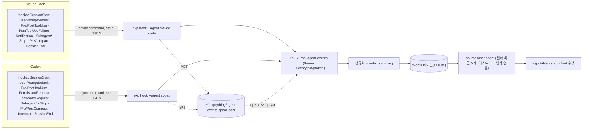

# 코딩 에이전트(Claude Code·Codex) 연동 방식 조사

> 작성: 2026-11-04 · 기준 버전(실측): Claude Code **2.1.317**(네이티브 설치, `~/.local/bin/claude`), Codex CLI **0.165.0**(npm 전역 `@openai/codex`, 소스는 태그 `rust-v0.165.0` = [`360319d`](https://github.com/openai/codex/tree/360319d8dee62d87e2d59fc0c21805d79519cfed), 2026-10-27)
> 범위: Exprything을 (1) 두 에이전트에 MCP 서버로 등록하고 자동화하는 방법, (2) 에이전트 활동을 캔버스로 모으는 방법(hooks·notify·OTel·트랜스크립트), (3) 플러그인·스킬로 묶어 배포하는 방법, (4) 데스크탑 GUI들이 CLI를 찾고 세션을 다루는 방식, (5) Exprything에 맞는 권장안.
> 방법: 1차 출처만 근거로 삼았다. Claude Code 공식 문서(code.claude.com/docs, 각 페이지의 `.md` 원문), Codex 공식 문서(developers.openai.com/codex는 2026-11 현재 learn.chatgpt.com/docs로 308 리다이렉트된다. 실측), openai/codex 소스(태그 고정), 오픈소스 프로젝트 README·소스(커밋 고정). 문서 페이지에는 갱신일이 없어 조회일(2026-11-04)을 기준으로 삼는다. 로컬에서는 `--help`, `--version`, 존재하지 않는 이름에 대한 `mcp get`만 실행했고, 에이전트 설정 파일과 인증 파일은 읽지 않았다(7장). 확인하지 못한 것은 **미확인**으로 표시했다(6장).

---

## 요약

- **Claude Code 등록은 `claude mcp add`/`add-json`이 정답이지만, 기본 scope가 `local`이라 현재 README와 앱 다이얼로그의 명령은 "그 명령을 실행한 디렉터리 프로젝트"에만 등록된다.** Exprything 캔버스는 사용자 전역(`~/.exprything`)이므로 `--scope user`가 맞다. local > project > user 순으로 이름이 가려지므로 예전 local 항목도 정리해야 한다(1.1, 5.3).
- Claude Code CLI는 프로그램에서 부르기에 반쯤 안전하다. `mcp add`는 같은 scope에 같은 이름이 있으면 실패하고, 2.1.283부터 파일에 실제로 써졌는지 검증한다. `mcp get`은 없는 이름에 exit 1(실측)이다. 다만 `mcp list/get`에는 JSON 출력이 없고(실측), 승인된 서버를 헬스체크하느라 stdio 서버를 실제로 띄운다(1.2).
- **Codex 등록은 `codex mcp add`가 항상 전역 `~/.codex/config.toml`에 쓰고, 같은 이름이면 조용히 덮어쓴다.** 덮어쓸 때 `startup_timeout_sec` 같은 수동 설정도 초기화된다(소스). 쓰기는 `toml_edit`과 원자적 쓰기여서 다른 내용과 주석은 보존된다. `list/get --json`이 있고, `get`은 없는 이름에 exit 1이다(실측). stdio 서버에는 `HOME`, `PATH` 등 11개 환경변수만 넘긴다(1.3, 1.4).
- **원클릭 설치:** Cursor(`cursor://…/mcp/install`)와 VS Code(`vscode:mcp/install`, `code --add-mcp`)에는 있다. Claude Code에는 MCP 설치용 딥링크가 없다. `claude-cli://open`은 세션만 연다. Codex(ChatGPT 데스크탑 앱)는 MCP가 아니라 **플러그인** 설치 딥링크를 문서화했다(`codex://plugins/install/<plugin>?marketplace=`, `codex://plugins/<plugin>?marketplacePath=`)(1.5).
- **활동 수집은 양쪽 모두 hooks가 1순위다.** Codex hooks는 이제 Claude와 거의 같은 형태다(같은 이벤트 이름, stdin JSON, exit 2 차단, `async`, `mcp_tool` 핸들러)(2.1, 2.2). 차이는 세 가지다.
  - Codex는 관리되지 않는 훅을 해시 단위로 **신뢰 검토**(`/hooks`)해야 실행한다.
  - Codex에는 HTTP 훅이 없다.
  - Codex에는 모델 요청 단위 훅(`PostModelRequest.token_usage`)이 있다.
- Codex `notify`는 `agent-turn-complete` 하나뿐인 레거시이고, 소스에 제거 예정 TODO가 있다(2.3).
- OTel은 양쪽 모두 OTLP/HTTP JSON으로 받을 수 있다. 하지만 신호당 목적지가 하나여서 사용자·조직의 수집기와 충돌하므로 선택 기능으로 둔다(2.4).
- 트랜스크립트(`~/.claude/projects/**`, `~/.codex/sessions/**`)는 두 회사 모두 "안정 인터페이스가 아니다"라고 명시한다(2.3, 2.5).
- **패키징은 Context7처럼 한 저장소에 마켓플레이스를 두 개 둔다.** Claude Code용 `.claude-plugin/marketplace.json`과 Codex용 `.agents/plugins/marketplace.json`을 두고, 에이전트별 플러그인 디렉터리를 나누는 방식이 실사용 중이다([context7 저장소](https://github.com/upstash/context7/tree/ac91d14f5e33e2f5cbae8705ffad2978ecd6f503))(3.4).
  - 두 회사 플러그인 모두 skills, MCP, hooks를 한 단위로 묶는다.
  - Codex 플러그인 훅에는 `CLAUDE_PLUGIN_ROOT`도 넣어 준다(3.3).
- **MCP 서버 `instructions`는 양쪽 모두 모델에 보인다.** Claude Code는 tool search 상태에서 세션 시작 시 툴 이름과 서버 instructions만 올린다. Codex는 서버 instructions를 툴 네임스페이스 설명으로 쓴다(소스). 지금 `exp mcp`에는 instructions도 tool annotations도 없다(3.2, 5.6).
- **권고:** 자세한 내용은 5장에 있다.
  1. `exp connect claude|codex`가 설정 파일 대신 공식 CLI를 호출한다(Claude는 user scope). 경로는 앱이 관리하는 안정 경로 `~/.exprything/bin/exp`를 등록한다.
  2. 앱의 Connect 버튼은 같은 명령을 로그인 셸 PATH로 실행하고 상태를 보여 준다.
  3. 활동 수집은 async command hook `exp hook --agent …`가 데몬 `POST /api/agent-events`로 보내고, 실패하면 스풀 파일에 남긴다.
  4. 지금 push 소스는 값이 바뀔 때마다 버퍼 전체를 히스토리에 스냅샷하므로 이벤트 스트림에 쓰면 안 된다(실측: 코드). 이벤트 로그 테이블과 `agent` 소스 kind가 필요하다.
  5. 플러그인은 `exprything`(MCP와 skill)과 opt-in `exprything-activity`(hooks)로 나눈다.

---

## 1. MCP 서버 등록

### 1.1 Claude Code: scope와 파일

| scope | 저장 위치 | 로드 범위 | 근거 |
|---|---|---|---|
| `local` (CLI 기본값) | `~/.claude.json` 안 `projects["<프로젝트 경로>"].mcpServers` | 그 프로젝트에서만 | [mcp#local-scope](https://code.claude.com/docs/en/mcp#local-scope), `claude mcp add --help`의 `(default: "local")`(실측) |
| `project` | 프로젝트 루트 `.mcp.json` | 그 프로젝트, 버전 관리로 팀 공유. 대화형 세션에서 승인 필요 | [mcp#project-scope](https://code.claude.com/docs/en/mcp#project-scope) |
| `user` | `~/.claude.json` 최상위 `mcpServers` | 모든 프로젝트 | [mcp#user-scope](https://code.claude.com/docs/en/mcp#user-scope) |
| plugin | 플러그인 루트 `.mcp.json` 또는 `plugin.json`의 `mcpServers` | 플러그인이 켜진 곳. 서버 이름 `plugin:<plugin>:<server>` | [mcp#plugin-provided-mcp-servers](https://code.claude.com/docs/en/mcp#plugin-provided-mcp-servers) |

- **우선순위:** 같은 이름이면 local > project > user > plugin > claude.ai connector 순이다. 이긴 정의 하나를 통째로 쓰고 필드는 병합하지 않는다. plugin과 connector는 이름이 아니라 endpoint(URL·명령)로 중복을 판정한다. 같은 이름이 여러 scope에서 다른 endpoint를 가리키면 `claude mcp list`와 `/mcp`에 경고가 뜬다([#scope-hierarchy-and-precedence](https://code.claude.com/docs/en/mcp#scope-hierarchy-and-precedence), [#configuration-warnings](https://code.claude.com/docs/en/mcp#configuration-warnings)).
- **`~/.claude.json`은 Claude Code가 스스로 쓰는 파일이다.** 계정 정보, 프로젝트별 신뢰 상태, MCP 설정이 들어 있고 문서는 "직접 편집할 필요가 없다"고 적는다. 다시 쓰기 전에 `~/.claude/backups/`에 백업을 5개까지 남긴다([settings#settings-files-and-who-they-affect](https://code.claude.com/docs/en/settings#settings-files-and-who-they-affect), [claude-directory](https://code.claude.com/docs/en/claude-directory)). `CLAUDE_CONFIG_DIR`을 설정하면 `~/.claude`와 `.claude.json`이 함께 옮겨진다.
- **`.mcp.json` 승인:**
  - 대화형 세션은 project scope 서버를 쓰기 전에 승인 프롬프트를 띄운다. `claude mcp reset-project-choices`로 선택을 초기화한다.
  - `-p`, Agent SDK, 클라우드 세션은 묻지 않고 로드한다.
  - 저장소에 커밋된 `.claude/settings.json`의 `enableAllProjectMcpServers`/`enabledMcpjsonServers`는 워크스페이스를 신뢰하기 전까지 무시된다. 저장소가 자기 서버를 스스로 승인하지 못하게 하려는 것이다([#project-server-approvals-and-workspace-trust](https://code.claude.com/docs/en/mcp#project-server-approvals-and-workspace-trust)).
- **stdio 서버가 받는 환경:**
  - `CLAUDE_PROJECT_DIR`([#option-3](https://code.claude.com/docs/en/mcp#option-3-add-a-local-stdio-server)).
  - `CLAUDE_CODE_SESSION_ID`: MCP 서버는 띄워질 때의 ID를 유지한다.
  - `CLAUDECODE=1`([env-vars](https://code.claude.com/docs/en/env-vars)).
- **종료:** macOS·Linux에서는 SIGINT를 보내고 100 ms 뒤 SIGTERM, 다시 400 ms 뒤 SIGKILL을 보낸다([#how-claude-code-stops-a-stdio-server](https://code.claude.com/docs/en/mcp#how-claude-code-stops-a-stdio-server)).
- **타임아웃:**
  - 시작 대기는 `MCP_TIMEOUT`이다(`--mcp-config`·`-p`에서 기본 30 s, [cli-reference](https://code.claude.com/docs/en/cli-reference)).
  - 툴 호출 상한은 서버 항목의 `timeout`(ms) 또는 `MCP_TOOL_TIMEOUT`이다. 둘 다 없으면 약 28 h다.
  - 별도로 stdio 서버에는 30분 idle 타임아웃이 있다. 진행 알림이 없으면 끊는다.
  - 메인 대화에서 2분을 넘는 호출은 백그라운드 작업으로 넘어간다([#time-limits-on-mcp-tool-calls](https://code.claude.com/docs/en/mcp#time-limits-on-mcp-tool-calls)).
- **다른 표면:**
  - 데스크탑 앱 Code 탭과 VS Code 확장은 각자 CLI 사본을 쓰지만, 같은 `~/.claude.json`·`.mcp.json`·설정을 읽는다.
  - Code 탭은 `claude_desktop_config.json`의 서버도 로드한다. user scope와 `.mcp.json`에 같은 stdio 이름이 있으면 CLI와 달리 `~/.claude.json` 쪽을 쓴다.
  - 독립 CLI는 `claude_desktop_config.json`을 읽지 않는다([desktop#shared-configuration](https://code.claude.com/docs/en/desktop#shared-configuration)).

### 1.2 Claude Code: CLI와 프로그램 호출 시 동작

| 명령(2.1.317 `--help` 실측) | 동작 | 프로그램 호출 관점 |
|---|---|---|
| `claude mcp add [-s local\|user\|project] [-e K=V…] [-t stdio\|sse\|http] [-H …] <name> <commandOrUrl> [args…]` | stdio는 `--` 뒤를 그대로 서버 명령으로 쓴다 | 성공하면 `Added …`를 출력한다. 같은 scope에 같은 이름이 있으면 `MCP server <name> already exists in local config`로 실패한다([mcp](https://code.claude.com/docs/en/mcp#authenticate-with-remote-mcp-servers), [quickstart "Server already exists"](https://code.claude.com/docs/en/mcp-quickstart)). exit code는 **미확인**. `-e` 바로 뒤에 이름이 오면 `KEY=value`로 오인해 거부한다([#option-3](https://code.claude.com/docs/en/mcp#option-3-add-a-local-stdio-server)) |
| `claude mcp add-json [-s] <name> '<json>'` | `{"type":"stdio","command":…,"args":[…],"env":{…}}` 그대로 저장 | 구성 비교·재현에 가장 정확하다([#add-mcp-servers-from-json-configuration](https://code.claude.com/docs/en/mcp#add-mcp-servers-from-json-configuration)) |
| `claude mcp get <name>` | 상세와 상태 | **없으면 exit 1**, stderr `No MCP server named "<name>". Configured servers: …`(실측). 승인된 서버는 **헬스체크한다**(help 실측, 즉 stdio 서버를 띄운다). JSON 옵션 없음(실측) |
| `claude mcp list` | 전체 목록과 상태(`✔ Connected`, `⏸ Pending approval`, `⊘ Disabled…`) | 모든 서버를 헬스체크하므로 느리다(Unity MCP는 15초 이상이라 적었다, 1.6). JSON 옵션 없음(실측) |
| `claude mcp remove [-s] <name>` | scope를 안 주면 있는 곳에서 지운다 | 여러 scope에 있으면 `exists in multiple scopes`로 거부한다. local은 프로젝트별이라 해당 디렉터리에서 실행해야 한다([quickstart](https://code.claude.com/docs/en/mcp-quickstart)). 2.1.311에서 저장소 루트 아래 하위 디렉터리에서 실행할 때 엉뚱한 프로젝트 항목을 가리키던 버그를 고쳤다([CHANGELOG](https://github.com/anthropics/claude-code/blob/964d69565952a176ac1975ed218362991db71433/CHANGELOG.md#L332)) |
| `claude mcp add-from-claude-desktop`, `login`, `logout`, `reset-project-choices`, `serve` | — | — |

- **쓰기 검증:** 2.1.283부터 `add`/`add-json`/`remove`는 `~/.claude.json`을 다시 읽어 변경이 반영됐는지 확인한다. 반영되지 않았으면 성공 줄 대신 `was not saved`·`may not have been saved` 오류로 끝난다. 그 전 버전은 샌드박스 등에서 쓰기에 실패해도 성공이라고 출력했다([errors#mcp-server-was-not-saved-or-removed](https://code.claude.com/docs/en/errors#mcp-server-was-not-saved-or-removed)).
- **거부 사례:**
  - 예약 이름(`workspace`, `claude-in-chrome`, `computer-use`, `Claude Preview`, `Claude Browser`)은 `add`가 거부한다([#configuration-warnings](https://code.claude.com/docs/en/mcp#configuration-warnings)).
  - 관리 설정 `strictPluginOnlyCustomization`이 MCP를 잠그면 `add`가 exit 1로 끝난다([errors](https://code.claude.com/docs/en/errors)).
- **`.mcp.json`의 `${VAR}`·`${VAR:-default}` 확장:** `command`, `args`, `env`, `url`, `headers`에서 쓸 수 있다. 원격 서버의 `url`·`headers`에서는 `ANTHROPIC_API_KEY` 같은 자격 증명 변수를 빈 문자열로 읽는다([#environment-variable-expansion-in-mcp-json](https://code.claude.com/docs/en/mcp#environment-variable-expansion-in-mcp-json)).

### 1.3 Codex: 설정 파일과 필드

- **파일:** 기본은 `~/.codex/config.toml`이다(`CODEX_HOME`으로 바꿀 수 있다). 프로젝트 `.codex/config.toml`은 **신뢰한 프로젝트에서만** 읽는다. ChatGPT 데스크탑 앱, Codex CLI, IDE 확장이 이 설정을 공유한다([extend/mcp](https://learn.chatgpt.com/docs/extend/mcp#connect-codex-to-an-mcp-server)). 프로젝트 config는 루트부터 cwd까지 찾은 파일을 모두 읽고 가까운 쪽이 이긴다. `notify`, `otel`, `model_provider` 등은 프로젝트 config에서 무시한다([config-advanced#project-config-files](https://learn.chatgpt.com/docs/config-file/config-advanced#project-config-files-codexconfigtoml)).
- **Codex 데스크탑은 이제 ChatGPT 데스크탑 앱의 Codex 모드다.** 앱 문서는 "Choose ChatGPT or Codex"라고 안내하고([app](https://learn.chatgpt.com/docs/app)), `codex://` 스킴은 "compatibility"를 위해 남겨 두었다고 적는다([reference/commands#deep-links](https://learn.chatgpt.com/docs/reference/commands#deep-links)). 이 머신의 `/Applications`에는 `ChatGPT.app`이 있고 `Codex.app`은 없다(실측).
- **`[mcp_servers.<name>]` 필드**([#stdio-servers](https://learn.chatgpt.com/docs/extend/mcp#stdio-servers), [config-reference](https://learn.chatgpt.com/docs/config-file/config-reference)):

| 구분 | 필드 |
|---|---|
| stdio | `command`(필수), `args`, `env`, `env_vars`(넘겨줄 변수 허용 목록), `cwd` |
| Streamable HTTP | `url`, `auth`(`oauth`\|`chatgpt`), `bearer_token_env_var`, `http_headers`, `env_http_headers`, `http_headers_helper` |
| 공통 | `startup_timeout_sec`(별칭 `startup_timeout_ms`), `tool_timeout_sec`, `enabled`, `required`, `startup_readiness`(`connection`\|`catalog`), `enabled_tools`, `disabled_tools`, `default_tools_approval_mode`(`auto`\|`prompt`\|`writes`\|`approve`, `writes`는 read-only로 표시되지 않은 툴만 묻는다), `tools.<tool>.approval_mode`, `tools.<tool>.output_token_limit`, `environment_id` |
| 최상위 | `mcp_optional_startup_grace_ms`(기본 1000) |

- **타임아웃 기본값은 문서와 소스가 다르다.** 문서는 startup 10 s, tool 60 s라 적는다([#other-configuration-options](https://learn.chatgpt.com/docs/extend/mcp#other-configuration-options)). 0.165.0 소스는 `DEFAULT_STARTUP_TIMEOUT = 30 s`, `DEFAULT_TOOL_TIMEOUT = 300 s`다([rmcp_client.rs L114-L115](https://github.com/openai/codex/blob/360319d8dee62d87e2d59fc0c21805d79519cfed/codex-rs/codex-mcp/src/rmcp_client.rs#L114-L115)). 의존하려면 명시적으로 설정해야 한다.
- **stdio 서버에 넘어가는 환경변수는 허용 목록뿐이다.** `HOME`, `LOGNAME`, `PATH`, `SHELL`, `USER`, `__CF_USER_TEXT_ENCODING`, `LANG`, `LC_ALL`, `TERM`, `TMPDIR`, `TZ`에 `env_vars`와 `env`를 더한 것이다([rmcp-client/src/utils.rs L163-L175](https://github.com/openai/codex/blob/360319d8dee62d87e2d59fc0c21805d79519cfed/codex-rs/rmcp-client/src/utils.rs#L163-L175)). 셸에서 `EXPRYTHING_HOME`·`EXPRYTHING_PORT`를 설정해도 Codex 아래의 `exp mcp`에는 전달되지 않는다.
- **플러그인 서버의 켜고 끄기와 툴 정책**은 `[plugins."<plugin>@<marketplace>".mcp_servers.<server>]`에 둔다([#plugin-provided-mcp-servers](https://learn.chatgpt.com/docs/extend/mcp#plugin-provided-mcp-servers)).

### 1.4 Codex: CLI와 프로그램 호출 시 동작

| 명령(0.165.0 `--help` 실측 + 소스) | 동작 | 프로그램 호출 관점 |
|---|---|---|
| `codex mcp add <name> [--env K=V]… -- <command…>` 또는 `--url <URL> [--bearer-token-env-var …]` | scope 옵션이 없다. 항상 전역 `CODEX_HOME/config.toml`에 쓰고 `Added global MCP server '<name>'.`를 출력한다 | **같은 이름이면 덮어쓴다.** `servers.insert` 뒤 `replace_mcp_servers`를 부르고([mcp_cmd.rs L447-L459](https://github.com/openai/codex/blob/360319d8dee62d87e2d59fc0c21805d79519cfed/codex-rs/cli/src/mcp_cmd.rs#L447-L459)), 새 항목의 `startup_timeout_sec`·`tool_timeout_sec`·`enabled_tools` 등은 `None`이 된다([L417-L445](https://github.com/openai/codex/blob/360319d8dee62d87e2d59fc0c21805d79519cfed/codex-rs/cli/src/mcp_cmd.rs#L417-L445)). 쓰기는 `toml_edit::DocumentMut`로 해당 테이블만 바꾸고 원자적으로 쓴다([config/edit.rs L443-L497, L784](https://github.com/openai/codex/blob/360319d8dee62d87e2d59fc0c21805d79519cfed/codex-rs/core/src/config/edit.rs#L443-L497)). stdio 형식은 `--env`만 받아 타임아웃은 CLI로 정할 수 없다 |
| `codex mcp get <name> [--json]` | 설정 출력. 서버를 띄우지 않는다 | **없으면 exit 1**, stderr `Error: No MCP server named '<name>' found.`(실측, [L958-L963](https://github.com/openai/codex/blob/360319d8dee62d87e2d59fc0c21805d79519cfed/codex-rs/cli/src/mcp_cmd.rs#L958-L963)) |
| `codex mcp list [--json]` | JSON 배열 `{name, enabled, disabled_reason, transport:{type:"stdio",command,args,env,env_vars,cwd} \| {type:"streamable_http",url,…}, startup_timeout_sec, tool_timeout_sec, auth_status}` | `env` 값이 그대로 나오므로 로그에 남기지 않는다([L720-L780](https://github.com/openai/codex/blob/360319d8dee62d87e2d59fc0c21805d79519cfed/codex-rs/cli/src/mcp_cmd.rs#L720-L780)) |
| `codex mcp remove <name>` | 전역에서 삭제 | 없으면 `No MCP server named …`를 출력하고 **exit 0**이다([L502-L532](https://github.com/openai/codex/blob/360319d8dee62d87e2d59fc0c21805d79519cfed/codex-rs/cli/src/mcp_cmd.rs#L502-L532)) |
| `codex mcp login/logout <name>` | HTTP 서버 OAuth | — |
| 공통 `-c key=value`, `--enable/--disable <feature>`, `--strict-config` | 일회성 덮어쓰기 | — |

- `get`/`list`는 `configured_servers(config)`, 즉 병합된 설정을 읽는다. `add`/`remove`는 `load_global_mcp_servers`, 즉 전역만 다룬다(같은 파일).
- TUI에서는 `/mcp`로 본다.
- ChatGPT 데스크탑 앱에서는 Settings → MCP servers → Add server(STDIO/Streamable HTTP) → Restart 순서로 추가한다. IDE 확장은 톱니 메뉴 → MCP servers다([extend/mcp](https://learn.chatgpt.com/docs/extend/mcp#configure-in-the-chatgpt-desktop-app)).

### 1.5 원클릭·프로그램 설치 패턴

| 대상 | 메커니즘 | 형식·특징 | 근거 |
|---|---|---|---|
| Cursor | URL 스킴 | `cursor://anysphere.cursor-deeplink/mcp/install?name=$NAME&config=$BASE64_ENCODED_CONFIG`(config는 서버 객체를 `JSON.stringify` 후 base64한 값). 웹 링크는 접두사를 `https://cursor.com/link/`로 바꾸는 일반 규칙이고 최대 10,000자 | [cursor.com/docs/mcp/install-links](https://cursor.com/docs/mcp/install-links), [deeplinks](https://cursor.com/docs/reference/deeplinks) |
| VS Code | URL 스킴, CLI | `vscode:mcp/install?{urlencoded json}`(Insiders는 `vscode-insiders:`), `code --add-mcp '{"name":…,"type":"stdio","command":…}'`(사용자 프로필에 추가). 웹 버튼은 `https://vscode.dev/redirect?url=<인코딩된 vscode URL>` | [vscode-docs mcp.md L262-L273](https://github.com/microsoft/vscode-docs/blob/464237ed730e0f8fec86332878012412bf965f29/api/extension-guides/ai/mcp.md#L262-L273), [mcp-configuration.md L412-L422](https://github.com/microsoft/vscode-docs/blob/464237ed730e0f8fec86332878012412bf965f29/docs/agents/reference/mcp-configuration.md#L412-L422), [command-line.md L291-L292](https://github.com/microsoft/vscode-docs/blob/464237ed730e0f8fec86332878012412bf965f29/docs/configure/command-line.md#L291-L292) |
| Claude Desktop(채팅) | `.mcpb` 번들(구 `.dxt`) | zip + `manifest.json`. `server.type`은 `node`\|`python`\|`binary`\|`uv`, `mcp_config.command/args`에 `${__dirname}`, `user_config`(`sensitive` 지원). CLI는 `mcpb init/validate/pack/sign` | [mcpb README L3-L13](https://github.com/modelcontextprotocol/mcpb/blob/70fe3b34cd6dff1b3bba046638edc72a6467a4fb/README.md#L3-L13), [MANIFEST.md](https://github.com/modelcontextprotocol/mcpb/blob/70fe3b34cd6dff1b3bba046638edc72a6467a4fb/MANIFEST.md#L38-L68), [CLI.md](https://github.com/modelcontextprotocol/mcpb/blob/70fe3b34cd6dff1b3bba046638edc72a6467a4fb/CLI.md#L74-L152) |
| Claude Code | 딥링크 **없음**(MCP 설치용) | `claude-cli://open?q=&cwd=&repo=`는 프롬프트를 채운 새 터미널 세션을 열 뿐이다(대화형 세션에서 첫 메시지를 보낼 때 핸들러를 등록하고, `disableDeepLinkRegistration`으로 끈다). `.mcpb`는 플러그인의 `mcpServers` 안에서만 받는다. 가장 가까운 "한 번에"는 `claude plugin install <p> --marketplace <src> --json`(2.1.292+, 3.1) | [deep-links](https://code.claude.com/docs/en/deep-links), [plugins/components#include-a-packaged-mcpb-server](https://code.claude.com/docs/en/plugins/components#include-a-packaged-mcpb-server) |
| Claude Desktop Code 탭 | `claude://code/new?ssh_host=…&ssh_folder=…&q=` | 새 세션 페이지를 연다(SSH 연결 지정 가능). MCP 설치 용도는 아니다 | [desktop#open-an-ssh-session-from-a-link](https://code.claude.com/docs/en/desktop#open-an-ssh-session-from-a-link) |
| Codex / ChatGPT 앱 | 플러그인 딥링크 | `codex://plugins/install/<plugin-name>?marketplace=<name>`(이미 아는 마켓플레이스의 설치 흐름), `codex://plugins/<plugin-name>?marketplacePath=<marketplace.json 절대경로>`(로컬 마켓플레이스의 플러그인 상세), `codex://settings`, `codex://new?prompt=&path=`. **MCP 서버를 바로 추가하는 링크는 문서에서 찾지 못했다** | [reference/commands#deep-links](https://learn.chatgpt.com/docs/reference/commands#deep-links) |

다중 클라이언트 설치 도구(모두 Claude Code와 Codex를 지원한다):

| 도구 | Claude Code 쓰는 법 | Codex 쓰는 법 | 기존 항목 처리 | 근거 |
|---|---|---|---|---|
| install-mcp (supermemoryai, npm 1.10.2) | 파일 직접. `~/.claude.json` 최상위 `mcpServers`, `--local`이면 `./.mcp.json` | `config.toml`을 @iarna/toml로 **파일 전체 재작성**(주석 소실) | 확인 없이 deep merge하므로 같은 이름의 예전 키가 남는다 | [client-config.ts L125-L156](https://github.com/supermemoryai/install-mcp/blob/c2a97fbbfc0dcfdbff0b4b4778b9ec1ba6a7ac7f/src/client-config.ts#L125-L156), [L415-L416](https://github.com/supermemoryai/install-mcp/blob/c2a97fbbfc0dcfdbff0b4b4778b9ec1ba6a7ac7f/src/client-config.ts#L415-L416) |
| Smithery CLI (`smithery mcp add … --client`) | **공식 CLI 호출**: `claude mcp add --transport stdio <name> -- …` | `codex mcp add <name> -- …` | 확인 없음, uninstall 미지원 | [command-templates.ts L11-L92](https://github.com/arcadeai-labs/smithery-cli/blob/407ac3b33944a585357379bc213fdf1ee55464d7/src/config/command-templates.ts#L11-L92), [client-config-io.ts L313-L380](https://github.com/arcadeai-labs/smithery-cli/blob/407ac3b33944a585357379bc213fdf1ee55464d7/src/lib/client-config-io.ts#L313-L380) |
| add-mcp (neon) | 파일 직접(`jsonc.modify`), project `.mcp.json`/global `~/.claude.json` | TOML 전체 재작성 | 같은 이름을 지운 뒤 병합한다. 이유를 주석으로 남겼다: 예전 stdio 필드와 새 `url`이 섞이면 Codex가 거부한다 | [utils.ts L29-L59](https://github.com/neon-solutions/add-mcp/blob/5ae1d29a406568b1dedbaa4bd3b8a6fd7ef2195c/src/formats/utils.ts#L29-L59) |
| ToolHive (`thv client setup`) | `.claude.json` `/mcpServers` | `[mcp_servers.<name>]` | 파일 잠금 + go-toml + 원자적 쓰기 | [config_editor.go L479-L512](https://github.com/stacklok/toolhive/blob/ba8b2ebb98155daceccbc160cc24d5faaa48630d/pkg/client/config_editor.go#L479-L512) |
| Docker MCP Toolkit (`docker mcp client connect`) | yq로 `$CLAUDE_CONFIG_DIR/.claude.json` 또는 `~/.claude.json` | go-toml 재작성, 전역만 | 덮어씀 | [config.yml L20-L41](https://github.com/docker/mcp-gateway/blob/7e0f34277c91855ad861eeff536b4fdc77420593/pkg/client/config.yml#L20-L41), [codex_handler.go L135-L190](https://github.com/docker/mcp-gateway/blob/7e0f34277c91855ad861eeff536b4fdc77420593/pkg/client/codex_handler.go#L135-L190) |

### 1.6 등록 여부 탐지와 재설치 전략

| 방법 | 쓰는 곳 | 장단점 |
|---|---|---|
| `~/.claude.json` 읽기: 최상위 `mcpServers`(user), `projects[<path>].mcpServers`(local) | Opik [targets.py L482-L516](https://github.com/comet-ml/opik/blob/ba87e59a4d125a84573d987bcd45016aa302f26c/sdks/python/src/opik/configurator/mcp/targets.py#L482-L516), Unity MCP, Docker | 빠르고 서버를 띄우지 않는다. Unity 주석: `claude mcp list`는 헬스체크 때문에 15초 이상 걸린다([L703-L705](https://github.com/CoplayDev/unity-mcp/blob/e2fd09c71644d1d9fa1ae134526ce913cbf97536/MCPForUnity/Editor/Clients/McpClientConfiguratorBase.cs#L703-L705)). 구조는 문서 예시에 있지만 내부 파일이다. `CLAUDE_CONFIG_DIR`을 존중하지 않는 도구가 많다 |
| `claude mcp get <name>` exit code와 `No MCP server named` 문자열 | godot-ai [claude_code.gd L36-L47](https://github.com/hi-godot/godot-ai/blob/643c64f3edf984a9668b3043f4d20ebb2bbec6b6/plugin/addons/godot_ai/clients/claude_code.gd#L36-L47), OpenPets [agent-setup-claude.ts L339-L370](https://github.com/OpenPetsHQ/openpets/blob/5235d5677f01a941c4479c8c74d084364a7dd1a4/apps/desktop/src/agent-setup-claude.ts#L339-L370) | 공식 동작이다(exit 1은 실측). 있으면 헬스체크로 서버를 띄운다. 이것을 연결 테스트로 쓸 수 있다 |
| `codex mcp get <name> --json` | Opik [targets.py L436-L479](https://github.com/comet-ml/opik/blob/ba87e59a4d125a84573d987bcd45016aa302f26c/sdks/python/src/opik/configurator/mcp/targets.py#L436-L479) | 공식 동작이고 JSON이며 서버를 띄우지 않는다 |
| `config.toml` 파싱 | Docker [codex_handler.go L51-L61](https://github.com/docker/mcp-gateway/blob/7e0f34277c91855ad861eeff536b4fdc77420593/pkg/client/codex_handler.go#L51-L61), Context7(문자열 포함 검사) | 프로젝트 레이어와 플러그인 서버를 놓친다 |
| 설치 여부: `claude --version`에 "Claude", `codex --version`에 "codex-cli" 포함 | Serena [client_setup.py L57-L59, L82-L84](https://github.com/oraios/serena/blob/ede329aaf0c824bea75455a2926f01420d7aa620/src/serena/config/client_setup.py#L53-L90) | 단순하다. 실측 출력 `2.1.317 (Claude Code)`, `codex-cli 0.165.0`과 맞는다 |
| 데스크탑 앱 존재: `CFBundleIdentifier` `com.openai.codex`인 `Codex.app`/`ChatGPT.app` | ToolHive [codex_desktop.go L15-L77](https://github.com/stacklok/toolhive/blob/ba8b2ebb98155daceccbc160cc24d5faaa48630d/pkg/client/codex_desktop.go#L15-L77) | ChatGPT.app의 번들 ID는 **미확인** |

**재설치 전략**:

- 지운 뒤 다시 추가: Opik, Unity, godot-ai. Claude는 같은 이름이면 실패하므로 이 방식이 필요하다.
- 덮어쓰기: Docker, ToolHive, add-mcp. Codex CLI 자체도 덮어쓴다.
- 제자리 패치: Context7 `ctx7 setup`. TOML의 해당 블록만 바이트 단위로 바꾼다([toml-editor.ts L168-L220](https://github.com/upstash/context7/blob/ac91d14f5e33e2f5cbae8705ffad2978ecd6f503/packages/cli/src/setup/toml-editor.ts#L168-L220)).
- 확인 없이 추가: Smithery, Serena.

TOML 라이브러리로 왕복하는 도구(@iarna/toml, tomli_w, go-toml, `toml::to_string_pretty`, smol-toml)는 모두 주석을 잃는다. 주석을 보존하는 것은 Codex CLI 자신(toml_edit), Context7, godot-ai, CodexMonitor(toml_edit)뿐이다.

### 1.7 사례: 두 에이전트를 모두 다루는 프로젝트

| 프로젝트 | Claude Code | Codex | 비고 |
|---|---|---|---|
| Serena (★31k) | `serena setup claude-code`가 `claude mcp add --scope user serena -- serena start-mcp-server --context=claude-code --project-from-cwd`를 실행한다 | `serena setup codex`가 `codex mcp add serena -- … --context=codex --project-from-cwd`를 실행한다. 수동 TOML에는 `startup_timeout_sec = 15` | 공식 CLI 호출. 느리면 `MCP_TIMEOUT=60000`. Codex는 앱이 프로젝트 디렉터리에서 세션을 시작하지 않는다고 경고한다([client_setup.py L53-L90](https://github.com/oraios/serena/blob/ede329aaf0c824bea75455a2926f01420d7aa620/src/serena/config/client_setup.py#L53-L90), [030_clients.md](https://github.com/oraios/serena/blob/ede329aaf0c824bea75455a2926f01420d7aa620/docs/02-usage/030_clients.md#L102-L127)) |
| Context7 (★64k) | `claude mcp add --scope user context7 -- npx -y @upstash/context7-mcp --api-key …`, HTTP 변형, 플러그인 `/plugin marketplace add upstash/context7` | `codex mcp add context7 -- npx -y @upstash/context7-mcp …`, TOML `startup_timeout_sec = 20`(타임아웃이면 40), 플러그인 `codex plugin marketplace add upstash/context7` + `codex plugin add context7@context7-marketplace` | `npx ctx7 setup --claude\|--codex`는 파일을 직접 쓴다. `CLAUDE_CONFIG_DIR`을 존중한다([all-clients.mdx L312-L340](https://github.com/upstash/context7/blob/ac91d14f5e33e2f5cbae8705ffad2978ecd6f503/docs/resources/all-clients.mdx#L312-L340), [agents.ts](https://github.com/upstash/context7/blob/ac91d14f5e33e2f5cbae8705ffad2978ecd6f503/packages/cli/src/setup/agents.ts#L31-L334)) |
| Playwright MCP (★39k) | `claude mcp add playwright npx @playwright/mcp@latest`(scope 없음 = local) | `codex mcp add playwright npx "@playwright/mcp@latest"` 또는 TOML | 문서만([README L95-L159](https://github.com/microsoft/playwright-mcp/blob/ec572ee8354015293bed67145db21eed386e876d/README.md#L95-L159)) |
| GitHub MCP (★34k) | 2.1.1+에서 `claude mcp add-json github '{"type":"http",…}'`. 예전 이름: local=project, user=global | `--bearer-token-env-var GITHUB_PAT_TOKEN` 필수 | [install-claude.md](https://github.com/github/github-mcp-server/blob/4bcdcdf8d7beee98c9448e73e257308280924cc4/docs/installation-guides/install-claude.md#L29-L116), [install-codex.md](https://github.com/github/github-mcp-server/blob/4bcdcdf8d7beee98c9448e73e257308280924cc4/docs/installation-guides/install-codex.md#L12-L68) |
| Chrome DevTools MCP (★55k) | `claude mcp add chrome-devtools --scope user npx chrome-devtools-mcp@latest` 또는 플러그인. 플러그인을 쓰려면 기존 MCP 등록을 먼저 지우라고 경고한다 | `codex mcp add chrome-devtools -- npx chrome-devtools-mcp@latest`, Windows TOML에 `startup_timeout_ms = 20_000` | [client-configurations.md L66-L135](https://github.com/ChromeDevTools/chrome-devtools-mcp/blob/81a037939b19a3588ac6a35e06d576af706a3b57/docs/client-configurations.md#L66-L135) |
| Figma | `claude plugin install figma@claude-plugins-official`(권장) 또는 `claude mcp add --transport http figma https://mcp.figma.com/mcp`. 문서는 기본값이 현재 프로젝트 전용이라고 적는다 | 앱은 Plugins에서 Figma 설치, CLI는 `codex mcp add figma --url …` | [remote-server-installation](https://developers.figma.com/docs/figma-mcp-server/remote-server-installation/) |
| Linear | `claude mcp add --transport http linear-server https://mcp.linear.app/mcp` 후 `/mcp`로 인증 | `codex mcp add linear --url …` 후 `codex mcp login linear`. 문서의 `experimental_use_rmcp_client`는 0.165.0 기능 목록에 없다(낡은 지시) | [linear.app/docs/mcp](https://linear.app/docs/mcp) |
| Sentry | `claude mcp add --transport http sentry https://mcp.sentry.dev/mcp` | `codex mcp add sentry --url …` | [claude-code.tsx](https://github.com/getsentry/toolkit/blob/2a81238b932ba54c7dd0c21ff263ea5a9ce2740f/packages/mcp-cloudflare/src/client/components/fragments/instructions/claude-code.tsx#L12-L56), [codex-cli.tsx](https://github.com/getsentry/toolkit/blob/2a81238b932ba54c7dd0c21ff263ea5a9ce2740f/packages/mcp-cloudflare/src/client/components/fragments/instructions/codex-cli.tsx#L8-L80) |
| Vibe Kanban (★29k) | MCP 설정 UI가 `~/.claude.json` 최상위 `mcpServers`를 직접 쓴다 | `$CODEX_HOME/config.toml` `mcp_servers`를 `toml::to_string_pretty`로 재작성한다(주석 소실, 비원자적) | 자기 서버(`npx -y vibe-kanban@latest --mcp`)는 "Popular servers" 카드로 넣는다([mcp_config.rs L59-L104](https://github.com/BloopAI/vibe-kanban/blob/08064e043c2d78ad123b473257ed867e7ce74768/crates/executors/src/mcp_config.rs#L59-L104)) |
| GUI "Connect" 버튼 | Docker Desktop MCP Toolkit(Clients 탭 → Connect), MCP for Unity(`claude mcp add --scope local …` 호출), godot-ai(scope별 `mcp remove` 후 `add`, CLI가 없으면 파일 폴백) | Unity·godot-ai는 TOML을 직접 쓴다(godot-ai는 주석 보존, `startup_timeout_sec=60, tool_timeout_sec=360`) | [godot-ai codex.gd L9-L44](https://github.com/hi-godot/godot-ai/blob/643c64f3edf984a9668b3043f4d20ebb2bbec6b6/plugin/addons/godot_ai/clients/codex.gd#L9-L44), [Docker 문서](https://docs.docker.com/ai/mcp-catalog-and-toolkit/get-started/) |
| 앱 번들 안의 런처를 등록하는 사례 | OpenPets: `app.asar`를 `app.asar.unpacked`로 바꾼 경로로 `claude mcp add --scope user openpets -- node <bundled path>` | — | [claude-code.ts L89-L107](https://github.com/OpenPetsHQ/openpets/blob/5235d5677f01a941c4479c8c74d084364a7dd1a4/packages/claude/src/claude-code.ts#L89-L107). Exprything과 같은 문제다 |

공통점:

- 공식 문서들은 Claude에 `--scope user`를 붙이는 쪽이 많다(Serena, Context7, Chrome DevTools). Playwright처럼 안 붙이면 local이 된다.
- Codex에는 `startup_timeout_sec`를 늘려 두는 사례가 많다(15~60 s).
- 각 서비스 문서는 Codex 버전을 따라가지 못해 낡은 지시가 남기 쉽다(Linear).

---

## 2. 에이전트 활동 수집

### 2.1 Claude Code hooks

**설정 위치**([hooks#hook-locations](https://code.claude.com/docs/en/hooks#hook-locations)):

- 설정 파일 4종: `~/.claude/settings.json`, `.claude/settings.json`, `.claude/settings.local.json`, 관리 설정.
- 플러그인 `hooks/hooks.json`.
- 스킬·서브에이전트 frontmatter.

동작 규칙:

- 레벨끼리는 덮어쓰지 않고 합쳐진다. 같은 핸들러가 여러 설정 파일에 있으면 한 번만 실행한다.
- 설정 파일 편집은 파일 감시로 실행 중인 세션에도 반영된다([settings#when-edits-take-effect](https://code.claude.com/docs/en/settings#when-edits-take-effect)).
- **대화형 세션은 워크스페이스 신뢰 대화상자를 수락하기 전까지 `~/.claude/settings.json`을 포함한 모든 설정 파일의 훅을 보류한다.** `-p`/SDK는 신뢰한 것으로 간주한다([#workspace-trust](https://code.claude.com/docs/en/hooks#workspace-trust)).

**이벤트**([#hook-lifecycle](https://code.claude.com/docs/en/hooks#hook-lifecycle)):

| 묶음 | 이벤트 |
|---|---|
| 세션 | `SessionStart`(matcher: `startup`/`resume`/`clear`/`compact`/`fork`), `SessionEnd`(`clear`/`resume`/`logout`/`prompt_input_exit`/`other`), `Setup` |
| 턴 | `UserPromptSubmit`, `UserPromptExpansion`, `Stop`, `StopFailure`, `MessageDisplay` |
| 툴 | `PreToolUse`(차단 가능), `PermissionRequest`, `PermissionDenied`, `PostToolUse`, `PostToolUseFailure`, `PostToolBatch` |
| 에이전트 | `SubagentStart`, `SubagentStop`, `TaskCreated`, `TaskCompleted`, `TeammateIdle` |
| 기타 | `Notification`(`permission_prompt`, `idle_prompt`, `agent_needs_input`, `agent_completed` 등), `PreCompact`/`PostCompact`, `PreModelSwitch`/`PostModelSwitch`, `InstructionsLoaded`, `ConfigChange`, `CwdChanged`, `DirectoryAdded`, `FileChanged`, `WorktreeCreate`/`WorktreeRemove`, `Elicitation`/`ElicitationResult` |

**핸들러 종류**([#hook-handler-fields](https://code.claude.com/docs/en/hooks#hook-handler-fields)):

| type | 요점 |
|---|---|
| `command` | stdin으로 JSON을 받는다. `args`가 있으면 exec 형식(셸 없이 직접 spawn, `${CLAUDE_PLUGIN_ROOT}` 등 치환)이고, 없으면 셸 형식(`sh -c`)이다. `async: true`면 백그라운드에서 돈다. `asyncRewake`, `onFailure: "block"`(2.1.295+)도 있다([#command-hook-fields](https://code.claude.com/docs/en/hooks#command-hook-fields)) |
| `http` | 같은 JSON을 POST 본문으로 보낸다. 헤더의 `$VAR`는 `allowedEnvVars`에 적은 것만 치환한다. 응답이 2xx가 아니거나 연결에 실패해도 차단하지 않는다([#http-hook-fields](https://code.claude.com/docs/en/hooks#http-hook-fields), [#http-response-handling](https://code.claude.com/docs/en/hooks#http-response-handling)) |
| `mcp_tool` | 설정된 MCP 서버의 툴을 호출한다. `input` 문자열에 `${tool_input.file_path}` 같은 치환이 된다. **실행 시작 시점의 `SessionStart`와 `Setup`에서는 MCP가 아직 없어 건너뛴다.** 관찰형 이벤트에서는 연결 중인 서버를 기다리지 않는다([#mcp-tool-hook-fields](https://code.claude.com/docs/en/hooks#mcp-tool-hook-fields)) |
| `prompt`, `agent` | 모델이나 서브에이전트로 판정한다 |

**공통 입력**([#common-input-fields](https://code.claude.com/docs/en/hooks#common-input-fields)):

- 기본 필드: `session_id`, `prompt_id`(OTel `prompt.id`와 같다), `transcript_path`, `cwd`, `scratchpad_dir`, `permission_mode`, `effort.level`, `hook_event_name`.
- 서브에이전트 안에서는 `agent_id`, `agent_type`가 붙는다.
- `model`은 `SessionStart`에만 가끔 있다. 페이로드에 타임스탬프와 Claude Code 버전은 없다.
- 이벤트별 필드:
  - `PreToolUse`: `tool_name`, `tool_input`, `tool_use_id`. MCP 툴이면 `mcp_server{name,source}`(2.1.274+)도 붙는다.
  - `PostToolUse`: 위에 `tool_response`, `duration_ms`가 더해진다([#posttooluse-input](https://code.claude.com/docs/en/hooks#posttooluse-input)).
  - `PostToolUseFailure`: `error`(첫 줄 `Exit code N`), `is_interrupt`, `duration_ms`.
  - `Notification`: `message`, `title`, `notification_type`.
  - `Stop`: `last_assistant_message`, `stop_hook_active`, `background_tasks[]`, `session_crons[]`([#stop-input](https://code.claude.com/docs/en/hooks#stop-input)).
  - `SubagentStop`: `agent_transcript_path`, `last_assistant_message`.
  - `SessionStart`: `source`. resume·fork이면 `context_tokens`, `estimated_cache_write_usd` 등도 있다.
  - `SessionEnd`: `reason`.
- 트랜스크립트는 비동기로 기록되어 늦을 수 있다. 마지막 응답 문장은 `Stop.last_assistant_message`를 쓰라고 권한다.
- 훅 프로세스는 부모 환경을 물려받는다. 다만 Claude Code가 모든 서브프로세스에서 `OTEL_*`를 지운다. 대신 `CLAUDE_PROJECT_DIR`, `CLAUDE_CODE_SESSION_ID`, `CLAUDECODE=1`, `CLAUDE_CODE_CHILD_SESSION=1`가 들어 있다([env-vars](https://code.claude.com/docs/en/env-vars)).
- 훅은 제어 터미널이 없는 세션으로 돈다. `/dev/tty`는 쓸 수 없다.

**종료 코드와 차단**([#exit-code-output](https://code.claude.com/docs/en/hooks#exit-code-output)):

- 0은 성공이다. stdout이 JSON 객체 하나면 그 필드를 적용한다.
- 2는 차단 가능한 이벤트에서 그 동작을 멈춘다. 이유는 stderr로 전한다.
- 그 밖의 코드는 비차단 오류다.
- `UserPromptSubmit`·`SessionStart`·`UserPromptExpansion`·`PostModelSwitch`에서는 평문 stdout이 Claude 컨텍스트에 들어간다. 관찰용 훅은 아무것도 출력하지 않아야 한다.

**시간 제한**([#common-fields](https://code.claude.com/docs/en/hooks#common-fields), [#timeouts](https://code.claude.com/docs/en/hooks#timeouts)):

- 기본은 `command`·`http`·`mcp_tool` 600 s다. `UserPromptSubmit`·`*ModelSwitch`에서는 30 s, `MessageDisplay`에서는 10 s다.
- `SessionEnd`는 훅 전체를 합쳐 **1.5 s 예산**이다. 설정 파일 훅의 개별 `timeout`이나 `CLAUDE_CODE_SESSIONEND_HOOKS_TIMEOUT_MS`로 60 s까지 늘린다. 플러그인 훅의 `timeout`은 예산을 늘리지 않는다([#sessionend](https://code.claude.com/docs/en/hooks#sessionend)).
- 일치한 훅들은 병렬로 실행한다.

**async**([#run-hooks-in-the-background](https://code.claude.com/docs/en/hooks#run-hooks-in-the-background)):

- `command`에만 있다.
- 시작하면 기다리지 않고, `timeout`도 강제하지 않는다.
- 결과의 `additionalContext`·`systemMessage`는 다음 턴에 Claude에게 전한다. 관찰용 훅은 아무것도 출력하지 않으면 된다.
- `-p` 세션이 끝나면 아직 돌고 있는 async 훅을 죽인다. 세션보다 오래 살아야 하면 완전히 분리된 프로세스를 띄우라고 한다.

### 2.2 Codex hooks (0.165.0, `[features] hooks` stable·기본 켜짐)

로컬 `codex features list`에 `hooks  stable  true`로 나온다(실측). 문서([hooks](https://learn.chatgpt.com/docs/hooks)):

- **위치:** 활성 config 레이어 옆의 `hooks.json`, 또는 `config.toml` 안의 인라인 `[hooks]`다. 실용적인 곳은 `~/.codex/hooks.json`, `~/.codex/config.toml`, `<repo>/.codex/hooks.json`, `<repo>/.codex/config.toml` 네 곳이다. 프로젝트 훅은 신뢰한 프로젝트에서만 읽는다. 켜진 플러그인의 `hooks/hooks.json`이나 매니페스트 `hooks`도 읽는다. 여러 소스의 훅은 모두 실행한다([#where-codex-looks-for-hooks](https://learn.chatgpt.com/docs/hooks#where-codex-looks-for-hooks)).
- **신뢰 검토가 필수다.** 관리되지 않는 훅은 정확한 정의를 검토하고 신뢰해야 실행된다.
  - 신뢰는 훅 해시에 대해 기록한다. 새 훅이나 바뀐 훅은 신뢰할 때까지 건너뛴다. CLI는 `/hooks`, 데스크탑 앱은 Review hooks 또는 Settings > Hooks에서 검토한다([#review-and-trust-hooks](https://learn.chatgpt.com/docs/hooks#review-and-trust-hooks)).
  - 플러그인은 정의가 같아도 번들 스크립트가 바뀌면 다시 검토해야 한다([#plugin-bundled-hooks](https://learn.chatgpt.com/docs/hooks#plugin-bundled-hooks)).
  - 신뢰 상태는 config의 `hooks.state.<key>.trusted_hash`(플러그인은 `trusted_content_hash`)에 저장된다([hook_config.rs L21-L38](https://github.com/openai/codex/blob/360319d8dee62d87e2d59fc0c21805d79519cfed/codex-rs/config/src/hook_config.rs#L21-L38)).
  - 자동화용으로 `--dangerously-bypass-hook-trust`가 있다.
  - app-server의 `hooks/list`가 `HookTrustStatus { Managed, Untrusted, Trusted, Modified }`를 돌려준다([protocol/v2/hook.rs L62-L63](https://github.com/openai/codex/blob/360319d8dee62d87e2d59fc0c21805d79519cfed/codex-rs/app-server-protocol/src/protocol/v2/hook.rs#L62-L63)).
- **핸들러:** `command`와 `mcp_tool`만 지원한다. `prompt`·`agent`는 파싱만 하고 건너뛴다. **HTTP 핸들러는 없다.**
  - `command`는 Unix에서 기본 셸의 `-lc`(로그인 셸)로 실행한다([command_runner.rs L444-L470](https://github.com/openai/codex/blob/360319d8dee62d87e2d59fc0c21805d79519cfed/codex-rs/hooks/src/engine/command_runner.rs#L444-L470)). 그래서 `$HOME` 같은 확장이 된다.
  - `mcp_tool`은 이미 연결된 서버만 쓰고 동기 실행이다. `SessionEnd`에서는 지원하지 않는다([#mcp-tool-hooks](https://learn.chatgpt.com/docs/hooks#mcp-tool-hooks)).
- **이벤트**:

| 이벤트 | matcher | 추가 필드 |
|---|---|---|
| `SessionStart` | `source`(`startup`/`resume`/`clear`/`compact`/`fork`) | `source` |
| `SessionEnd` | `reason`(현재 `other`만) | 메인 스레드만. 종료·보관·삭제 시, 또는 어떤 클라이언트에도 열려 있지 않은 채 30분 idle이면 발생한다. **항상 동기**, 기본 1 s, 최대 3 s |
| `UserPromptSubmit` | 없음 | `turn_id`, `prompt` |
| `PreToolUse` / `PostToolUse` | `tool_name`. `Bash`(shell과 `exec_command`), `apply_patch`(`Edit`/`Write` 별칭), `mcp__server__tool`, 그 밖의 로컬 함수 툴. 호스티드 툴(WebSearch)은 걸리지 않는다 | `turn_id`, `tool_name`, `tool_use_id`, `tool_input`(Bash·apply_patch는 `tool_input.command`), Post는 `tool_response`. **Bash가 0이 아닌 코드로 끝나도 PostToolUse가 돈다**(별도 Failure 이벤트 없음) |
| `PermissionRequest` | `tool_name` | 승인이 필요할 때만 발생한다. `tool_input.description` |
| `PreModelRequest` / `PostModelRequest` | 없음 | 모델 요청 시도마다 발생. `model`, `turn_id`, `agent_id`/`agent_type`. Post는 `status`, `error`, **`token_usage`**(`input_tokens`, `cached_input_tokens`, `cache_write_input_tokens`, `output_tokens`, `reasoning_output_tokens`, `total_tokens`)([schema](https://github.com/openai/codex/blob/360319d8dee62d87e2d59fc0c21805d79519cfed/codex-rs/hooks/schema/generated/model-request.command.input.schema.json)) |
| `PreCompact` / `PostCompact` | `trigger`(`manual`/`auto`) | — |
| `SubagentStart` / `SubagentStop` | `agent_type` | `agent_id`, Stop은 `agent_transcript_path`, `last_assistant_message` |
| `Stop` | 없음 | `turn_id`, `stop_hook_active`, `last_assistant_message` |
| `Interrupt` | 없음 | 메인 스레드에서 활성 턴을 중단할 때. 기본 1 s, 최대 3 s |

- **공통 입력**([#common-input-fields](https://learn.chatgpt.com/docs/hooks#common-input-fields)):
  - `session_id`. 서브에이전트 훅도 부모의 ID를 쓴다.
  - `transcript_path`. "안정 인터페이스가 아님"이라고 명시한다.
  - `cwd`, `hook_event_name`, `model`(Codex 확장).
  - 턴 단위 이벤트는 `turn_id`, 다수 이벤트는 `permission_mode`.
  - 0.165.0의 생성된 JSON 스키마는 [codex-rs/hooks/schema/generated](https://github.com/openai/codex/tree/360319d8dee62d87e2d59fc0c21805d79519cfed/codex-rs/hooks/schema/generated)에 있다. 문서는 `main` 스키마에 아직 출시되지 않은 필드가 섞일 수 있다고 경고한다.
- **출력:**
  - 출력 없이 exit 0은 성공이다.
  - `Stop`/`SubagentStop`/`Interrupt`는 출력을 낸다면 평문이 아니라 JSON이어야 한다.
  - exit 2와 stderr는 차단 또는 계속이다. `PermissionRequest`의 허용·거부는 JSON `hookSpecificOutput.decision.behavior`(`allow`/`deny`)로 하고, 여러 훅 중 `deny`가 이긴다([#permissionrequest](https://learn.chatgpt.com/docs/hooks#permissionrequest)). exit 2도 거부가 된다는 것은 ccmux 주석에만 있다(2.6).
  - 출력이 크면 약 2,500 토큰을 넘는 부분을 디스크로 내보낸다(spill)([#common-output-fields](https://learn.chatgpt.com/docs/hooks#common-output-fields)).
- **async:**
  - `command`에 `async: true`를 줄 수 있다.
  - 세션당 동시 8개까지 돌고 시작 순서와 다르게 끝날 수 있다.
  - 세션이 끝나면 취소한다. `SessionEnd`는 항상 동기다([#run-hooks-in-the-background](https://learn.chatgpt.com/docs/hooks#run-hooks-in-the-background)).
- **환경:** Codex는 셸 명령 실행 환경에 `CODEX_THREAD_ID`를 넣는다([shell_environment.rs L165-L168](https://github.com/openai/codex/blob/360319d8dee62d87e2d59fc0c21805d79519cfed/codex-rs/protocol/src/shell_environment.rs#L165-L168)). 훅 프로세스와 MCP 서버 환경에도 들어가는지는 **미확인**이다.
- **기능 플래그 이름:** `hooks`이고 `codex_hooks`는 폐기 예정 별칭이다([#turn-hooks-off](https://learn.chatgpt.com/docs/hooks#turn-hooks-off)).

### 2.3 Codex의 나머지 경로: notify, `exec --json`, 세션 파일, app-server

- **`notify`**([config-advanced#notifications](https://learn.chatgpt.com/docs/config-file/config-advanced#notifications)):
  - 형식은 `notify = ["python3", "/path/notify.py"]`다. 현재 이벤트는 `agent-turn-complete` 하나다.
  - JSON 한 덩어리를 **마지막 argv 인자**로 넘긴다. 필드는 `type`, `thread-id`, `turn-id`, `cwd`, `client`(있을 때), `input-messages`, `last-assistant-message`다.
  - 소스에서는 stdin/stdout/stderr를 null로 두고 spawn만 하며 기다리지 않는다. "legacy notify support"를 지울 때 이 훅도 지우라는 TODO가 있다([legacy_notify.rs L13-L27, L44-L66](https://github.com/openai/codex/blob/360319d8dee62d87e2d59fc0c21805d79519cfed/codex-rs/hooks/src/legacy_notify.rs#L13-L66)).
  - 프로젝트 config에서는 무시한다. → **새로 만들 연동의 기반으로는 쓰지 않는다.**
- **`codex exec --json`**([non-interactive-mode#make-output-machine-readable](https://learn.chatgpt.com/docs/non-interactive-mode#make-output-machine-readable)):
  - stdout이 JSONL이 된다.
  - 이벤트는 `thread.started{thread_id}`, `turn.started`, `turn.completed{usage:{input_tokens,cached_input_tokens,output_tokens,reasoning_output_tokens}}`, `turn.failed`, `item.started|completed{item:{type:command_execution|agent_message|…}}`, `error`다.
  - **Exprything이 직접 띄우는 실행에만** 쓸 수 있다. 사람이 연 세션은 관찰할 수 없다.
- **세션 파일:**
  - 경로는 `CODEX_HOME/sessions/YYYY/MM/DD/rollout-<timestamp>-<thread-id>.jsonl`이다. `thread/revert` 뒤에는 `…-<thread-id>_<rollout-id>.jsonl`이 된다([recorder.rs L100-L103, L1770-L1792](https://github.com/openai/codex/blob/360319d8dee62d87e2d59fc0c21805d79519cfed/codex-rs/rollout/src/recorder.rs#L1770-L1792)).
  - 보관하면 `archived_sessions/`로 간다.
  - 7일 넘은 롤아웃은 `.jsonl.zst`로 압축된다([compression.rs L371](https://github.com/openai/codex/blob/360319d8dee62d87e2d59fc0c21805d79519cfed/codex-rs/rollout/src/compression.rs#L371)).
  - 레코드 타입은 `session_meta`, `turn_context`, `response_item`, `event_msg`(`token_count`, `task_started`, `item_completed` …), `compacted` 등이다. 서드파티 파서와 로컬 키 관찰로 확인했다(2.6). 공식 문서는 형식을 정의하지 않는다.
- **app-server**([app-server](https://learn.chatgpt.com/docs/app-server)):
  - IDE 확장이 쓰는 JSON-RPC다. 전송은 stdio(JSONL, 기본), `ws://`(실험), `unix://`가 있다.
  - `thread/list`는 `sourceKinds`를 생략하면 대화형 소스(`cli`, `vscode`)만 준다. `exec`, `appServer`, 서브에이전트 종류는 명시해야 한다([#list-threads-with-pagination--filters](https://learn.chatgpt.com/docs/app-server#list-threads-with-pagination--filters)).
  - 알림은 `thread/*`, `turn/*`, `item/*`, `hook/started|completed`다. 동기 훅에만 해당한다.
  - 0.165의 대화형 CLI는 **공유 로컬 백그라운드 서버**(daemon)를 쓴다. `codex --help`에 "Run without the shared background server"라는 `--no-daemon`이 있고, `codex features list`에 `daemon_auto_start stable true`가 나온다(실측). 관련 명령은 `/daemon`, `codex agents`, `codex app-server daemon`이다([developer-commands](https://learn.chatgpt.com/docs/developer-commands?surface=cli)).
  - 남의 세션을 실시간 구독하는 공식 방법은 **미확인**이다(6장).

### 2.4 OpenTelemetry

| | Claude Code | Codex |
|---|---|---|
| 켜는 법 | 환경변수: `CLAUDE_CODE_ENABLE_TELEMETRY=1`, `OTEL_METRICS_EXPORTER`/`OTEL_LOGS_EXPORTER`(`otlp`, `console`, `prometheus`), `OTEL_EXPORTER_OTLP_PROTOCOL`(`grpc`\|`http/json`\|`http/protobuf`, 기본값 없음), `…_ENDPOINT`, `…_HEADERS`. 셸, `~/.claude/settings.json`의 `env`, 관리 설정에 둔다. **저장소의 `.claude/settings*.json`에 둔 exporter 변수는 무시한다**([monitoring-usage](https://code.claude.com/docs/en/monitoring-usage#administrator-configuration)) | `[otel] exporter = { otlp-http = { endpoint, protocol = "binary"\|"json", headers } }` 또는 `otlp-grpc`, `trace_exporter`, `metrics_exporter`(기본 `statsig`), `log_user_prompt`. 사용자 config에만 둔다(프로젝트 config에서는 무시)([config-advanced#observability-and-telemetry](https://learn.chatgpt.com/docs/config-file/config-advanced#observability-and-telemetry)) |
| 메트릭 | `claude_code.session.count`, `lines_of_code.count`, `pull_request.count`, `commit.count`, `cost.usage`(USD), `token.usage`, `code_edit_tool.decision`, `active_time.total` | `codex.api_request`, `codex.sse_event`, `codex.tool.call`(+duration), `turn.token_usage`, `mcp.call`, `hooks.run` 등 |
| 이벤트(로그) | `user_prompt`, `assistant_response`, `tool_result`(`tool_use_id`가 훅과 같다), `api_request`(`cost_usd`, 토큰), `api_error`, `tool_decision`, `hook_execution_*`, `mcp_server_connection`, `subagent_completed` 등. 상관 키는 `prompt.id`, `event.sequence` | `codex.conversation_starts`, `codex.api_request`, `codex.sse_event`(`response.completed`의 토큰 수), `codex.user_prompt`, `codex.tool_decision`, `codex.tool_result`, `codex.agent_response`(옵트인) |
| 내용 | 프롬프트·응답·툴 인자는 기본 redacted다. `OTEL_LOG_USER_PROMPTS`, `OTEL_LOG_TOOL_DETAILS` 등으로 켠다 | 프롬프트는 기본 redacted다 |
| 주의 | `OTEL_*`는 Bash·훅·MCP 서브프로세스에 전달하지 않는다. 관리 설정이 목적지를 잠글 수 있다 | exporter는 비동기 배치로 보내고 종료할 때 flush한다 |

함의:

- 데몬이 OTLP/HTTP JSON 수신기(`/v1/logs`, `/v1/metrics`)를 열면 두 에이전트의 비용·토큰을 받을 수 있다.
- 하지만 신호당 endpoint가 하나다. 사용자나 조직이 이미 수집기를 쓰면 덮어써서 충돌한다.
- 켜고 끄려면 사용자 전역 설정을 바꿔야 하고, exporter 초기화는 새 세션부터일 가능성이 높다(**미확인**).
- 따라서 기본 경로가 아니라 "고급: 비용·토큰" 옵션으로 둔다.

### 2.5 그 밖의 경로

- **Claude 트랜스크립트:**
  - 경로는 `~/.claude/projects/<project>/<session-id>.jsonl`이다. `<project>`는 작업 디렉터리 경로에서 영숫자가 아닌 문자를 모두 `-`로 바꾼 것이고, 200자를 넘으면 잘라 해시를 붙인다.
  - "항목 형식은 Claude Code 내부 형식이며 버전마다 바뀐다"고 명시하고, `/export`나 스크립트 인터페이스를 쓰라고 한다([sessions#where-transcripts-are-stored](https://code.claude.com/docs/en/sessions#where-transcripts-are-stored)).
  - 서브에이전트 트랜스크립트는 `<session>/subagents/`에 있다.
  - 실행 중인 세션은 `~/.claude/sessions/`에 작은 파일로 표시된다([claude-directory](https://code.claude.com/docs/en/claude-directory)). 그 파일의 형식은 **미확인**이다.
- **`claude agents --json [--all]`:** 백그라운드 세션(agent view)의 상태를 읽는 **공식** 방법이다. `state`는 `working`/`blocked`/`done`/`failed`/`stopped`이고 `waitingFor` 필드가 있다. `~/.claude/jobs/` 파일은 안정 인터페이스가 아니다([agent-view#read-session-state-from-a-script](https://code.claude.com/docs/en/agent-view#read-session-state-from-a-script)). 터미널에서 직접 연 대화형 세션은 백그라운드로 보내기 전에는 목록에 없다.
- **status line:** `statusLine` 명령은 `session_id`, `transcript_path`, `cost.total_cost_usd`, `context_window` 등을 stdin으로 받는다. 이벤트마다 300 ms 디바운스로 실행되고, `refreshInterval`로 주기를 줄 수 있다([statusline](https://code.claude.com/docs/en/statusline#when-the-status-line-updates)). 슬롯이 하나뿐이라 claude-hud 같은 사용자 상태줄과 충돌한다. → Exprything은 쓰지 않는다.
- **`claude -p --output-format stream-json [--include-hook-events] [--include-partial-messages]`:** 자기가 띄운 실행의 이벤트 스트림이다(`claude --help` 실측). GUI들이 쓰는 방식이다(4장).

### 2.6 사례 아키텍처

| 프로젝트 | 수집 방식 | 서버가 죽었을 때 / 에이전트 지연 | Codex | 스택 | 근거 |
|---|---|---|---|---|---|
| disler/claude-code-hooks-multi-agent-observability | 프로젝트 `.claude/settings.json`에 12개 이벤트를 등록한다. 이벤트마다 `uv run send_event.py`가 `http://localhost:4000/events`로 POST(timeout 5 s)하고 항상 exit 0. 훅 안에서 트랜스크립트 전체를 읽어 모델명을 뽑고, `--summarize`면 Haiku를 동기 호출한다 | 서버가 다운이면 이벤트를 잃는다. 서버가 멈춰 있으면 훅당 최대 5 s 지연 | 없음 | Bun + bun:sqlite + WS, Vue 3 | [settings.json L11-L185](https://github.com/disler/claude-code-hooks-multi-agent-observability/blob/8a6e5cf795df50767cea7123703751282a819697/.claude/settings.json#L11-L185), [send_event.py L30-L56](https://github.com/disler/claude-code-hooks-multi-agent-observability/blob/8a6e5cf795df50767cea7123703751282a819697/.claude/hooks/send_event.py#L30-L56) |
| simple10/agents-observe | 플러그인 훅 28개. `hook.sh`가 node를 백그라운드로 띄우고 바로 exit 0(주석: 2~5 ms) | POST 5 s, 실패하면 손실. `SessionStart`만 동기로 서버 자동 시작을 기다린다(최대 30 s) | `.codex/hooks.json` | Hono + SQLite + ws(Docker), React | [hook.sh L1-L9](https://github.com/simple10/agents-observe/blob/b3a7238b3913976c10da052f75c73e29ad084c61/hooks/scripts/hook.sh#L1-L9), [.codex/hooks.json](https://github.com/simple10/agents-observe/blob/b3a7238b3913976c10da052f75c73e29ad084c61/.codex/hooks.json#L1-L58) |
| ai-agent-session-center | Claude는 `async: true` 훅 13개, Codex는 `config.toml`의 `[[hooks.X]]`와 레거시 `notify`. 스크립트는 `{…} & disown` 후 exit 0 | **파일 큐**(`/tmp/claude-session-center/queue.jsonl`)에 원자적으로 append하고, 큐가 없으면 curl(1 s 연결, 3 s 전체)로 POST한다. 서버는 오프셋 스냅샷에서 이어 읽어 다운 중 이벤트도 재생한다 | 0.130+ | Express/ws + SQLite, React + Electron | [dashboard-hook-codex.sh L57-L159](https://github.com/coding-by-feng/ai-agent-session-center/blob/f48e494845551acda1cdf011958ecabcdaa53da8/hooks/dashboard-hook-codex.sh#L57-L159), [mqReader.ts](https://github.com/coding-by-feng/ai-agent-session-center/blob/f48e494845551acda1cdf011958ecabcdaa53da8/server/mqReader.ts#L1-L110) |
| epilande/ccmux | 훅은 PID 마커 파일만 쓰고(tmp → mv), 데몬이 chokidar로 감시하며 트랜스크립트를 바이트 오프셋으로 증분해서 읽는다 | 마커가 디스크에 남아 데몬 재시작 때 재생된다. 주석: Codex 훅은 항상 exit 0에 stdout 없음(PermissionRequest에서 exit 2+stderr는 Deny) | `~/.codex/hooks.json`. 플래그가 0.124에서 `codex_hooks`에서 `hooks`로 바뀌었다고 적는다 | Bun 데몬(REST+SSE) | [hook-scripts.ts L7-L55](https://github.com/epilande/ccmux/blob/bc0ae72cc59d51cdcb1284263ff9c8fde21e3c89/src/daemon/adapters/codex/hook-scripts.ts#L7-L55), [README](https://github.com/epilande/ccmux/blob/bc0ae72cc59d51cdcb1284263ff9c8fde21e3c89/README.md#L966-L997) |
| shepard-obs-stack | 각 CLI의 네이티브 OTel + 훅에서 OTLP 카운터 전송(`curl --max-time 5 … &`) | fire-and-forget | `notify` + `[otel]`. 턴이 끝나면 롤아웃을 찾아 Tempo span으로 바꾼다 | Grafana/Prometheus/Loki/Tempo | [install.sh L140-L182](https://github.com/shepard-system/shepard-obs-stack/blob/a6d492678ad0b6fd9ec680295d64a21e8fb54554/hooks/install.sh#L140-L182), [notify.sh](https://github.com/shepard-system/shepard-obs-stack/blob/a6d492678ad0b6fd9ec680295d64a21e8fb54554/hooks/codex/notify.sh#L1-L60) |
| ColeMurray/claude-code-otel, anthropics/claude-code-monitoring-guide | 네이티브 OTel → Collector → Prometheus/Loki → Grafana | 수집기 다운 시 동작은 미확인 | — | Grafana | [collector-config.yaml](https://github.com/ColeMurray/claude-code-otel/blob/43263654a369c28e01733fe71f0204084f08eec3/collector-config.yaml#L1-L37) |
| ccusage | 트랜스크립트 일괄 읽기. `message.id`+`requestId`로 중복을 제거한다. statusline stdin도 받는다. `blocks --live`는 v18에서 제거됐다 | 서버 없음 | `ccusage codex …`: `event_msg.payload.type=token_count`, `turn_context.payload.model`. 형식은 실험적이라고 명시 | Rust CLI(npm 래퍼) | [claude README](https://github.com/ccusage/ccusage/blob/b4e61933b8bd3abfb6257eb4e6992379bb141dde/rust/adapters/claude/src/README.md#L3-L63), [codex README](https://github.com/ccusage/ccusage/blob/b4e61933b8bd3abfb6257eb4e6992379bb141dde/rust/adapters/codex/src/README.md#L3-L66) |
| Plannotator | 플러그인 훅 `PermissionRequest` matcher `ExitPlanMode`(timeout 4일). 훅 프로세스 안에서 `Bun.serve`를 띄우고 브라우저를 열어 결정을 기다린 뒤 `hookSpecificOutput.decision` JSON을 출력한다 | 의도적으로 블로킹 | Codex는 `Stop` 훅 + 롤아웃 파싱(`CODEX_THREAD_ID`로 파일 찾기). 거부는 `{"decision":"block"}` | Bun | [hooks.json](https://github.com/backnotprop/plannotator/blob/54afb521849b33c9f8bcc000de5f974bbb1bbf2a/apps/hook/hooks/hooks.json#L1-L42), [apps/codex/README.md](https://github.com/backnotprop/plannotator/blob/54afb521849b33c9f8bcc000de5f974bbb1bbf2a/apps/codex/README.md#L5-L66) |
| jazzyalex/agent-sessions | 트랜스크립트 색인 + 2 s 간격 `lsof -c codex`로 열려 있는 롤아웃 탐지. 할당량은 `codex app-server`로 조회 | 서버 없음 | 16개 에이전트 | SwiftUI | [CodexActiveSessionsModel.swift](https://github.com/jazzyalex/agent-sessions/blob/df9c05e7b69791b7a01b2d6632c73e1d3d64c6fe/AgentSessions/Services/CodexActiveSessionsModel.swift#L1129-L1200) |
| Dimillian/CodexMonitor | 관찰하지 않고 **호스팅한다**. 워크스페이스마다 `codex app-server` 자식을 띄운다 | 자기가 띄운 것만 | Codex 전용 | Tauri + React | [app_server.rs L749-L823](https://github.com/Dimillian/CodexMonitor/blob/dd61b9abd37de5ded86e82b9fe8a83fd49d46fa5/src-tauri/src/backend/app_server.rs#L749-L823) |

패턴:

1. **상태는 훅에서, 내용과 토큰은 트랜스크립트나 OTel에서 얻는다.**
2. **에이전트를 막지 않는다.** 백그라운드로 돌리고 exit 0으로 끝내거나 `async`를 쓴다.
3. **유실 방지는 파일 큐나 마커로 한다.** HTTP만 쓰는 설계(disler, agents-observe)는 서버가 다운이면 이벤트를 잃는다.
4. **형식은 계속 흔들린다.** Agent Sessions는 주간 drift 모니터를 돌린다. 이 머신의 롤아웃 표본(키와 타입 값만 확인)에서도 `event_msg` 종류가 줄어 있었다(7장).

---

## 3. 패키징

### 3.1 Claude Code 플러그인과 마켓플레이스

**레이아웃**([manifest-reference#standard-layout](https://code.claude.com/docs/en/plugins/manifest-reference#standard-layout)):

- `.claude-plugin/plugin.json`(선택). 이것만 `.claude-plugin/` 안에 둔다.
- `skills/<name>/SKILL.md`
- `commands/`(구형)
- `agents/`
- `hooks/hooks.json`
- `.mcp.json`
- `.lsp.json`
- `monitors/monitors.json`
- `output-styles/`, `themes/`, `workflows/`
- `bin/`: 플러그인이 켜져 있는 동안 Bash 툴 PATH 뒤쪽에 붙는다.
- `settings.json`

루트의 `CLAUDE.md`는 로드하지 않는다. 지침은 스킬로 넣는다.

**경로 변수**([#environment-variables](https://code.claude.com/docs/en/plugins/manifest-reference#environment-variables)):

| 변수 | 값 | 어디서 치환·전달되나 |
|---|---|---|
| `${CLAUDE_PLUGIN_ROOT}` | 설치된 버전 디렉터리(업데이트마다 바뀐다) | 훅 `command`/`args`, MCP stdio `command`/`args`/`env`, 스킬 본문. 훅과 MCP 프로세스 env로도 전달 |
| `${CLAUDE_PLUGIN_DATA}` | `~/.claude/plugins/data/<id>/`(업데이트 후에도 유지) | 같음 |
| `${CLAUDE_PROJECT_DIR}` | 프로젝트 루트 | 같음 |
| `${user_config.KEY}` / `CLAUDE_PLUGIN_OPTION_<KEY>` | `userConfig` 값(`sensitive`면 보안 저장소) | exec 형식 훅에서만 치환. 셸 형식에서 쓰면 오류다 |

- **MCP 이름:** 플러그인 서버는 `plugin:<plugin>:<server>`이고 툴은 `mcp__plugin_<plugin>_<server>__<tool>`이다. 훅 matcher와 권한 규칙도 이 이름을 써야 한다([mcp#plugin-provided-mcp-servers](https://code.claude.com/docs/en/mcp#plugin-provided-mcp-servers)).
- **`.mcpb`:** `mcpServers`에 `./servers/x.mcpb`나 https URL을 줄 수 있다([components#include-a-packaged-mcpb-server](https://code.claude.com/docs/en/plugins/components#include-a-packaged-mcpb-server)).
- **monitors:** 세션 동안 백그라운드 셸 명령을 돌리고, 출력이 Claude에게 알림으로 간다. `-p`에서는 시작하지 않는다([components#monitors](https://code.claude.com/docs/en/plugins/components#monitors)).
- **channels:** MCP 서버가 세션에 메시지를 밀어 넣는다. research preview이고 커스텀 채널은 `--dangerously-load-development-channels`가 필요하다([channels](https://code.claude.com/docs/en/channels)).

**마켓플레이스**:

- 형식은 `.claude-plugin/marketplace.json` = `{name, owner, plugins:[{name, source, description, version?}]}`다([create-marketplace](https://code.claude.com/docs/en/plugins/create-marketplace)).
- 소스로 GitHub `owner/repo[#ref]`, git URL, `marketplace.json` URL, 로컬 디렉터리나 파일을 받는다([plugins/cli-reference#plugin-marketplace-add](https://code.claude.com/docs/en/plugins/cli-reference#plugin-marketplace-add)).

| 명령(2.1.317 `--help` 실측) | 프로그램 호출 관점 |
|---|---|
| `claude plugin marketplace add <source> [--scope user\|project\|local] [--sparse …] [--json]` | 이미 있으면 `already on disk`에 exit 0. 소스 형식이 틀리면 exit 1. `--json`은 마지막 줄에 `{command:"marketplace-add",outcome,message,…}`(2.1.287+) |
| `claude plugin install <p>@<m> [-s user\|project\|local] [--config k=v] [--json]` | 이미 설치되어 있으면 `is already installed`에 exit 0. TTY가 아니고 마켓플레이스가 선언한 명령이 있으면 `-y` 없이는 exit 1([#plugin-install](https://code.claude.com/docs/en/plugins/cli-reference#plugin-install)) |
| `claude plugin install <p> --marketplace <source>` | **마켓플레이스 추가와 설치를 한 번에**(셸 2.1.292+, 세션 2.1.275+). 확인 없이 user 설정에 마켓플레이스를 선언한다([install#add-a-marketplace-and-install-in-one-command](https://code.claude.com/docs/en/plugins/install#add-a-marketplace-and-install-in-one-command)) |
| `claude plugin list --json [--available]` | 배열 `{id:"name@marketplace", version, scope, enabled, installPath, mcpServers?, errors?, …}`([#plugin-list](https://code.claude.com/docs/en/plugins/cli-reference#plugin-list)) |
| `claude plugin uninstall/enable/disable/update … [--json]` | 같은 JSON 결과 형식 |
| `claude plugin validate <path> [--json]`, `claude plugin init <name>` | `init`은 `~/.claude/skills/<name>/`에 스캐폴드한다 |
| `/reload-plugins` | 실행 중인 세션에 반영. 비대화형 세션에서는 플러그인 MCP 연결을 바꾸지 않는다 |

**로딩**([loading#in-place-and-copied-plugins](https://code.claude.com/docs/en/plugins/loading#in-place-and-copied-plugins)):

- 일반 마켓플레이스 플러그인은 `cache/<marketplace>/<plugin>/<version>/`으로 **복사해서** 로드한다.
- **로컬 경로로 추가한 마켓플레이스의 상대 경로 플러그인**은 제자리에서 로드한다. 원본을 고치면 다음 세션이나 `/reload-plugins`에 반영된다.
- `~/.claude/skills/<name>/`에 `.claude-plugin/plugin.json`이 있는 폴더는 설치 없이 `<name>@skills-dir` 플러그인으로 자동 로드된다(관리 설정이 막을 수 있다)([plugins/create](https://code.claude.com/docs/en/plugins/create)).
- user scope로 설치한 플러그인은 터미널, 데스크탑 Code 탭, VS Code에서 함께 쓴다([plugins/overview](https://code.claude.com/docs/en/plugins/overview#understand-install-scopes)).

**배포**:

- 자기 저장소에 마켓플레이스를 두거나 Anthropic 디렉터리에 제출한다([plugins/publish](https://code.claude.com/docs/en/plugins/publish)).
- CLI가 `CLAUDECODE` 환경에서 stderr로 `<claude-code-hint … type="plugin" value="x@claude-plugins-official" />`를 내면 설치 제안이 뜬다. 공식 마켓플레이스 이름일 때만 동작한다([plugins/cli-hints](https://code.claude.com/docs/en/plugins/cli-hints)).

### 3.2 Claude Code 스킬과 서버 instructions

- **스킬 위치:** `~/.claude/skills/<name>/SKILL.md`(개인, 모든 프로젝트), `.claude/skills/`(프로젝트), 플러그인 `skills/`(`/plugin:skill`), 관리 설정 디렉터리다. 폴더 심볼릭 링크를 따라간다([skills#choose-where-skills-load](https://code.claude.com/docs/en/skills#choose-where-skills-load)).
- **frontmatter:** `name`, `description`(권장, `when_to_use`와 합쳐 1,536자에서 자른다), `allowed-tools`, `disable-model-invocation`, `user-invocable`, `context: fork`, `hooks` 등이다. 플랫폼 밖으로 배포하려면 Agent Skills 표준 6개 필드(`name`, `description`, `license`, `compatibility`, `metadata`, `allowed-tools`)만 쓴다([#frontmatter-reference](https://code.claude.com/docs/en/skills#frontmatter-reference)).
- **MCP 서버 `instructions`:** tool search가 기본인 상태에서는 세션 시작 시 툴 이름과 **서버 instructions**만 올리고, 툴 정의는 필요할 때 불러온다. 서버 작성자에게 "어떤 작업, 언제 검색할지, 핵심 기능"을 instructions에 쓰라고 권한다. 상한은 4,096자다([mcp#tool-search-for-mcp-server-authors](https://code.claude.com/docs/en/mcp#tool-search-for-mcp-server-authors)).
- **tool annotations:** `readOnlyHint`면 다른 읽기 전용 호출과 병렬로 실행한다. `idempotentHint`면 HTTP 연결이 끊겼을 때 한 번 재시도한다([mcp#mark-tools-that-are-safe-to-call-twice](https://code.claude.com/docs/en/mcp#mark-tools-that-are-safe-to-call-twice)).

### 3.3 Codex: 플러그인, 스킬, AGENTS.md, custom prompts

- **스킬**([build-skills#where-codex-loads-local-skills](https://learn.chatgpt.com/docs/build-skills#where-codex-loads-local-skills)):
  - 위치는 저장소의 `.agents/skills`(cwd에서 저장소 루트까지 모든 디렉터리), 사용자 `~/.agents/skills`, `/etc/codex/skills`, 번들 시스템 스킬이다. 심볼릭 링크를 따라간다.
  - `SKILL.md`에는 `name`과 `description`이 필수다.
  - 선택 파일 `agents/openai.yaml`에는 `interface`, `policy.allow_implicit_invocation`, `dependencies.tools`(type `mcp`, 문서 예시는 streamable_http URL)를 쓴다([#optional-metadata](https://learn.chatgpt.com/docs/build-skills#optional-metadata)).
  - `$skill`이나 `/skills`로 부르고, description이 맞으면 암묵적으로도 고른다.
  - 초기 목록은 컨텍스트의 2%(또는 8,000자)까지다.
  - `[[skills.config]]`로 끈다.
- **AGENTS.md**([agents-md](https://learn.chatgpt.com/docs/agent-configuration/agents-md)):
  - 전역은 `~/.codex/AGENTS.override.md` 또는 `AGENTS.md`다.
  - 프로젝트 루트에서 cwd까지 디렉터리마다 한 파일씩 이어 붙이고, 가까운 쪽이 뒤에 온다. 기본 32 KiB까지다.
- **custom prompts**(`~/.codex/prompts/*.md`)는 **deprecated**다. 스킬을 쓰라고 한다([custom-prompts](https://learn.chatgpt.com/docs/custom-prompts)).
- **플러그인**([developers.openai.com/plugins/build/plugins](https://developers.openai.com/plugins/build/plugins#plugin-structure)):
  - 이식형 루트 `plugin.json`이다(`$schema: https://agent-plugins.org/schemas/1.0.0/plugin.schema.json`). OpenAI 전용 설정은 `extensions.com.openai`나 호환용 `.codex-plugin/plugin.json`에 둔다.
  - 구성 요소는 루트 `mcp.json`(stdio 예: `"command":"node","args":["${PLUGIN_ROOT}/server/dist/index.js"]`, [desktop-only](https://developers.openai.com/plugins/deploy/desktop-only)), `skills/`, `hooks`, `assets/`다.
  - 플러그인 MCP 서버의 `.mcp.json`도 읽는다([extend/mcp#plugin-provided-mcp-servers](https://learn.chatgpt.com/docs/extend/mcp#plugin-provided-mcp-servers)). 구형 매니페스트와 Claude 호환 매니페스트도 받지만, 새 패키지는 이식형 형식을 쓰라고 한다([#plugin-structure](https://developers.openai.com/plugins/build/plugins#plugin-structure)).
  - **훅이 든 플러그인은 데스크탑에서 수동 설치할 때만 지원하고 공개 디렉터리에는 올릴 수 없다.** 로컬(stdio) MCP를 공개 제출할 수 있는 것은 승인된 파트너뿐이다([#bundled-mcp-servers-and-lifecycle-hooks](https://developers.openai.com/plugins/build/plugins#bundled-mcp-servers-and-lifecycle-hooks), [desktop-only](https://developers.openai.com/plugins/deploy/desktop-only)).
  - 플러그인 훅에는 `PLUGIN_ROOT`, `PLUGIN_DATA`와 **호환용 `CLAUDE_PLUGIN_ROOT`, `CLAUDE_PLUGIN_DATA`**를 넣어 준다([hooks#plugin-bundled-hooks](https://learn.chatgpt.com/docs/hooks#plugin-bundled-hooks)).
- **마켓플레이스**([#how-local-marketplaces-work](https://developers.openai.com/plugins/build/plugins#how-local-marketplaces-work)):
  - 위치는 `$REPO_ROOT/.agents/plugins/marketplace.json`, **호환용 `$REPO_ROOT/.claude-plugin/marketplace.json`**, 개인 `~/.agents/plugins/marketplace.json`이다.
  - 항목은 `{name, source:{source:"local", path:"./plugins/x"}, policy:{installation, authentication}, category}`다.
  - 설치하면 `~/.codex/plugins/cache/<marketplace>/<plugin>/<version>/`으로 **복사**된다. 로컬은 `local`로 표시된다.
  - 켜고 끈 상태는 `~/.codex/config.toml`에 남는다.
  - CLI(0.165.0 `--help` 실측):
    - `codex plugin marketplace add <source> [--ref] [--sparse] [--json]`
    - `codex plugin add <plugin>@<marketplace> [--json]`
    - `codex plugin list [--available] [--json]`
    - `codex plugin remove`
  - 문서는 로컬 플러그인 설치와 테스트를 데스크탑 앱으로 하라고 하고, 변경 후 앱을 재시작하라고 한다([#add-a-marketplace-from-the-cli](https://developers.openai.com/plugins/build/plugins#add-a-marketplace-from-the-cli)).
  - `extensions.com.openai.onboardingSkill`로 설치 후 실행할 설정 스킬을 지정할 수 있다.

### 3.4 두 에이전트 동시 배포 사례: Context7

[upstash/context7 `ac91d14`](https://github.com/upstash/context7/tree/ac91d14f5e33e2f5cbae8705ffad2978ecd6f503)는 한 저장소에서 여러 에이전트용 마켓플레이스를 낸다. 루트에 `.claude-plugin/`, `.agents/plugins/`, `.cursor-plugin/`, `.github/plugin/` 아래 `marketplace.json`이 있다. Claude와 Codex 부분은 다음과 같다.

```text
.claude-plugin/marketplace.json      → "source": "./plugins/claude/context7"
.agents/plugins/marketplace.json     → "source": {"source":"local","path":"./plugins/codex/context7"}
plugins/claude/context7/.claude-plugin/plugin.json + .mcp.json
plugins/codex/context7/.codex-plugin/plugin.json   ("skills": "./skills/", "mcpServers": "./.mcp.json", "interface": {…})
plugins/codex/context7/.mcp.json + skills/context7-mcp/SKILL.md
```

([.claude-plugin/marketplace.json](https://github.com/upstash/context7/blob/ac91d14f5e33e2f5cbae8705ffad2978ecd6f503/.claude-plugin/marketplace.json), [.agents/plugins/marketplace.json](https://github.com/upstash/context7/blob/ac91d14f5e33e2f5cbae8705ffad2978ecd6f503/.agents/plugins/marketplace.json), [codex plugin.json](https://github.com/upstash/context7/blob/ac91d14f5e33e2f5cbae8705ffad2978ecd6f503/plugins/codex/context7/.codex-plugin/plugin.json))

플러그인 디렉터리를 에이전트별로 나눠 두면, Codex가 Claude 매니페스트를 어떻게 해석하는지(호환 레이어)에 기대지 않아도 된다.

사용 안내를 에이전트에 전달하는 방식은 다섯 가지다.

1. 툴 description과 서버 instructions. 양쪽 모두 모델에 보인다. Codex는 instructions를 네임스페이스 설명으로 쓴다([rmcp_client.rs L925-L940](https://github.com/openai/codex/blob/360319d8dee62d87e2d59fc0c21805d79519cfed/codex-rs/codex-mcp/src/rmcp_client.rs#L925-L940)).
2. 플러그인 스킬(Context7, Figma, Chrome DevTools).
3. 설치 후 안내 출력. Serena는 Claude 설치 뒤 "훅도 설정하라"는 안내를 출력한다.
4. CLAUDE.md·AGENTS.md 스니펫.
5. Codex onboarding skill.

---

## 4. 데스크탑 GUI 사례

### 4.1 비교

| GUI | 스택 | CLI 찾기 | 실행 방식 | 세션 발견 | 에이전트 설정을 쓰나 | Codex |
|---|---|---|---|---|---|---|
| opcode(구 Claudia, ★22k, 2025-10 이후 코드 정체) | Tauri+React | 저장된 경로 → `which claude` → nvm → 고정 목록(`~/.claude/local/claude`, `~/.local/bin`, Homebrew 등) → 버전 높은 것. 로그인 셸 PATH는 쓰지 않는다 | piped child, `-p … --output-format stream-json --verbose --dangerously-skip-permissions` | `~/.claude/projects` 스캔(JSONL `cwd`로 경로 복원) | 사용자가 조작하면 `claude mcp add/add-json/remove` 호출, `settings.json` 훅 편집 | 없음 |
| Crystal(2026-02 deprecated) → Nimbalyst | Electron | rc 파일을 source한 `$SHELL -c` 또는 `-l -i -c`로 PATH 확보. Nimbalyst는 사용자 지정 → `~/.claude/local` → 로그인 셸 PATH(`env -0`) → 고정 목록 순 | node-pty. Crystal은 stream-json + `--permission-prompt-tool mcp__crystal-permissions__approve_permission`. Nimbalyst는 대화형 `claude`에 `--settings`로 PreToolUse 훅을 주입한다(주석: `--permission-prompt-tool`은 대화형에서 무시됨) | 자체 DB. Nimbalyst는 `~/.claude/projects`, `$CODEX_HOME/sessions` 스캔 | Crystal은 세션별 임시 `--mcp-config`만 쓰고 사용자 설정은 읽기만. Nimbalyst는 `~/.claude.json`을 쓴다 | Crystal `codex exec --json`, Nimbalyst 번들 `codex app-server` |
| Vibe Kanban(★29k) | Rust+React | `npx`를 `which`로 찾고, 실패하면 로그인 셸 PATH로 갱신 | `npx -y @anthropic-ai/claude-code@2.1.119 -p` stream-json 입출력 + SDK 제어 프로토콜(`can_use_tool`, `hook_callback`) | 자체 SQLite | MCP 설정 UI가 `~/.claude.json`, `config.toml`을 쓴다 | `npx -y @openai/codex@0.124.0 app-server` |
| claude-squad(★8.7k) | Go TUI+tmux | `$SHELL -c 'source ~/.zshrc; which claude'` → LookPath | `tmux new-session`, 500 ms마다 `capture-pane` 해시. 프롬프트 문자열로 대기 상태 판정 | `~/.claude-squad/state.json` | 없음 | 범용 프로그램으로만 |
| CodexMonitor(★4.4k) | Tauri+React | 설정 또는 `codex` + PATH 보강(Homebrew, `~/.local/bin`, mise, nvm…) | 워크스페이스마다 `codex app-server`(JSON-RPC) | `thread/list`(`sourceKinds`에 cli, vscode, appServer…) | `config.toml [features]`만 `toml_edit`로 | 전용 |
| CloudCLI(claudecodeui) | Node 웹 | `CLAUDE_CLI_PATH` 또는 `claude`(Agent SDK) | Agent SDK `query()`, Codex SDK | `~/.claude/projects`, `~/.codex/sessions` + `session_index.jsonl` | `~/.claude.json`, `.mcp.json`, `config.toml`을 직접 쓴다 | 있음 |
| Conductor(비공개) | Mac 앱 | 번들 바이너리 또는 시스템 바이너리 | 미확인 | 미확인 | 문서가 `claude mcp add -s user`, `codex mcp add`를 안내한다 | 있음 |

출처는 7장의 OSS 조사에서 커밋을 고정해 읽은 소스다. 예: [opcode claude_binary.rs L35-L95](https://github.com/winfunc/opcode/blob/d1ca30a3c0c39fff01fde2f86c2d5af6a1db658b/src-tauri/src/claude_binary.rs#L35-L95), [Crystal shellPath.ts L104-L206](https://github.com/stravu/crystal/blob/1e18e0bc981225f75b5226f82a300fa741970c6f/main/src/utils/shellPath.ts#L104-L206), [Nimbalyst claudeExecutableResolver.ts L12-L107](https://github.com/nimbalyst/nimbalyst/blob/b01bb2a0f8efe881a03b826844fde7be69f19e42/packages/electron/src/main/services/ai/claudeExecutableResolver.ts#L12-L107), [Vibe Kanban claude.rs L61-L67](https://github.com/BloopAI/vibe-kanban/blob/08064e043c2d78ad123b473257ed867e7ce74768/crates/executors/src/executors/claude.rs#L61-L67), [claude-squad config.go L107-L153](https://github.com/smtg-ai/claude-squad/blob/ce1ffb4392b01f38e2c4599c7c84d2a93973b138/config/config.go#L107-L153), [CodexMonitor app_server.rs L563-L710](https://github.com/Dimillian/CodexMonitor/blob/dd61b9abd37de5ded86e82b9fe8a83fd49d46fa5/src-tauri/src/backend/app_server.rs#L563-L710).

### 4.2 CLI 찾기와 macOS GUI PATH

- Finder에서 연 앱은 셸 PATH를 받지 못한다. 그래서 모든 GUI가 로그인 셸에서 환경을 얻거나(Crystal, Nimbalyst, Vibe Kanban, Exprything 데몬 기동) 후보 경로를 하드코딩한다(opcode, CodexMonitor).
- Claude 데스크탑도 시작할 때 로그인 셸이 export한 값을 읽고 앱을 종료할 때까지 유지한다([desktop](https://code.claude.com/docs/en/desktop)).
- **이 머신 실측:**
  - `claude`는 네이티브 Mach-O 바이너리다(`~/.local/bin/claude` → `~/.local/share/claude/versions/2.1.317`).
  - `codex`는 nvm 아래 npm 셔임이다(`#!/usr/bin/env node`). **절대경로를 알아도 PATH에 `node`가 없으면 실행되지 않는다.**
- Nimbalyst 주석에 실제 사례가 있다. `~/.claude/local`을 빠뜨린 하드코딩 목록이 낡은 v1.0.x를 골랐다. → 탐색 순서는 사용자 지정 → 로그인 셸 `command -v` → 공식 설치 위치 → 고정 목록이 안전하다.

### 4.3 세션 실행·감시와 승인

| 방식 | 사용처 | 특징 |
|---|---|---|
| `claude -p --output-format stream-json --verbose [--input-format stream-json --include-partial-messages --replay-user-messages]` | opcode, Crystal, Vibe Kanban | 자기가 띄운 세션만. 초기화 줄 `{"type":"system","subtype":"init","session_id":…}`로 ID를 얻는다 |
| SDK 제어 프로토콜 / Agent SDK | Vibe Kanban, Nimbalyst, CloudCLI | 승인을 `can_use_tool`로 처리. 설정 파일을 쓰지 않는다 |
| pty로 대화형 CLI | Crystal, Nimbalyst | 사용자가 보는 TUI 그대로 |
| tmux 화면 수집 | claude-squad | 에이전트에 무관하지만 문자열 매칭이 취약하다 |
| `codex app-server` JSON-RPC | CodexMonitor, Vibe Kanban, Nimbalyst | `thread/start`, `turn/start`, `*requestApproval` 응답, `item/*` 알림 |
| 세션별 주입 | Crystal(`--mcp-config`), Nimbalyst(`--settings` 훅, `--session-id`), Nimbalyst Codex(thread `config.mcp_servers`) | 사용자 설정을 영구 변경하지 않는다 |

### 4.4 세션 발견

- **Claude:**
  - `~/.claude/projects/<인코딩된 cwd>/*.jsonl`. 인코딩 규칙은 공식 문서에 있다(2.5).
  - 백그라운드 세션은 `claude agents --json`.
- **Codex:**
  - `$CODEX_HOME/sessions/**/rollout-*.jsonl`(+`.jsonl.zst`)과 제목용 `session_index.jsonl`.
  - 공식 API는 app-server `thread/list`다.
- 데스크탑 Code 탭과 VS Code 확장은 각자 세션 목록을 갖는다. 데스크탑은 `/resume`이나 `claude --desktop --resume <id>`로 CLI 세션을 가져온다([sessions](https://code.claude.com/docs/en/sessions), [desktop](https://code.claude.com/docs/en/desktop)).

### 4.5 공식 데스크탑 표면과 설정 공유

- **Claude:** Code 탭과 VS Code 확장은 자체 CLI 사본을 쓰지만 `~/.claude.json`, `.mcp.json`, `~/.claude/settings.json`을 공유한다. 따라서 **어느 `claude`로 user scope에 등록해도 세 표면에 다 보인다**(1.1, [plugins/install](https://code.claude.com/docs/en/plugins/install)).
- **Codex:** ChatGPT 앱(Codex), CLI, IDE 확장이 `~/.codex/config.toml`을 공유한다. 앱 UI에서 MCP를 추가한 뒤에는 Restart가 필요하다(1.3).
- **확인하지 못한 것:** ChatGPT 앱이 자체 `codex`를 번들하는지, 아니면 CLI의 공유 데몬을 쓰는지(**미확인**).

---

## 5. Exprything 권장안

### 5.1 현재 상태 진단

1. **README와 앱 다이얼로그의 Claude 명령이 local scope로 등록된다.**
   - 문제의 명령: `claude mcp add exprything -- …`([README.md L23, L60](../../README.md), [desktop main.ts L131-L145](../../packages/desktop/src/main.ts)).
   - 사용자가 홈 디렉터리에서 붙여 넣으면 홈 프로젝트에서만 보인다. 저장소에서 붙여 넣으면 그 저장소에서만 보인다.
   - 이후 다른 위치에서 user scope로 등록해도, 그 프로젝트에서는 local 항목이 우선한다.
2. **등록되는 경로가 앱 위치에 묶여 있다**(`/Applications/Exprything.app/…/bin/exp`).
   - 앱을 옮기거나 다른 경로에서 실행하면 등록이 깨진다.
   - 공증되지 않은 앱(지금 빌드는 ad-hoc 서명)을 다운로드 폴더에서 바로 실행하면 macOS가 임의 경로로 옮겨 실행할 수 있다(App Translocation, **미확인**).
   - 개발 checkout 경로(`node …/exp.js`)는 에이전트 환경에 `node`가 있어야 한다.
3. **`exp mcp`가 에이전트에게 주는 정보가 부족하다.**
   - 서버 `instructions`와 tool annotations가 없다(`new Server({ name, version }, { capabilities: { tools: {} } })`, [mcp/src/index.ts L61](../../packages/mcp/src/index.ts)).
   - 누가 그렸는지를 기록하지 않는다. Claude는 stdio 서버에 `CLAUDE_CODE_SESSION_ID`를 주므로 바로 쓸 수 있다.
4. **Codex에서는 `EXPRYTHING_HOME`/`EXPRYTHING_PORT`가 `exp mcp`에 전달되지 않는다**(1.3 허용 목록). 기본값을 쓰는 사용자는 문제없다.
5. **push 소스는 이벤트 스트림에 맞지 않는다.**
   - push가 올 때마다 소스를 다시 돌린다([sources.ts L100-L108](../../packages/daemon/src/sources.ts)).
   - 값이 바뀌면 매번 **버퍼 전체를 히스토리 샘플로 기록한다**([sources.ts L216-L222](../../packages/daemon/src/sources.ts), [history.ts L18-L28](../../packages/daemon/src/history.ts)).
   - 2,000개 버퍼에 이벤트가 들어올 때마다 수백 KB를 쓰게 된다.
   - 없는 소스로 push하면 실패한다([sources.ts L102](../../packages/daemon/src/sources.ts)).
6. DESIGN.md 5.3의 "Codex notify 수집"은 레거시 경로다(2.3). 지금은 Codex hooks가 stable이다.

### 5.2 원칙

1. **에이전트 설정 파일은 그 에이전트의 CLI로만 쓴다.**
   - `~/.claude.json`은 Claude Code가 소유한다. 계정·신뢰 상태가 들어 있고 실행 중인 Claude가 다시 쓴다. Exprything은 읽기만 한다.
   - Codex는 `codex mcp add`가 주석을 보존하며 원자적으로 쓴다. CLI로 못 정하는 필드만 최소한으로 편집한다.
2. **안정 경로를 등록한다.**
   - `~/.exprything/bin/exp`는 앱이 실행될 때마다 다시 쓰는 셸 셔임이다. 예: `exec "<현재 앱 경로>/Contents/Resources/exprything/bin/exp" "$@"`.
   - 에이전트 설정에는 이 절대경로만 넣는다.
   - 앱 위치가 바뀌어도 등록을 고칠 필요가 없다.
   - Codex 훅의 해시가 바뀌지 않아 재신뢰도 필요 없다(5.7).
3. **Claude는 user scope로 등록한다.** 캔버스가 사용자 전역이기 때문이다.
4. **connect는 멱등이다.** 탐지 → 비교 → 그대로 두기 또는 고치기 → 검증 순서로 진행하고 결과를 JSON으로 낸다.
5. **관측(hooks)은 MCP 등록과 분리한 opt-in이다.** 프롬프트, 파일 내용, 명령 출력이 페이로드에 실린다.

### 5.3 `exp connect claude`

```bash
# 0) 안정 셔임(앱이 매 실행 시 갱신, 또는 connect가 생성)
#    ~/.exprything/bin/exp  →  exec "/Applications/Exprything.app/Contents/Resources/exprything/bin/exp" "$@"

# 1) CLI 탐색: 로그인 셸 `command -v claude` → ~/.local/bin/claude → ~/.claude/local/claude → /opt/homebrew/bin, /usr/local/bin
claude --version                                   # "2.1.317 (Claude Code)"

# 2) 기존 등록 탐지(읽기 전용): CLAUDE_CONFIG_DIR/.claude.json 또는 ~/.claude.json을 JSON으로 읽어
#    - 최상위 mcpServers.exprything          → user scope
#    - projects[<path>].mcpServers.exprything → local scope(경로마다)
#    - 현재 디렉터리 .mcp.json의 exprything    → project scope

# 3) 등록(없을 때). 이미 user에 있고 command·args가 같으면 아무것도 하지 않는다
claude mcp add-json --scope user exprything \
  '{"type":"stdio","command":"/Users/<me>/.exprything/bin/exp","args":["mcp"]}'

# 4) user에 다른 명령으로 있으면 교체(같은 이름 add는 실패하므로)
claude mcp remove exprything --scope user && claude mcp add-json --scope user exprything '…'

# 5) 예전 local 항목 정리(가림 방지): 각 projects[<path>]에 대해 cwd=<path>로
claude mcp remove exprything --scope local

# 6) 검증: 헬스체크가 exp mcp를 실제로 띄운다(데몬도 기동됨)
claude mcp get exprything                          # exit 0, "✔ Connected" 줄 확인
```

- `add`가 아니라 `add-json`을 쓰는 이유가 있다. 비교 대상과 같은 JSON을 그대로 넘길 수 있고, `-e`가 이름 앞에서 오인되는 문제도 없다(1.2). 기본 위치가 아닌 홈을 쓰면 `"env":{"EXPRYTHING_HOME":"…"}`를 추가한다.
- local 정리는 사용자 확인 후에만 한다. local 항목이 다른 명령을 가리키면 사용자가 의도한 것일 수 있다.
- 선택 사항으로, 사용자가 동의하면 `~/.claude/settings.json`의 `permissions.allow`에 읽기 전용 툴(`mcp__exprything__catalog_get`, `…__canvas_read`, `…__canvas_open`, `…__canvas_selection`, `…__source_status`)을 넣는다. 규칙 문법은 [permissions](https://code.claude.com/docs/en/permissions)에 있다. 기본값은 넣지 않는 것이다.
- 출력: `{"agent":"claude-code","cli":{"path":…,"version":"2.1.317"},"registered":{"scope":"user","command":…},"changed":true,"verified":true}`

### 5.4 `exp connect codex`

```bash
codex --version                                    # "codex-cli 0.165.0"(npm 셔임이면 PATH에 node 필요)
codex mcp get exprything --json                    # exit 1 → 미등록, exit 0 → transport.command/args 비교
codex mcp add exprything -- /Users/<me>/.exprything/bin/exp mcp   # 없거나 다를 때(덮어쓰기)
codex mcp get exprything --json                    # 확인(서버를 띄우지 않음)
```

필요할 때만 TOML 필드를 추가한다. `codex mcp add`를 다시 실행하면 이 필드들이 지워지므로, connect가 add 뒤에 다시 넣는다.

```toml
[mcp_servers.exprything]
command = "/Users/<me>/.exprything/bin/exp"
args = ["mcp"]
startup_timeout_sec = 20          # 데몬 첫 기동 대비(문서 기본 10s, 소스 기본 30s)
tool_timeout_sec = 120            # dryRun이 exec 소스를 1회 실행하는 시간
# env_vars = ["EXPRYTHING_HOME", "EXPRYTHING_PORT"]  # 기본 경로가 아닐 때만
# default_tools_approval_mode = "writes"             # annotations(5.6) 적용 후, read-only 툴은 묻지 않음
```

- **TOML 편집 원칙:** 해당 테이블의 키만 바꾸는 형식 보존 편집을 하고, 실패하면 아무것도 쓰지 않는다. 파일 전체를 다시 직렬화하는 라이브러리(1.6)는 쓰지 않는다. 자신이 없으면 TOML 조각을 보여 주고 사용자에게 맡긴다.
- Codex CLI에는 프로젝트 scope가 없다. 프로젝트별 등록은 신뢰한 프로젝트의 `.codex/config.toml`뿐인데, Exprything에는 필요 없다.
- `codex` CLI가 없고 ChatGPT 앱만 있는 경우가 있다. 이때는 `codex://settings`를 열고 Settings → MCP servers → Add server(STDIO) 입력값을 보여 준다. 이 화면도 같은 `config.toml`에 쓴다. 이후 플러그인이 생기면 플러그인 딥링크로 바꾼다(5.8).

### 5.5 앱의 Connect 버튼

- **Help > Connect an Agent…를 상태 패널로 바꾼다.**
  - Claude Code와 Codex를 한 행씩 둔다.
  - 각 행에 CLI 경로·버전, 등록 상태(scope, 명령 일치 여부), 관측 훅 상태를 표시한다.
  - 버튼은 Connect, Repair, Disconnect, Copy command다.
- **실행 방식:**
  - 앱은 번들된 CLI를 `process.execPath` + `ELECTRON_RUN_AS_NODE=1`로 띄운다. 이미 데몬을 띄울 때 쓰는 방식이다([main.ts L33-L41](../../packages/desktop/src/main.ts)).
  - 실행할 명령은 `exp connect --status --json`과 `exp connect <agent> --json`이다.
  - `PATH`에는 기존 `loginShellPath()` 결과를 넘긴다. 그래야 `claude`와 nvm 아래의 `codex`·`node`를 찾는다.
  - 자식 CLI에는 `ELECTRON_RUN_AS_NODE`·`EXPRYTHING_UI_DIST`를 넘기지 않는다.
- **동작 규칙:**
  - 설정은 사용자가 버튼을 눌렀을 때만 바꾼다. 앱 시작 시 바꾸지 않는다.
  - 바꾸기 전에 무엇을 바꾸는지 보여 준다(scope, 명령, 지울 local 항목).
  - 실패하면 정확한 복사용 명령으로 폴백한다. 이것이 현재 다이얼로그가 하는 일이다.
- **앱 시작 시에는 `~/.exprything/bin/exp` 셔임만 갱신한다.**

### 5.6 MCP 서버 개선(작고 효과 큼)

1. **`instructions` 추가**(TS SDK `Server`의 `instructions` 옵션, 4,096자 이내).
   - 앞부분에 Exprything이 무엇이고 언제 써야 하는지를 쓴다. 예: "차트, 표, KPI, 로그, 대시보드를 그려 달라는 요청, 계속 갱신되어야 하는 화면".
   - 이어서 작성 절차(`catalog_get` → `canvas_apply(dryRun)` → 확인 → apply → exec 승인)와 "결과가 아니라 구하는 방법" 원칙을 넣는다.
   - Claude는 tool search에서, Codex는 네임스페이스 설명으로 쓴다(3.2, 3.4).
2. **tool annotations:**
   - `readOnlyHint: true`: `catalog_get`, `canvas_read`, `canvas_open`, `canvas_selection`, `source_status`. Claude는 병렬 실행한다. Codex `writes` 모드는 "read-only로 표시되지 않은 툴"만 묻는다고 적는데, 그 표시가 MCP `readOnlyHint`인지는 **미확인**이다.
   - `idempotentHint: true`: `canvas_apply`(id upsert).
3. **actor 기록:**
   - `exp mcp`는 `CLAUDE_CODE_SESSION_ID`가 있으면 `actor: "agent:claude-code:<id>"`를 붙여 apply한다(DESIGN 7-6).
   - Codex는 MCP 서버 환경에 `CODEX_THREAD_ID`가 들어오는지 **미확인**이다. 없으면 `agent:codex`로만 기록한다. MCP `initialize`의 `clientInfo.name`으로 에이전트를 구분할 수 있는지도 미확인이다.

### 5.7 에이전트 활동 캔버스: hook → 데몬



**왜 이 경로인가**:

| 대안 | 문제 |
|---|---|
| Claude `http` 훅으로 직접 POST | Codex에는 HTTP 훅이 없다. 토큰을 헤더에 넣으려면 `allowedEnvVars`로 환경변수를 써야 해서 `settings.json` `env`에 비밀이 평문으로 남는다 |
| `mcp_tool` 훅 → `exp mcp`의 수집 툴 | Codex는 동기 실행이고 `SessionEnd`를 지원하지 않는다. Claude는 실행 시작 시점의 `SessionStart`를 건너뛴다. 모델에게도 그 툴이 보인다 |
| 훅에서 `exp push agent-events` | 소스가 미리 있어야 한다. 데몬을 자동 기동한다. 원시 페이로드 정규화가 훅마다 흩어진다. push 소스의 히스토리 문제(5.1-5) |
| `notify`(Codex) | 턴 완료 하나뿐이고 제거 예정 |
| 트랜스크립트 tail | 두 회사 모두 비안정 형식이라 명시한다. Codex는 7일 후 zstd 압축(2.3, 2.5) |

**`exp hook` 동작**:

1. 실행되자마자 `receivedAt`을 찍는다. 훅 페이로드에는 타임스탬프가 없고, async 훅은 시작 순서와 다르게 끝날 수 있다(2.2).
2. stdin을 최대 1 MiB까지 읽는다.
3. `POST http://127.0.0.1:<port>/api/agent-events`로 `{agent, receivedAt, payload}`를 보낸다. 토큰은 `$EXPRYTHING_HOME/token`, 제한 시간은 1 s다. **데몬을 자동 기동하지 않는다.**
4. 실패하면 스풀 파일에 한 줄을 append한다(한 번의 `write`, 크기 상한).
5. stdout에는 아무것도 쓰지 않고 **항상 exit 0으로 끝낸다.** Claude는 exit 2를 차단으로 해석한다. Codex PermissionRequest에서 exit 2는 거부가 된다는 주석도 있다(ccmux, 공식 문서는 JSON `decision`만 설명한다).
6. `EXPRYTHING_ACTIVITY=off`면 바로 종료한다.

참고로 번들 `exp --help`는 이 Mac에서 약 0.07 s 걸린다(warm, 실측). async라 에이전트를 기다리게 하지 않는다.

**Claude Code 훅**. 플러그인이면 `hooks/hooks.json`이고, 플러그인 없이 쓰면 같은 블록을 `~/.claude/settings.json`의 `"hooks"`에 넣는다. 아래는 플러그인 exec 형식이다.

```json
{
  "description": "Exprything agent activity (opt-in)",
  "hooks": {
    "SessionStart":       [{ "hooks": [{ "type": "command", "command": "${CLAUDE_PLUGIN_ROOT}/scripts/exp-hook", "args": ["--agent", "claude-code"], "async": true }] }],
    "UserPromptSubmit":   [{ "hooks": [{ "type": "command", "command": "${CLAUDE_PLUGIN_ROOT}/scripts/exp-hook", "args": ["--agent", "claude-code"], "async": true }] }],
    "PreToolUse":         [{ "matcher": "*", "hooks": [{ "type": "command", "command": "${CLAUDE_PLUGIN_ROOT}/scripts/exp-hook", "args": ["--agent", "claude-code"], "async": true }] }],
    "PostToolUse":        [{ "matcher": "*", "hooks": [{ "type": "command", "command": "${CLAUDE_PLUGIN_ROOT}/scripts/exp-hook", "args": ["--agent", "claude-code"], "async": true }] }],
    "PostToolUseFailure": [{ "matcher": "*", "hooks": [{ "type": "command", "command": "${CLAUDE_PLUGIN_ROOT}/scripts/exp-hook", "args": ["--agent", "claude-code"], "async": true }] }],
    "Notification":       [{ "hooks": [{ "type": "command", "command": "${CLAUDE_PLUGIN_ROOT}/scripts/exp-hook", "args": ["--agent", "claude-code"], "async": true }] }],
    "SubagentStart":      [{ "hooks": [{ "type": "command", "command": "${CLAUDE_PLUGIN_ROOT}/scripts/exp-hook", "args": ["--agent", "claude-code"], "async": true }] }],
    "SubagentStop":       [{ "hooks": [{ "type": "command", "command": "${CLAUDE_PLUGIN_ROOT}/scripts/exp-hook", "args": ["--agent", "claude-code"], "async": true }] }],
    "Stop":               [{ "hooks": [{ "type": "command", "command": "${CLAUDE_PLUGIN_ROOT}/scripts/exp-hook", "args": ["--agent", "claude-code"], "async": true }] }],
    "PreCompact":         [{ "hooks": [{ "type": "command", "command": "${CLAUDE_PLUGIN_ROOT}/scripts/exp-hook", "args": ["--agent", "claude-code"], "async": true }] }],
    "SessionEnd":         [{ "hooks": [{ "type": "command", "command": "${CLAUDE_PLUGIN_ROOT}/scripts/exp-hook", "args": ["--agent", "claude-code"], "timeout": 2 }] }]
  }
}
```

- `scripts/exp-hook`는 `exec "$HOME/.exprything/bin/exp" hook "$@"` 한 줄이다. 사용자마다 다른 절대경로를 플러그인 파일에 박지 않고 `$HOME`으로 해석하려는 것이다.
- 설정 파일 방식이라면 셸 형식 `"command": "\"$HOME/.exprything/bin/exp\" hook --agent claude-code"`도 된다(셸 형식은 `sh -c`).
- `SessionEnd`는 동기로 돌리되 1.5 s 예산 안에 끝나야 한다. 플러그인 훅의 `timeout`은 이 예산을 늘리지 않는다([#sessionend](https://code.claude.com/docs/en/hooks#sessionend)). 그래서 `exp hook`은 `SessionEnd`에서는 HTTP를 생략하고 스풀에만 쓰는 편이 안전하다. async 훅이 종료 중에 잘리는지는 **미확인**이다.

**Codex 훅**. 플러그인이면 매니페스트 `"hooks": "./hooks/codex.json"`이고, 플러그인 없이 쓰면 `~/.codex/hooks.json`이다. 명령은 `-lc` 셸로 실행된다.

```json
{
  "description": "Exprything agent activity (opt-in)",
  "hooks": {
    "SessionStart":      [{ "hooks": [{ "type": "command", "command": "\"$HOME/.exprything/bin/exp\" hook --agent codex", "async": true, "timeout": 10 }] }],
    "UserPromptSubmit":  [{ "hooks": [{ "type": "command", "command": "\"$HOME/.exprything/bin/exp\" hook --agent codex", "async": true, "timeout": 10 }] }],
    "PreToolUse":        [{ "matcher": "*", "hooks": [{ "type": "command", "command": "\"$HOME/.exprything/bin/exp\" hook --agent codex", "async": true, "timeout": 10 }] }],
    "PermissionRequest": [{ "matcher": "*", "hooks": [{ "type": "command", "command": "\"$HOME/.exprything/bin/exp\" hook --agent codex", "async": true, "timeout": 10 }] }],
    "PostToolUse":       [{ "matcher": "*", "hooks": [{ "type": "command", "command": "\"$HOME/.exprything/bin/exp\" hook --agent codex", "async": true, "timeout": 10 }] }],
    "PostModelRequest":  [{ "hooks": [{ "type": "command", "command": "\"$HOME/.exprything/bin/exp\" hook --agent codex", "async": true, "timeout": 10 }] }],
    "SubagentStart":     [{ "matcher": "*", "hooks": [{ "type": "command", "command": "\"$HOME/.exprything/bin/exp\" hook --agent codex", "async": true, "timeout": 10 }] }],
    "SubagentStop":      [{ "matcher": "*", "hooks": [{ "type": "command", "command": "\"$HOME/.exprything/bin/exp\" hook --agent codex", "async": true, "timeout": 10 }] }],
    "Stop":              [{ "hooks": [{ "type": "command", "command": "\"$HOME/.exprything/bin/exp\" hook --agent codex", "async": true, "timeout": 10 }] }],
    "Interrupt":         [{ "hooks": [{ "type": "command", "command": "\"$HOME/.exprything/bin/exp\" hook --agent codex", "async": true, "timeout": 1 }] }],
    "SessionEnd":        [{ "hooks": [{ "type": "command", "command": "\"$HOME/.exprything/bin/exp\" hook --agent codex", "timeout": 2 }] }]
  }
}
```

- 설치하고 나면 **사용자가 신뢰해야 동작한다.** CLI는 `/hooks`, 앱은 Settings > Hooks에서 신뢰한다. 연결 패널은 app-server `hooks/list`의 `trustStatus`로 "신뢰 대기"를 보여 줄 수 있다(필드 형태는 **미확인**).
- Exprything이 `trusted_hash`를 대신 쓰는 것은 보안 검토를 우회하는 것이므로 하지 않는다.
- 훅 정의를 버전 간에 바꾸지 않아야 재검토가 생기지 않는다. 그래서 명령은 안정 경로를 쓴다.

**데몬이 받는 페이로드**(원시). 두 예시는 각 문서 예시를 줄인 것이다.

```jsonc
// Claude Code PostToolUse
{ "session_id": "abc123", "prompt_id": "550e…", "transcript_path": "/Users/…/.claude/projects/…/00893aaf….jsonl",
  "cwd": "/Users/…/repo", "permission_mode": "default", "hook_event_name": "PostToolUse",
  "tool_name": "Write", "tool_input": { "file_path": "/path/to/file.txt", "content": "…" },
  "tool_response": { "filePath": "/path/to/file.txt", "type": "create" }, "tool_use_id": "toolu_01…", "duration_ms": 12 }

// Codex PostModelRequest
{ "session_id": "…", "turn_id": "…", "transcript_path": "…", "cwd": "…", "model": "…", "hook_event_name": "PostModelRequest",
  "status": "completed", "error": null,
  "token_usage": { "input_tokens": 0, "cached_input_tokens": 0, "cache_write_input_tokens": 0, "output_tokens": 0, "reasoning_output_tokens": 0, "total_tokens": 0 } }
```

**정규화된 `AgentEvent`**(DESIGN 4.5를 구체화한 것):

```jsonc
{ "seq": 1043, "ts": "2026-11-04T10:00:09.123Z",              // ts = exp hook의 receivedAt
  "agent": "claude-code" | "codex", "session": "abc123", "turn": "<prompt_id|turn_id>",
  "cwd": "/Users/…/repo", "model": "…",                         // 있을 때만
  "kind": "session.start|prompt|tool.pre|tool.post|tool.fail|permission|notify|subagent.start|subagent.stop|model.request|turn.end|compact|interrupt|session.end",
  "subagent": { "id": "…", "type": "Explore" },                 // agent_id/agent_type
  "tool": { "name": "Bash", "useId": "toolu_…", "summary": "npm test", "ok": false, "durationMs": 4187, "error": "Exit code 1" },
  "tokens": { "input": 0, "output": 0, "cached": 0 },           // Codex PostModelRequest
  "text": null,                                                 // capture="full"일 때만 프롬프트·마지막 응답(상한 8 KB)
  "raw": null }                                                 // 디버그 옵션일 때만, 상한
```

| 원시 이벤트 | Claude Code | Codex | `kind` |
|---|---|---|---|
| 세션 시작 | `SessionStart{source, model?}` | `SessionStart{source, model}` | `session.start` |
| 프롬프트 | `UserPromptSubmit{prompt}` | `UserPromptSubmit{turn_id, prompt}` | `prompt` |
| 툴 전 | `PreToolUse{tool_name, tool_input, tool_use_id}` | 같음 + `turn_id`(Bash·`apply_patch`는 `tool_input.command`) | `tool.pre` |
| 툴 후 | `PostToolUse{tool_response, duration_ms}` | `PostToolUse{tool_response}`(Bash 실패 포함) | `tool.post`. Codex는 응답에서 실패 판정 |
| 툴 실패 | `PostToolUseFailure{error, is_interrupt}` | — | `tool.fail` |
| 승인 대기 | `PermissionRequest`, `Notification{notification_type: permission_prompt\|idle_prompt\|agent_needs_input}` | `PermissionRequest` | `permission` / `notify` |
| 모델 요청 | — | `PostModelRequest{status, token_usage}` | `model.request` |
| 서브에이전트 | `SubagentStart/Stop{agent_id, agent_type}` | 같음 | `subagent.*` |
| 턴 끝 | `Stop{last_assistant_message}` | `Stop{turn_id, last_assistant_message}` | `turn.end` |
| 압축 | `PreCompact` | `PreCompact/PostCompact{trigger}` | `compact` |
| 중단 | — | `Interrupt` | `interrupt` |
| 세션 끝 | `SessionEnd{reason}` | `SessionEnd{reason:"other"}` | `session.end` |

**redaction 기본값**(`capture: "meta"`):

- 프롬프트와 마지막 응답은 길이만 남긴다.
- `tool_input`에서 남기는 것:
  - Bash: 명령 첫 줄 200자.
  - 파일 툴: `file_path`.
  - `apply_patch`: `*** Update File:` 경로들.
  - MCP: 서버와 툴 이름.
- `tool_response`는 크기, 성공 여부, 오류 첫 줄만 남긴다.
- `transcript_path`의 내용은 읽지 않는다. 경로만 남긴다.
- `capture: "full"`은 캔버스 설정에서 명시적으로 켠다. 이유: 트랜스크립트와 훅 출력에는 `.env` 값 같은 비밀이 섞일 수 있다([claude-directory](https://code.claude.com/docs/en/claude-directory)).

**`agent` 소스 kind**:

- push와 달리 값이 이벤트 테이블 질의 결과다. 예: `{ "kind": "agent", "filter": { "agents": [...], "kinds": [...], "cwd": "…" }, "limit": 2000 }`.
- 히스토리 스냅샷을 남기지 않는다. 또는 집계값만 남긴다.
- 새 이벤트가 들어오면 그 소스를 구독하는 노드만 갱신한다.
- 상태 판정:
  - `prompt`·`tool.*` → working
  - `permission`·`notify(permission_prompt)` → waiting
  - `turn.end` → idle
  - `session.end` → ended
- 이 상태 판정은 노드의 JSONata로도 할 수 있다. 아래 식은 jsonata 2.2.2로 실행해 확인했다(7장).

```jsonc
{ "canvas": "agent-activity",
  "ops": [
    { "op": "source.upsert", "source": { "id": "agent-events", "kind": "agent", "limit": 2000 } },   // 제안 kind
    { "op": "node.upsert", "node": { "id": "agent-sessions", "type": "table", "title": "Sessions", "source": "agent-events",
      "transform": "( $evts := $; [$distinct($evts.session).( $s := $; $mine := $evts[session = $s]; $last := $mine[-1]; { \"session\": $substring($s, 0, 8), \"agent\": $last.agent, \"cwd\": $last.cwd, \"state\": $last.kind = \"turn.end\" ? \"idle\" : $last.kind = \"permission\" ? \"waiting\" : $last.kind = \"session.end\" ? \"ended\" : \"working\", \"tools\": $count($mine[kind = \"tool.post\"]), \"last\": $last.ts } )] )" } },
    { "op": "node.upsert", "node": { "id": "agent-timeline", "type": "log", "title": "Timeline", "source": "agent-events",
      "transform": "$map($, function($e) { $e.ts & \"  \" & $e.agent & \"  \" & $e.kind & ($e.tool ? \"  \" & $e.tool.name & ($e.tool.summary ? \" \" & $e.tool.summary : \"\") : \"\") })",
      "props": { "maxLines": 300 }, "layout": { "near": "agent-sessions", "side": "below" } } },
    { "op": "node.upsert", "node": { "id": "agent-tool-calls", "type": "stat", "title": "Tool calls", "source": "agent-events",
      "transform": "{ \"value\": $count($[kind = \"tool.post\"]) }", "layout": { "near": "agent-sessions", "side": "right" } } }
  ] }
```

**비용·토큰은 2단계다.**

- Codex는 훅(`PostModelRequest.token_usage`)만으로 충분하다.
- Claude는 훅에 토큰이 없다. 방법은 둘이다.
  - (a) 옵트인 OTel: `~/.claude/settings.json` `env`에 `CLAUDE_CODE_ENABLE_TELEMETRY=1`, `OTEL_LOGS_EXPORTER=otlp`, `OTEL_EXPORTER_OTLP_PROTOCOL=http/json`, 데몬 endpoint와 헤더를 넣는다. 그러면 `claude_code.api_request`의 `cost_usd`·토큰이 들어온다. 헤더 값은 설정 파일에 평문으로 남으므로 데몬 토큰이 아니라 수집만 할 수 있는 별도 토큰을 쓴다. 사용자가 이미 OTel을 쓰면 켜지 않는다.
  - (b) 트랜스크립트의 `message.usage`를 읽는다(비안정, ccusage 방식).

### 5.8 플러그인·스킬 배치

Context7의 배치(3.4)를 따른다. 앱 번들 `Resources/exprything/agent-plugins/`와 공개 저장소에 같은 트리를 둔다.

```text
agent-plugins/
├── .claude-plugin/marketplace.json        # {"name":"exprything","owner":{"name":"Exprything"},"plugins":[
│                                          #   {"name":"exprything","source":"./plugins/claude/exprything"},
│                                          #   {"name":"exprything-activity","source":"./plugins/claude/exprything-activity"}]}
├── .agents/plugins/marketplace.json       # Codex: source {"source":"local","path":"./plugins/codex/…"}
└── plugins/
    ├── claude/exprything/                 # MCP + skill
    │   ├── .claude-plugin/plugin.json
    │   ├── .mcp.json                      # {"mcpServers":{"exprything":{"command":"${CLAUDE_PLUGIN_ROOT}/scripts/exp","args":["mcp"]}}}
    │   ├── scripts/exp                    # exec "$HOME/.exprything/bin/exp" "$@"
    │   └── skills/exprything/SKILL.md
    ├── claude/exprything-activity/        # hooks only(opt-in)
    │   ├── .claude-plugin/plugin.json
    │   ├── hooks/hooks.json               # 5.7 Claude 블록
    │   └── scripts/exp-hook
    ├── codex/exprything/
    │   ├── .codex-plugin/plugin.json      # {"name":"exprything","skills":"./skills/","mcpServers":"./.mcp.json","interface":{…}}
    │   ├── .mcp.json                      # {"mcpServers":{"exprything":{"type":"stdio","command":"${PLUGIN_ROOT}/scripts/exp","args":["mcp"]}}}
    │   ├── scripts/exp
    │   └── skills/exprything/SKILL.md     # (+ agents/openai.yaml: interface)
    └── codex/exprything-activity/
        ├── .codex-plugin/plugin.json      # {"name":"exprything-activity","hooks":"./hooks/hooks.json"}
        └── hooks/hooks.json               # 5.7 Codex 블록
```

- **설치 명령:**
  - Claude: `claude plugin install exprything --marketplace ~/.exprything/agent-plugins --scope user --json`(2.1.292+). 그보다 낮으면 `claude plugin marketplace add ~/.exprything/agent-plugins` 후 `claude plugin install exprything@exprything`.
  - Claude 확인: `claude plugin list --json`에서 `id == "exprything@exprything" && enabled`.
  - `~/.exprything/agent-plugins`는 앱 번들 안의 트리를 가리키는 링크다. 로컬 경로 마켓플레이스의 상대 경로 플러그인은 제자리에서 로드되므로 앱을 업데이트하면 플러그인도 따라온다(3.1). 링크를 따라가는지는 **미확인**이다.
  - Codex: `codex plugin marketplace add ~/.exprything/agent-plugins --json`, `codex plugin add exprything@exprything --json`.
  - Codex 앱: `codex://plugins/exprything?marketplacePath=<…/.agents/plugins/marketplace.json>`.
  - Codex는 플러그인을 캐시로 복사하므로 앱을 업데이트한 뒤 다시 설치하거나 갱신해야 할 수 있다(**미확인**).
  - Codex 플러그인 `.mcp.json`의 `${PLUGIN_ROOT}` 치환은 이식형 `mcp.json` 예시([desktop-only](https://developers.openai.com/plugins/deploy/desktop-only))에만 근거가 있다. `.codex-plugin` 형식에서도 되는지는 **미확인**이다. 같은 루트에 `.claude-plugin/marketplace.json`과 `.agents/plugins/marketplace.json`이 함께 있을 때 Codex가 어느 쪽을 읽는지도 **미확인**이다. Context7도 같은 배치를 쓴다.
- **MCP 중복:**
  - Claude는 플러그인 서버와 수동 서버가 같은 명령을 가리키면 endpoint로 중복을 판정해 한 번만 연결한다(1.1).
  - 하지만 툴 이름이 `mcp__exprything__*`에서 `mcp__plugin_exprything_exprything__*`로 바뀌어 권한 규칙과 훅 matcher가 깨진다.
  - Codex는 이름이 다른 서버로 두 번 붙을 수 있다.
  - → 사용자에게는 **둘 중 하나만** 둔다. 플러그인으로 옮길 때 `exp connect`가 수동 등록을 지운다.
- **SKILL.md:** 영어로 쓴다. `description` 앞부분에 트리거를 둔다. 예: "visualize/chart/dashboard/monitor … that keeps refreshing on the Exprything canvas". 본문은 작성 절차, push 패턴(`make 2>&1 | exp push build --lines`), 활동 캔버스 레시피를 담는다. 상세 사양은 `catalog_get`이 주므로 반복하지 않는다. 서버 instructions(5.6)가 있으면 스킬은 보조다.
- **Claude 전용으로 `bin/` 디렉터리**를 두면 Claude Bash에서 `exp`를 바로 쓸 수 있다(3.1). 다만 사용자 PATH 뒤에 붙고 claude.ai·Cowork에서는 설치되지 않는다. 이름 충돌이 있을 수 있다(DESIGN 10-6).

### 5.9 단계

| 단계 | 내용 | 바뀌는 것 |
|---|---|---|
| 1 | 셔임 `~/.exprything/bin/exp`, `exp connect claude\|codex [--status] [--json]`, 앱 연결 패널, README·다이얼로그 명령을 `--scope user`로 수정 | cli, desktop, README |
| 2 | MCP `instructions`, annotations, actor | mcp |
| 3 | `POST /api/agent-events`, 스풀, 이벤트 테이블, `agent` 소스 kind, `exp hook`, `exp hooks install claude\|codex`(settings·hooks.json 방식) | daemon, schema, cli |
| 4 | `agent-plugins/` 두 쌍, 플러그인 설치 경로로 전환 | 새 디렉터리, desktop build |
| 5 | 옵트인 OTel 수신(비용·토큰), app-server 연동 검토 | daemon |

### 5.10 리스크

1. **형식이 흔들린다.**
   - 훅 필드는 버전마다 늘고 바뀐다(Codex 플래그가 `codex_hooks`에서 `hooks`로 바뀜, 문서가 경고하는 `main` 스키마와 출시판의 차이).
   - 대응: 정규화기는 모르는 필드를 무시한다. 원시 페이로드는 옵션으로만, 상한을 두고 저장한다. connect 때 에이전트 버전을 기록한다(페이로드에 버전이 없다).
2. **신뢰 게이트 때문에 이벤트가 빠진다.**
   - Claude는 신뢰하지 않은 폴더의 대화형 세션에서 설정 파일 훅을 보류한다.
   - Codex는 훅을 신뢰할 때까지 실행하지 않는다.
   - 대응: 캔버스에 "이 세션은 훅이 꺼져 있을 수 있음"을 표시한다. 연결 패널에 신뢰 상태를 보여 준다.
3. **부하가 커질 수 있다.**
   - Pre·PostToolUse는 툴 호출마다 발생한다.
   - Codex async는 세션당 8개 동시 상한이 있고, 넘으면 대기열이 생긴다.
   - Codex `-lc`는 매번 로그인 프로필을 읽는다.
   - 대응: matcher 범위를 좁히는 옵션을 둔다(예: Pre 없이 Post만).
4. **프라이버시와 보안.**
   - 페이로드에 프롬프트, 파일 내용, 명령 출력이 실린다. → `meta`가 기본이다.
   - 토큰을 설정 파일에 넣지 않는다.
   - 데몬의 Host 검사와 Bearer 인증은 그대로 둔다([server.ts L20-L47](../../packages/daemon/src/server.ts)).
5. **설정 소유권.**
   - `~/.claude.json` 직접 쓰기는 실행 중인 Claude와 경합한다.
   - `codex mcp add` 재실행은 수동 필드를 초기화한다.
   - TOML 재직렬화는 주석을 지운다.
   - → 5.2-1.
6. **경로 안정성.**
   - 앱 이동, App Translocation, `readlink -f`가 없는 macOS 12.3 이전(런처의 심볼릭 링크 해석).
   - → 심볼릭 링크 대신 생성한 셔임 스크립트를 쓴다. `exp connect --status`로 점검한다.
7. **중복과 가림.**
   - 여러 scope에 같은 이름이 생긴다(local이 user를 가린다).
   - 플러그인과 수동 등록이 공존하며 툴 이름이 바뀐다.
8. **Codex 환경.** 허용 목록에 없는 환경변수는 `exp mcp`에 전달되지 않는다. 필요하면 `env_vars`를 쓴다.
9. **레거시 의존.** `notify`는 제거 예정이다. DESIGN 5.3을 hooks 기준으로 고친다.
10. **버전 요구.**
    - Claude `plugin install --marketplace`는 2.1.292+, `onFailure`·여러 줄 async JSON은 2.1.295+, `mcp add` 쓰기 검증은 2.1.283+.
    - Codex hooks는 0.165에서 stable(`codex features list` 실측)이다. 이전 버전 호환은 ccmux 등 2차 정보뿐이다.
    - 대응: 버전을 보고 기능을 끄고 켠다.
11. **Codex 공유 데몬.** 0.165 대화형 CLI는 백그라운드 서버를 쓴다. MCP 서버를 데몬이 띄운다면 그 환경(PATH 등)은 데몬이 시작될 때 정해질 수 있다(**미확인**).

---

## 6. 미확인 항목

1. **`claude mcp add`가 중복 이름에서 내는 exit code:** 문서는 실패한다고만 적는다. 읽기 전용 제약 때문에 실행하지 않았다.
2. **`claude mcp get <name>` 성공 시 출력 형식:** `Scope:` 줄, 상태 문자열을 2.1.317로 확인하지 않았다. godot-ai는 2.1.241에서 확인했다고 적었다. 존재하는 서버에 실행하면 서버가 실제로 뜨므로 실행하지 않았다.
3. **Claude 플러그인 훅이 워크스페이스 신뢰에 묶이는지:** 문서는 "설정 파일 훅"만 명시한다.
4. **Claude async 훅을 `SessionEnd`에서 쓸 수 있는지, 대화형 종료 시 잘리는지:** 문서에 없다.
5. **Claude 플러그인 `.mcp.json`의 `command`에서 `${HOME}` 같은 일반 환경변수가 확장되는지:** 문서 예시는 `env`의 `${DB_URL}`뿐이다. 권장안은 셔임 스크립트로 우회했다.
6. **Codex 훅 프로세스와 MCP 서버 환경에 `CODEX_THREAD_ID`가 있는지:** 셸 실행 환경에 넣는 것만 소스로 확인했다.
7. **Codex `hooks/list` 응답의 정확한 형태:** `HookTrustStatus` enum만 확인했다. `/hooks`에서 여러 훅을 한 번에 신뢰할 수 있는지, 데스크탑 앱이 훅을 다시 읽으려면 재시작해야 하는지도 확인하지 않았다(Plannotator 문서는 재시작하라고 한다).
8. **Codex MCP 타임아웃 기본값:** 문서(10 s/60 s)와 0.165.0 소스(30 s/300 s)가 다르다. 소스 상수가 모든 경로에 적용되는지 추적하지 않았다.
9. **Codex `default_tools_approval_mode`의 `auto`/`approve` 의미와 MCP 툴 기본 승인 동작:** `writes` 설명만 문서에 있다. `writes`가 말하는 "read-only 표시"가 MCP `readOnlyHint` 어노테이션인지도 확인하지 않았다.
10. **ChatGPT 데스크탑 앱의 Codex:** 번들 `codex`를 쓰는지 공유 데몬을 쓰는지, 번들 ID가 `com.openai.codex`인지(ToolHive 코드에만 근거가 있다), CLI로 설치한 로컬 플러그인을 언제 다시 읽는지 확인하지 못했다.
11. **`codex://plugins/<name>?marketplacePath=` 링크로 등록되지 않은 로컬 마켓플레이스를 설치까지 할 수 있는지:** 문서는 "상세 페이지"를 연다고만 한다.
12. **Codex 스킬 `agents/openai.yaml`의 `dependencies.tools`가 stdio MCP 서버를 선언할 수 있는지:** 문서 예시는 HTTP뿐이다. `skill_mcp_dependency_install` 기능은 stable이다(실측).
13. **Codex가 `$REPO_ROOT/.claude-plugin/marketplace.json`(호환 마켓플레이스)의 Claude 형식 플러그인을 어디까지 해석하는지:** 권장안은 에이전트별 디렉터리로 우회했다. 두 마켓플레이스 파일이 한 루트에 있을 때 `codex plugin marketplace add`가 어느 쪽을 읽는지, `.codex-plugin` 형식의 `.mcp.json`에서 `${PLUGIN_ROOT}`가 치환되는지도 확인하지 않았다.
14. **OTel exporter 설정을 실행 중인 세션에서 바꿨을 때 반영 시점, 수집기가 다운일 때 두 에이전트의 동작.**
15. **MCP `initialize` `clientInfo`로 Claude와 Codex를 구분할 수 있는지:** Exprything 서버에서 실측하지 않았다.
16. **macOS App Translocation과 미공증 앱 번들 런처를 다른 프로세스가 실행할 때의 Gatekeeper 동작:** Apple 문서를 확인하지 않았다.
17. **`~/.claude/sessions/*.json`(실행 중 세션 표시), `~/.codex/ipc/ipc.sock`의 형식과 프로토콜:** 파일 이름만 확인했다(7장의 OSS 조사).
18. **OSS 조사의 2차 주장:** ccmux의 "Codex 0.124 플래그 변경·PermissionRequest 0.122+", ai-agent-session-center의 "`config.toml`의 `[[hooks.Stop]]`을 Codex가 무시함", Plannotator의 Claude 버전별 동작은 각 프로젝트의 주석이나 README에만 근거가 있다.
19. **별 수와 문서 내용은 2026-11-04 조회 시점 값이다.** Figma, Linear, Cursor, Sentry 페이지에는 날짜 표시가 없다.

---

## 7. 검증 방법(실측)

- **환경:** macOS(Darwin 25.5.0, arm64), `claude` 2.1.317, `codex-cli` 0.165.0, Node 22.17.1.
- **실행한 명령:**
  - `claude --version`, `codex --version`
  - `claude mcp --help`, `claude mcp add|add-json|get|list|remove|serve|add-from-claude-desktop --help`
  - `claude plugin --help`, `claude plugin install|list|init|validate|marketplace add --help`, `claude import --help`, `claude --help`
  - `codex --help`, `codex mcp add|list|get|remove --help`, `codex exec --help`, `codex agents --help`, `codex app-server --help`, `codex plugin add|list|marketplace --help`
  - `codex features list`: 출력은 기능 이름, 단계, 켜짐 여부뿐이다.
- **없는 이름으로 확인한 종료 동작:**
  - `claude mcp get __exprything_probe_nonexistent__` → exit 1.
  - `codex mcp get __exprything_probe_nonexistent__ --json` → exit 1. 설정된 서버 목록은 기록하지 않았다.
- **실행하지 않은 것:**
  - `claude mcp add/remove`, `codex mcp add/remove`, 플러그인 설치, 훅 설치.
  - 에이전트 설정 파일(`~/.claude.json`, `~/.claude/settings.json`, `~/.codex/config.toml`)과 인증 파일 읽기.
- **문서 조회:** Claude Code 문서는 `https://code.claude.com/docs/en/<page>.md`, Codex 문서는 `https://learn.chatgpt.com/docs/<page>.md`, 플러그인 문서는 `https://developers.openai.com/plugins/...md`를 curl로 받아 원문 기준으로 인용했다. developers.openai.com/codex의 주요 경로가 learn.chatgpt.com/docs로 308되는 것을 curl로 확인했다.
- **openai/codex 소스:** 태그 `rust-v0.165.0`(`360319d`)의 파일을 raw로 받아 줄 번호를 확인했다. 대상 파일: `mcp_cmd.rs`, `config/edit.rs`, `rmcp_client.rs`, `rmcp-client/src/utils.rs`, `legacy_notify.rs`, `rollout/src/recorder.rs`, `rollout/src/compression.rs`, `hook_config.rs`, `shell_environment.rs`, `command_runner.rs`, `app-server-protocol/.../hook.rs`, `hooks/schema/generated/*.json`.
- **OSS 조사:** 별도 조사 3건(설치 패턴, 관측 프로젝트, 데스크탑 GUI)이 각 저장소를 커밋에 고정해 원문을 받았다. 받은 파일은 리포 밖 스크래치 디렉터리에 두었다. 그중 Serena `client_setup.py` L53-L90, Context7 `all-clients.mdx` L312-L340, disler `send_event.py` L30-L56은 원문 줄을 다시 대조했다. Context7의 마켓플레이스와 매니페스트 6개 파일은 직접 받아 확인했다.
- **번들 CLI 시작 시간:** `packages/desktop/release/mac-arm64/Exprything.app/Contents/Resources/exprything/bin/exp --help`를 3회 실행했다. 각 `real 0.07`초(첫 실행은 0.31초).
- **JSONata:** 5.7의 세 식(sessions, timeline, toolCalls)을 리포의 `jsonata@2.2.2`로 표본 이벤트 6개에 실행했다. 결과: sessions는 `[{"session":"aaaaaaaa","agent":"claude-code",…,"state":"idle","tools":1,…},{"session":"bbbbbbbb","agent":"codex",…,"state":"working",…}]`, toolCalls는 `{"value":2}`, timeline은 6줄.
- **Exprything 코드:** 읽기만 했다. `packages/cli/src/main.ts`, `packages/mcp/src/index.ts`, `packages/desktop/src/main.ts`, `packages/desktop/scripts/build.mjs`, `packages/daemon/src/{server,sources,history}.ts`, `packages/client/src/index.ts`, `packages/schema/src/{index,catalog}.ts`.

### 7.1 구현 후 실측 (2026-11-04)

`exp connect`·`exp hook`을 구현한 뒤, 스크래치 `CLAUDE_CONFIG_DIR`·`CODEX_HOME`·`EXPRYTHING_HOME`으로 사용자 설정을 건드리지 않고 확인했다.

- **Claude Code 2.1.317:**
  - `CLAUDE_CONFIG_DIR`을 주면 MCP 등록은 그 안의 `.claude.json`에 들어간다(1.1의 설명과 같다).
  - scope 없는 `claude mcp add`는 `… to local config`로 local에 들어간다(5.1-1 확인).
  - 성공한 `claude mcp get exprything`은 `Scope: User config (available in all your projects)`, `Status: ✔ Connected`를 출력하고 exit 0이다(6장 2번 해소). 이때 셔임을 통해 `exp mcp`가 실제로 떴다.
  - `claude -p` 세션 하나에 `--settings`로 훅만 주입하자 `SessionStart`·`UserPromptSubmit`·`PreToolUse`·`PostToolUse`·`SessionEnd`가 들어왔다. async `Stop`은 들어오지 않았다. `-p` 세션이 끝날 때 남은 async 훅을 죽인다는 2.1의 설명과 맞는다. 동기인 `SessionEnd`는 남았다(6장 4번 일부 해소).
- **Codex 0.165.0:** `codex mcp add`는 `[mcp_servers.exprything]`에 `command`, `args`만 쓴다. `get --json`의 형태는 1.4 표와 같다(`transport.command/args`, `env: null`, `env_vars: []`). 훅이 실제로 도는지는 확인하지 않았다(인증이 필요한 실행).
- **셔임:** `env -i`에 가까운 환경(PATH=/usr/bin:/bin, `EXPRYTHING_*` 없음)에서도 셔임으로 MCP initialize가 됐다. Codex 허용 목록(1.3)을 셔임이 넘는다.
- **속도:** `exp hook` 1회는 체크아웃(tsx)에서 0.15–0.19 s, 앱 번들에서 0.08 s였다.
- **JSONata 주의:** 배열 생성자로 시작하는 경로(`[…]^(>calls)`)는 입력 배열의 항목마다 다시 평가된다. 5.7의 표·타임라인 식은 문제없지만, 정렬이 붙은 집계 식은 변수에 먼저 묶어야 한다.

---

## 8. 출처

**Claude Code 공식 문서**(code.claude.com/docs, 2026-11-04 조회, 2.1.317 기준)

- MCP: [mcp](https://code.claude.com/docs/en/mcp), [mcp-quickstart](https://code.claude.com/docs/en/mcp-quickstart), [managed-mcp](https://code.claude.com/docs/en/managed-mcp), [errors](https://code.claude.com/docs/en/errors)
- 설정·디렉터리: [settings](https://code.claude.com/docs/en/settings), [settings-reference](https://code.claude.com/docs/en/settings-reference), [claude-directory](https://code.claude.com/docs/en/claude-directory), [env-vars](https://code.claude.com/docs/en/env-vars), [permissions](https://code.claude.com/docs/en/permissions)
- 훅·관측: [hooks](https://code.claude.com/docs/en/hooks), [hooks-guide](https://code.claude.com/docs/en/hooks-guide), [monitoring-usage](https://code.claude.com/docs/en/monitoring-usage), [statusline](https://code.claude.com/docs/en/statusline), [sessions](https://code.claude.com/docs/en/sessions), [agent-view](https://code.claude.com/docs/en/agent-view), [headless](https://code.claude.com/docs/en/headless), [channels](https://code.claude.com/docs/en/channels), [channels-reference](https://code.claude.com/docs/en/channels-reference)
- 플러그인·스킬: [plugins/overview](https://code.claude.com/docs/en/plugins/overview), [plugins/components](https://code.claude.com/docs/en/plugins/components), [plugins/manifest-reference](https://code.claude.com/docs/en/plugins/manifest-reference), [plugins/create](https://code.claude.com/docs/en/plugins/create), [plugins/create-marketplace](https://code.claude.com/docs/en/plugins/create-marketplace), [plugins/host-marketplace](https://code.claude.com/docs/en/plugins/host-marketplace), [plugins/install](https://code.claude.com/docs/en/plugins/install), [plugins/cli-reference](https://code.claude.com/docs/en/plugins/cli-reference), [plugins/loading](https://code.claude.com/docs/en/plugins/loading), [plugins/publish](https://code.claude.com/docs/en/plugins/publish), [plugins/cli-hints](https://code.claude.com/docs/en/plugins/cli-hints), [skills](https://code.claude.com/docs/en/skills)
- 표면: [cli-reference](https://code.claude.com/docs/en/cli-reference), [deep-links](https://code.claude.com/docs/en/deep-links), [desktop](https://code.claude.com/docs/en/desktop), [changelog](https://code.claude.com/docs/en/changelog), [CHANGELOG.md `964d695`](https://github.com/anthropics/claude-code/blob/964d69565952a176ac1975ed218362991db71433/CHANGELOG.md)

**Codex 공식 문서**(learn.chatgpt.com/docs, developers.openai.com/codex에서 308, 2026-11-04 조회)

- [extend/mcp](https://learn.chatgpt.com/docs/extend/mcp), [config-file/config-basic](https://learn.chatgpt.com/docs/config-file/config-basic), [config-file/config-advanced](https://learn.chatgpt.com/docs/config-file/config-advanced), [config-file/config-reference](https://learn.chatgpt.com/docs/config-file/config-reference), [config-file/environment-variables](https://learn.chatgpt.com/docs/config-file/environment-variables)
- [hooks](https://learn.chatgpt.com/docs/hooks), [non-interactive-mode](https://learn.chatgpt.com/docs/non-interactive-mode), [app-server](https://learn.chatgpt.com/docs/app-server), [developer-commands](https://learn.chatgpt.com/docs/developer-commands?surface=cli), [reference/commands](https://learn.chatgpt.com/docs/reference/commands), [app](https://learn.chatgpt.com/docs/app)
- [build-skills](https://learn.chatgpt.com/docs/build-skills), [agent-configuration/agents-md](https://learn.chatgpt.com/docs/agent-configuration/agents-md), [custom-prompts](https://learn.chatgpt.com/docs/custom-prompts), [plugins](https://learn.chatgpt.com/docs/plugins), [build-plugins](https://learn.chatgpt.com/docs/build-plugins)
- [developers.openai.com/plugins/build/plugins](https://developers.openai.com/plugins/build/plugins), [plugins/deploy/desktop-only](https://developers.openai.com/plugins/deploy/desktop-only)

**openai/codex 소스**([`rust-v0.165.0` = `360319d`](https://github.com/openai/codex/tree/360319d8dee62d87e2d59fc0c21805d79519cfed))

- [cli/src/mcp_cmd.rs](https://github.com/openai/codex/blob/360319d8dee62d87e2d59fc0c21805d79519cfed/codex-rs/cli/src/mcp_cmd.rs), [core/src/config/edit.rs](https://github.com/openai/codex/blob/360319d8dee62d87e2d59fc0c21805d79519cfed/codex-rs/core/src/config/edit.rs), [codex-mcp/src/rmcp_client.rs](https://github.com/openai/codex/blob/360319d8dee62d87e2d59fc0c21805d79519cfed/codex-rs/codex-mcp/src/rmcp_client.rs), [rmcp-client/src/utils.rs](https://github.com/openai/codex/blob/360319d8dee62d87e2d59fc0c21805d79519cfed/codex-rs/rmcp-client/src/utils.rs), [config/src/mcp_types.rs](https://github.com/openai/codex/blob/360319d8dee62d87e2d59fc0c21805d79519cfed/codex-rs/config/src/mcp_types.rs)
- [hooks/src/legacy_notify.rs](https://github.com/openai/codex/blob/360319d8dee62d87e2d59fc0c21805d79519cfed/codex-rs/hooks/src/legacy_notify.rs), [hooks/src/engine/command_runner.rs](https://github.com/openai/codex/blob/360319d8dee62d87e2d59fc0c21805d79519cfed/codex-rs/hooks/src/engine/command_runner.rs), [config/src/hook_config.rs](https://github.com/openai/codex/blob/360319d8dee62d87e2d59fc0c21805d79519cfed/codex-rs/config/src/hook_config.rs), [hooks/schema/generated](https://github.com/openai/codex/tree/360319d8dee62d87e2d59fc0c21805d79519cfed/codex-rs/hooks/schema/generated), [app-server-protocol/src/protocol/v2/hook.rs](https://github.com/openai/codex/blob/360319d8dee62d87e2d59fc0c21805d79519cfed/codex-rs/app-server-protocol/src/protocol/v2/hook.rs)
- [rollout/src/recorder.rs](https://github.com/openai/codex/blob/360319d8dee62d87e2d59fc0c21805d79519cfed/codex-rs/rollout/src/recorder.rs), [rollout/src/compression.rs](https://github.com/openai/codex/blob/360319d8dee62d87e2d59fc0c21805d79519cfed/codex-rs/rollout/src/compression.rs), [protocol/src/shell_environment.rs](https://github.com/openai/codex/blob/360319d8dee62d87e2d59fc0c21805d79519cfed/codex-rs/protocol/src/shell_environment.rs)

**설치 패턴·도구**

- Cursor [install-links](https://cursor.com/docs/mcp/install-links), [deeplinks](https://cursor.com/docs/reference/deeplinks)
- VS Code [vscode-docs `464237e`](https://github.com/microsoft/vscode-docs/tree/464237ed730e0f8fec86332878012412bf965f29)
- [modelcontextprotocol/mcpb `70fe3b3`](https://github.com/modelcontextprotocol/mcpb/tree/70fe3b34cd6dff1b3bba046638edc72a6467a4fb)
- [supermemoryai/install-mcp `c2a97fb`](https://github.com/supermemoryai/install-mcp/tree/c2a97fbbfc0dcfdbff0b4b4778b9ec1ba6a7ac7f)
- [arcadeai-labs/smithery-cli `407ac3b`](https://github.com/arcadeai-labs/smithery-cli/tree/407ac3b33944a585357379bc213fdf1ee55464d7)
- [neon-solutions/add-mcp `5ae1d29`](https://github.com/neon-solutions/add-mcp/tree/5ae1d29a406568b1dedbaa4bd3b8a6fd7ef2195c)
- [pathintegral-institute/mcpm.sh `0119b7f`](https://github.com/pathintegral-institute/mcpm.sh/tree/0119b7f8e7453a3941f290b31fa1d64dc0322ca5)
- [stacklok/toolhive `ba8b2eb`](https://github.com/stacklok/toolhive/tree/ba8b2ebb98155daceccbc160cc24d5faaa48630d)
- [docker/mcp-gateway `7e0f342`](https://github.com/docker/mcp-gateway/tree/7e0f34277c91855ad861eeff536b4fdc77420593)
- [comet-ml/opik `ba87e59`](https://github.com/comet-ml/opik/tree/ba87e59a4d125a84573d987bcd45016aa302f26c)
- [OpenPetsHQ/openpets `5235d56`](https://github.com/OpenPetsHQ/openpets/tree/5235d5677f01a941c4479c8c74d084364a7dd1a4)
- [hi-godot/godot-ai `643c64f`](https://github.com/hi-godot/godot-ai/tree/643c64f3edf984a9668b3043f4d20ebb2bbec6b6)
- [CoplayDev/unity-mcp `e2fd09c`](https://github.com/CoplayDev/unity-mcp/tree/e2fd09c71644d1d9fa1ae134526ce913cbf97536)
- [generalaction/emdash `5922811`](https://github.com/generalaction/emdash/tree/592281113a9d83a2987d8a1715d0fedf854d44c4)

**두 에이전트 연동 사례**

- [oraios/serena `ede329a`](https://github.com/oraios/serena/tree/ede329aaf0c824bea75455a2926f01420d7aa620)
- [upstash/context7 `ac91d14`](https://github.com/upstash/context7/tree/ac91d14f5e33e2f5cbae8705ffad2978ecd6f503)
- [microsoft/playwright-mcp `ec572ee`](https://github.com/microsoft/playwright-mcp/tree/ec572ee8354015293bed67145db21eed386e876d)
- [github/github-mcp-server `4bcdcdf`](https://github.com/github/github-mcp-server/tree/4bcdcdf8d7beee98c9448e73e257308280924cc4)
- [ChromeDevTools/chrome-devtools-mcp `81a0379`](https://github.com/ChromeDevTools/chrome-devtools-mcp/tree/81a037939b19a3588ac6a35e06d576af706a3b57)
- [getsentry/toolkit `2a81238`](https://github.com/getsentry/toolkit/tree/2a81238b932ba54c7dd0c21ff263ea5a9ce2740f)
- Figma [remote](https://developers.figma.com/docs/figma-mcp-server/remote-server-installation/)/[local](https://developers.figma.com/docs/figma-mcp-server/local-server-installation/)
- [Linear MCP](https://linear.app/docs/mcp)
- [Docker MCP Toolkit](https://docs.docker.com/ai/mcp-catalog-and-toolkit/get-started/)

**관측 프로젝트**

- [disler/claude-code-hooks-multi-agent-observability `8a6e5cf`](https://github.com/disler/claude-code-hooks-multi-agent-observability/tree/8a6e5cf795df50767cea7123703751282a819697)
- [ccusage/ccusage `b4e6193`](https://github.com/ccusage/ccusage/tree/b4e61933b8bd3abfb6257eb4e6992379bb141dde)
- [backnotprop/plannotator `54afb52`](https://github.com/backnotprop/plannotator/tree/54afb521849b33c9f8bcc000de5f974bbb1bbf2a)
- [simple10/agents-observe `b3a7238`](https://github.com/simple10/agents-observe/tree/b3a7238b3913976c10da052f75c73e29ad084c61)
- [coding-by-feng/ai-agent-session-center `f48e494`](https://github.com/coding-by-feng/ai-agent-session-center/tree/f48e494845551acda1cdf011958ecabcdaa53da8)
- [epilande/ccmux `bc0ae72`](https://github.com/epilande/ccmux/tree/bc0ae72cc59d51cdcb1284263ff9c8fde21e3c89)
- [shepard-system/shepard-obs-stack `a6d4926`](https://github.com/shepard-system/shepard-obs-stack/tree/a6d492678ad0b6fd9ec680295d64a21e8fb54554)
- [jazzyalex/agent-sessions `df9c05e`](https://github.com/jazzyalex/agent-sessions/tree/df9c05e7b69791b7a01b2d6632c73e1d3d64c6fe)
- [ColeMurray/claude-code-otel `4326365`](https://github.com/ColeMurray/claude-code-otel/tree/43263654a369c28e01733fe71f0204084f08eec3)
- [anthropics/claude-code-monitoring-guide `0277744`](https://github.com/anthropics/claude-code-monitoring-guide/tree/02777441f2a3fa38a187b57872ca9dc5e0411b48)
- [chiphuyen/sniffly `a237d7e`](https://github.com/chiphuyen/sniffly/tree/a237d7e9a9b37181626c049046c99b496f6c33c5)

**데스크탑 GUI**

- [winfunc/opcode `d1ca30a`](https://github.com/winfunc/opcode/tree/d1ca30a3c0c39fff01fde2f86c2d5af6a1db658b)
- [stravu/crystal `1e18e0b`](https://github.com/stravu/crystal/tree/1e18e0bc981225f75b5226f82a300fa741970c6f)
- [nimbalyst/nimbalyst `b01bb2a`](https://github.com/nimbalyst/nimbalyst/tree/b01bb2a0f8efe881a03b826844fde7be69f19e42)
- [BloopAI/vibe-kanban `08064e0`](https://github.com/BloopAI/vibe-kanban/tree/08064e043c2d78ad123b473257ed867e7ce74768)
- [smtg-ai/claude-squad `ce1ffb4`](https://github.com/smtg-ai/claude-squad/tree/ce1ffb4392b01f38e2c4599c7c84d2a93973b138)
- [Dimillian/CodexMonitor `dd61b9a`](https://github.com/Dimillian/CodexMonitor/tree/dd61b9abd37de5ded86e82b9fe8a83fd49d46fa5)
- [siteboon/claudecodeui `13e9ef6`](https://github.com/siteboon/claudecodeui/tree/13e9ef64977d909eaf881eb83fec250c679f3d5c)
- [Conductor docs](https://www.conductor.build/docs/reference/harnesses)

**Exprything(읽기만 함)**

- [README.md](../../README.md), [docs/DESIGN.md](../DESIGN.md)
- [packages/cli/src/main.ts](../../packages/cli/src/main.ts), [packages/mcp/src/index.ts](../../packages/mcp/src/index.ts), [packages/desktop/src/main.ts](../../packages/desktop/src/main.ts)
- [packages/daemon/src/server.ts](../../packages/daemon/src/server.ts), [packages/daemon/src/sources.ts](../../packages/daemon/src/sources.ts), [packages/daemon/src/history.ts](../../packages/daemon/src/history.ts)
- [packages/client/src/index.ts](../../packages/client/src/index.ts), [packages/schema/src/index.ts](../../packages/schema/src/index.ts)
