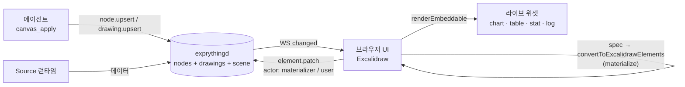

# Excalidraw를 기본 캔버스로 쓰는 방안 조사

> 작성: 2026-11-03 · 기준 버전: `@excalidraw/excalidraw` **0.18.1** (npm `latest`), 비교용 master 프리릴리스 `next` = **0.18.0-4ce8305**
> 범위: Exprything UI(현재 React Flow)에 자유 드로잉·도형·텍스트·화살표·포스트잇형 박스·선택/그룹·줌/팬·undo/redo·이미지·export 같은 "기본 캔버스" 기능을 넣는 데 Excalidraw를 쓸 수 있는지, 데이터에 묶인 라이브 위젯과 한 캔버스에서 어떻게 공존시킬지, 에이전트가 그림을 어떻게 선언적으로 그리게 할지.
> 방법: 1차 출처(공식 문서의 저장소 소스, GitHub 태그 `v0.18.1` 소스, npm 레지스트리 메타데이터, 배포된 `dist`·`.d.ts`, 라이선스 파일)만 근거로 삼았다. 핵심 주장은 스크래치 디렉터리에 패키지를 받아 직접 실행해 확인했다(13장). 확인하지 못한 것은 **미확인**으로 표시하고 이유를 적었다(12장).

---

## TL;DR

- **권고: (A) Excalidraw를 기본 캔버스로 채택한다.** React Flow를 Excalidraw로 바꾸고, 라이브 위젯은 `embeddable` 요소 + `renderEmbeddable` prop으로 그린다. 데몬은 계속 단일 진실 원천이고, 에이전트는 새 op `drawing.upsert`(Excalidraw skeleton 요소)로 그림을 선언한다. skeleton→요소 변환은 브라우저에서 하고, "사람 편집 우선"은 Excalidraw의 요소 단위 version 비교에 맡기지 않고 데몬의 필드 단위 패치와 pin으로 구현한다. 본 구현 전에 UI만 바꾸는 1~2일 spike로 StrictMode·ECharts 위젯·pin 동작을 확인한다.
- `renderEmbeddable`은 iframe이 아니라 **임의의 React 컴포넌트**를 그린다. 실측(React 19.3.1, Chrome 156): 위젯 2개 마운트, iframe 0개, 콘솔 에러 0. 위젯은 비활성 상태에서도 스스로 갱신된다. 마우스 입력은 요소 가운데 1/3 영역을 클릭해 "활성화"해야 들어가지만, 위젯 안 컨트롤에 `pointer-events: auto`를 주면 활성화 없이도 클릭·휠이 된다(실측).
- 제약: embeddable은 캔버스 위에 얹힌 DOM 오버레이(`z-index: 2`)라서 화살표·메모를 위젯 **위에** 그릴 수 없다. PNG/SVG export에서는 위젯이 링크 문자열 자리표시자로 나온다. 한 번 화면에 들어온 위젯은 화면 밖으로 나가도 언마운트되지 않고 계속 돈다. 앞의 두 제약은 Chrome 157(2026-10)에 나온 HTML-in-Canvas API로 풀 수 있는 종류지만, Excalidraw가 이 API를 쓰지 않고 브라우저 지원도 아직 Chrome뿐이라 당장은 그대로 남는다(9.4).
- Node에서는 그대로 돌지 않는다. 0.18.1 `dist`를 순수 Node로 import하면 확장자 없는 import에서 실패하고, 번들해도 top-level `window`·canvas 접근에서 실패한다. jsdom + canvas/FontFace 스텁을 넣어야 `convertToExcalidrawElements`가 돈다(실측). 그래서 변환은 공식 Excalidraw MCP처럼 브라우저에서 한다.
- 병합: excalidraw.com 협업은 `version`/`versionNonce` 기반 **요소 단위 LWW** + `isDeleted` 톰스톤 + fractional index이고, `reconcileElements`가 npm 패키지에서 export된다. 실측에서 version이 더 높은 원격 갱신은 사람이 드래그 중인 요소를 빼앗았다(텍스트 편집 중인 요소는 보호됨). `CaptureUpdateAction.NEVER`로 넣은 갱신은 사람의 undo 스택에 들어가지 않았다.
- 로컬 우선 조건: MIT, React 19 지원, ko-KR 번역 100%. 다만 폰트는 기본적으로 esm.sh CDN에서 받으므로, `dist/prod/fonts`(13 MB, 한글을 포함한 CJK 손글씨 Xiaolai 12 MB)를 데몬이 서빙하고 `window.EXCALIDRAW_ASSET_PATH`를 지정해야 오프라인이 된다. 첫 로드 JS는 React Flow 대비 약 +0.9 MiB(min) 커진다.
- 대안: tldraw는 기술적으로 가장 잘 맞지만(위젯을 1급 shape로, z-order 통합, 공식 agent kit) **라이선스 키 없이는 production에서 동작하지 않는다**. React Flow 유지 + 자체 드로잉은 가볍고 통제력이 높지만 freehand·undo/redo·helper lines 등을 직접 만들거나 유료 Pro 예제를 참고해야 한다. 두 캔버스를 겹치는 hybrid는 비권장.
- 버전 리스크: 안정판 0.18.x는 2025-03 이후 보안 백포트(0.18.1)만 나왔고, master에는 `onExcalidrawAPI`·`setViewport`·`exportScene`·`stickynote` 등 breaking change가 쌓여 있다. Excalidraw 접근을 얇은 어댑터로 감싸 이전 비용을 줄인다.

---

## 1. 패키지 사실관계 (Q1)

| 항목 | 값 | 근거 |
|---|---|---|
| 최신 안정판 | **0.18.1** (`latest`, 2026-04-20 배포). 직전 0.18.0은 2025-03-10 | [npm registry](https://registry.npmjs.org/@excalidraw/excalidraw) `time`·`dist-tags` |
| 0.18.1의 성격 | Mermaid XSS(CVE-2025-54881) 대응 보안 패치. `@excalidraw/mermaid-to-excalidraw`를 2.2.2로 백포트 | [Release v0.18.1](https://github.com/excalidraw/excalidraw/releases/tag/v0.18.1) |
| `next` 태그 | master 프리릴리스 `0.18.0-4ce8305` (2026-10-27). master `package.json`의 version도 아직 `0.18.0` | npm registry, [master package.json](https://github.com/excalidraw/excalidraw/blob/8bcdca4526867433f99fdfcb55a063668db0c9dc/packages/excalidraw/package.json) |
| 라이선스 | MIT | [LICENSE](https://github.com/excalidraw/excalidraw/blob/v0.18.1/LICENSE), [package.json](https://github.com/excalidraw/excalidraw/blob/v0.18.1/packages/excalidraw/package.json) |
| React peerDependencies | `react`/`react-dom`: `^17.0.2 \|\| ^18.2.0 \|\| ^19.0.0` → React 19 지원. 실측으로 React **19.3.1**(Exprything과 같은 버전)에서 렌더·상호작용 확인 | [package.json](https://github.com/excalidraw/excalidraw/blob/v0.18.1/packages/excalidraw/package.json), 13장 |
| 모듈 형식 | **ESM 전용** (`"type": "module"`, `exports` 맵). 0.18.0에서 UMD 폐기 | [CHANGELOG L46](https://github.com/excalidraw/excalidraw/blob/v0.18.1/packages/excalidraw/CHANGELOG.md#L46) |
| CSS | JS가 CSS를 import하지 않는다. `import "@excalidraw/excalidraw/index.css"`를 따로 해야 한다 | [CHANGELOG L81](https://github.com/excalidraw/excalidraw/blob/v0.18.1/packages/excalidraw/CHANGELOG.md#L81), 배포 `dist/prod/index.js` 확인 |
| 타입 | `@excalidraw/excalidraw/types` 등(`"./*"` → `.d.ts`). TS `moduleResolution`은 `bundler`/`node16`/`nodenext`여야 한다. 우리 `tsconfig.json`은 `Bundler`라 그대로 맞는다 | [CHANGELOG L69](https://github.com/excalidraw/excalidraw/blob/v0.18.1/packages/excalidraw/CHANGELOG.md#L69) |
| 크기(unpacked) | 46,802,783 B, 1,029 files. `dist/dev` 27 MB, `dist/prod` 17 MB(그중 fonts 13 MB, locales 1.7 MB), `dist/types` 2.2 MB | [registry 0.18.1](https://registry.npmjs.org/@excalidraw/excalidraw/0.18.1) `dist.unpackedSize`, 설치본 `du` |
| SSR | 지원하지 않음. client에서만 렌더 | [integration.mdx L35](https://github.com/excalidraw/excalidraw/blob/v0.18.1/dev-docs/docs/@excalidraw/excalidraw/integration.mdx#L35) |
| 컨테이너 | 부모 블록의 width/height 100%를 쓰므로 부모가 0이 아닌 크기여야 한다 | [installation.mdx L51](https://github.com/excalidraw/excalidraw/blob/v0.18.1/dev-docs/docs/@excalidraw/excalidraw/installation.mdx#L51) |
| 빌드 도구 | Vite 8.3.5 + `@vitejs/plugin-react` 6.2.1(우리와 같은 버전)로 설정 없이 `vite build` 성공. 경고는 chunk 크기뿐 | 13장 실측 |

### 1.1 폰트·자산 로딩과 오프라인

- 문서: 기본적으로 사용하는 폰트를 CDN에서 받는다. self-host하려면 `node_modules/@excalidraw/excalidraw/dist/prod/fonts`를 자산 경로로 복사하고 `window.EXCALIDRAW_ASSET_PATH`를 같은 경로로 지정한다([installation.mdx L21-L26](https://github.com/excalidraw/excalidraw/blob/v0.18.1/dev-docs/docs/@excalidraw/excalidraw/installation.mdx#L21-L26)). 0.18.0부터 문자열 배열도 받는다([CHANGELOG L230](https://github.com/excalidraw/excalidraw/blob/v0.18.1/packages/excalidraw/CHANGELOG.md#L230)).
- 코드: `ExcalidrawFontFace`는 `FontFace`의 `src`를 **[`EXCALIDRAW_ASSET_PATH` 기반 URL들…, `https://esm.sh/@excalidraw/excalidraw@0.18.1/dist/prod/`]** 순서로 만든다([ExcalidrawFontFace.ts L11-L29, L133-L167](https://github.com/excalidraw/excalidraw/blob/v0.18.1/packages/excalidraw/fonts/ExcalidrawFontFace.ts#L11-L29)). 브라우저는 앞 소스가 실패할 때만 다음 소스를 쓰므로, 로컬 경로가 맞으면 CDN은 쓰지 않는다. 문서는 CDN을 `esm.run`이라 적었지만 코드는 `esm.sh`다(문서·코드 불일치, 코드 기준).
- UI 폰트(Assistant)는 `index.css`의 상대 `url()`이라 번들러가 복사한다(Vite 실측: woff2 4개 복사). 캔버스 폰트(Excalifont, Virgil, Nunito, Lilita One, Comic Shanns, Cascadia, Liberation, Xiaolai)는 JS 안의 문자열 경로라 **번들러가 복사하지 않는다**(Vite 실측). 빌드 때 `packages/ui/public/`으로 복사하고 `window.EXCALIDRAW_ASSET_PATH = "/"`로 두면, 데몬이 이미 UI `dist`를 정적 서빙하므로([server.ts](../../packages/daemon/src/server.ts)) `/fonts/...`로 제공된다.
- 크기: 9개 패밀리 13 MB. 그중 Xiaolai가 unicode-range별 woff2 209개, 12 MB이고 쓰는 글자 범위만 받는다.
- 그 밖의 네트워크 호출은 모두 사용자 동작 때만 일어난다: 라이브러리 둘러보기(libraries.excalidraw.com), 이미지 URL 붙여넣기, 라이브러리 publish(`dist/dev` 소스의 `fetch` 호출 지점 확인).

### 1.2 한국어(ko-KR)

- `ko-KR`은 언어 목록에 있고([i18n.ts L41](https://github.com/excalidraw/excalidraw/blob/v0.18.1/packages/excalidraw/i18n.ts#L41)), 번역 완성도는 100%다([percentages.json L28](https://github.com/excalidraw/excalidraw/blob/v0.18.1/packages/excalidraw/locales/percentages.json#L28)). 목록 노출 기준은 85%다([i18n.ts L6](https://github.com/excalidraw/excalidraw/blob/v0.18.1/packages/excalidraw/i18n.ts#L6)). 실측에서 `langCode="ko-KR"`로 툴바 title("선택된 도구 유지하기 — Q")과 embeddable 힌트("클릭하여 상호작용")가 한국어로 나왔다.
- 손글씨 폰트로 쓴 한글은 CJK 대체 폰트 Xiaolai가 맡는다. 배포본의 unicode-range에 Hangul 범위(U+AC00–D7A3, U+1100–11FF 등)가 들어 있다. 0.18.0 하이라이트 "Font for Chinese, Japanese and Korean"([CHANGELOG L30](https://github.com/excalidraw/excalidraw/blob/v0.18.1/packages/excalidraw/CHANGELOG.md#L30)).
- 부작용: 언어를 정할 때 `document.documentElement.dir`/`lang`을 바꾼다([i18n.ts L91-L92](https://github.com/excalidraw/excalidraw/blob/v0.18.1/packages/excalidraw/i18n.ts#L91-L92)). 실측에서 `<html lang="ko-KR">`이 됐다. Exprything 페이지 전체에 영향을 준다.

---

## 2. 기본 제공 캔버스 기능 (Q2)

0.18.1의 도구 목록은 `selection, rectangle, diamond, ellipse, arrow, line, freedraw, text, image, eraser, hand, frame, magicframe, embeddable, laser`다([types.ts L122-L137](https://github.com/excalidraw/excalidraw/blob/v0.18.1/packages/excalidraw/types.ts#L122-L137)).

| 요청 기능 | 0.18.1 지원 | 근거 |
|---|---|---|
| 자유 드로잉 | `freedraw` 도구(perfect-freehand 의존) | ToolType, package.json |
| 도형 | rectangle / diamond / ellipse / line | ToolType |
| 텍스트 | text 도구, 도형 안 라벨(컨테이너 텍스트), 0.18.0부터 자동 줄바꿈 | [CHANGELOG L16-L44](https://github.com/excalidraw/excalidraw/blob/v0.18.1/packages/excalidraw/CHANGELOG.md#L16-L44) |
| 화살표 | arrow + 도형 바인딩(`startBinding`/`endBinding`), 0.18.0부터 elbow arrow | 같은 하이라이트, [element/types.ts](https://github.com/excalidraw/excalidraw/blob/v0.18.1/packages/excalidraw/element/types.ts) |
| 포스트잇형 박스 | **전용 타입 없음**. 채운 rectangle + 라벨로 대신한다. master에는 `stickynote` 타입이 있으나 미출시 | [master CHANGELOG L61-L70](https://github.com/excalidraw/excalidraw/blob/8bcdca4526867433f99fdfcb55a063668db0c9dc/packages/excalidraw/CHANGELOG.md#L61-L70) |
| 선택·그룹·잠금 | 선택, `groupIds`, `locked` | [element/types.ts L71-L78](https://github.com/excalidraw/excalidraw/blob/v0.18.1/packages/excalidraw/element/types.ts#L71-L78) |
| 프레임 | `frame` 도구, `frameId`, `updateFrameRendering` API | ToolType, [types.ts L791](https://github.com/excalidraw/excalidraw/blob/v0.18.1/packages/excalidraw/types.ts#L791) |
| 줌/팬 | hand 도구·휠·`scrollToContent` | [excalidraw-api.mdx L280](https://github.com/excalidraw/excalidraw/blob/v0.18.1/dev-docs/docs/@excalidraw/excalidraw/api/props/excalidraw-api.mdx#L280) |
| undo/redo | 내장 History(0.18.0 멀티플레이어 undo/redo), `history.clear()` | [CHANGELOG L22](https://github.com/excalidraw/excalidraw/blob/v0.18.1/packages/excalidraw/CHANGELOG.md#L22) |
| 이미지 | image 도구, `files`·`addFiles`, 0.18.0부터 crop, `UIOptions.tools.image`로 숨김 | [ui-options.mdx](https://github.com/excalidraw/excalidraw/blob/v0.18.1/dev-docs/docs/@excalidraw/excalidraw/api/props/ui-options.mdx) |
| export | 메뉴의 PNG/SVG/클립보드 + `exportToCanvas/Blob/Svg/Clipboard`, `exportEmbedScene` | [export.mdx](https://github.com/excalidraw/excalidraw/blob/v0.18.1/dev-docs/docs/@excalidraw/excalidraw/api/utils/export.mdx) |
| 그리드·스냅 | `gridModeEnabled`, `objectsSnapModeEnabled` prop | [types.ts L540-L541](https://github.com/excalidraw/excalidraw/blob/v0.18.1/packages/excalidraw/types.ts#L540-L541) |
| 보기 모드 | `viewModeEnabled`(prop으로 주면 host가 완전히 통제), `zenModeEnabled` | [props.mdx L204](https://github.com/excalidraw/excalidraw/blob/v0.18.1/dev-docs/docs/@excalidraw/excalidraw/api/props/props.mdx#L204) |
| 다크 테마 | `theme` prop, `THEME` 상수. 다크 모드는 **canvas에만** CSS filter를 건다 → DOM 위젯은 스스로 테마를 맞춰야 한다 | [props.mdx L220](https://github.com/excalidraw/excalidraw/blob/v0.18.1/dev-docs/docs/@excalidraw/excalidraw/api/props/props.mdx#L220), [styles.scss L122-L129](https://github.com/excalidraw/excalidraw/blob/v0.18.1/packages/excalidraw/css/styles.scss#L122-L129) |
| 요소 링크 | 모든 요소의 `link` 필드, 0.18.0 element linking, `generateLinkForSelection`, `onLinkOpen` | [CHANGELOG L42](https://github.com/excalidraw/excalidraw/blob/v0.18.1/packages/excalidraw/CHANGELOG.md#L42), [types.ts L556-L557](https://github.com/excalidraw/excalidraw/blob/v0.18.1/packages/excalidraw/types.ts#L556-L557) |
| 라이브러리 | Library 사이드바, `updateLibrary`, `onLibraryChange`, `useHandleLibrary` | [excalidraw-api.mdx](https://github.com/excalidraw/excalidraw/blob/v0.18.1/dev-docs/docs/@excalidraw/excalidraw/api/props/excalidraw-api.mdx) |
| 기타 | eraser, laser pointer, 씬 검색, 커맨드 팔레트, flowchart, Mermaid→Excalidraw(TTD 다이얼로그) | [CHANGELOG L16-L44](https://github.com/excalidraw/excalidraw/blob/v0.18.1/packages/excalidraw/CHANGELOG.md#L16-L44) |

툴바와 속성 패널은 아직 커스터마이즈할 수 없다고 문서가 명시한다([children-components-intro.mdx L12](https://github.com/excalidraw/excalidraw/blob/v0.18.1/dev-docs/docs/@excalidraw/excalidraw/api/children-components/children-components-intro.mdx#L12)). "위젯 넣기" 같은 우리 도구는 `renderTopRightUI`나 사이드바 버튼 + `setActiveTool({ type: "custom", customType })`으로 만든다.

---

## 3. 임베딩 API (Q3)

### 3.1 주요 props ([types.ts L498-L583](https://github.com/excalidraw/excalidraw/blob/v0.18.1/packages/excalidraw/types.ts#L498-L583))

- `initialData`: 객체, Promise, 또는 그것을 돌려주는 함수(0.18.0). `{ elements, appState, files, libraryItems, scrollToContent }`([initialdata.mdx](https://github.com/excalidraw/excalidraw/blob/v0.18.1/dev-docs/docs/@excalidraw/excalidraw/api/props/initialdata.mdx)).
- `onChange(elements, appState, files)`: "컴포넌트가 갱신될 때마다" 호출된다([props.mdx L55-L57](https://github.com/excalidraw/excalidraw/blob/v0.18.1/dev-docs/docs/@excalidraw/excalidraw/api/props/props.mdx#L55-L57)). 드래그 중 포인터 이동마다 불리므로, 서버로 보낼 때는 version으로 바뀐 요소만 골라야 한다(`getSceneVersion` = version 합, `hashElementsVersion` = versionNonce 해시, 둘 다 export).
- `excalidrawAPI(api)`: 명령형 API를 받는 콜백. ref 지원은 0.17.0에서 제거([excalidraw-api.mdx L45](https://github.com/excalidraw/excalidraw/blob/v0.18.1/dev-docs/docs/@excalidraw/excalidraw/api/props/excalidraw-api.mdx#L45)).
- 그 밖: `langCode`, `theme`, `viewModeEnabled`, `zenModeEnabled`, `gridModeEnabled`, `objectsSnapModeEnabled`, `UIOptions`, `renderTopRightUI(isMobile, appState)`, `renderCustomStats`, `onPointerUpdate/Down/Up`, `onScrollChange`, `onPaste`, `onDuplicate`, `generateIdForFile`, `onLinkOpen`, `handleKeyboardGlobally`(기본 false: 키 입력은 Excalidraw가 포커스를 가졌을 때만), `autoFocus`, `validateEmbeddable`, `renderEmbeddable`, `children`.

### 3.2 명령형 API ([types.ts L762~](https://github.com/excalidraw/excalidraw/blob/v0.18.1/packages/excalidraw/types.ts#L762))

`updateScene`, `updateLibrary`, `resetScene`, `getSceneElementsIncludingDeleted`, `getSceneElements`, `getAppState`, `getFiles`, `getName`, `scrollToContent(target?, { fitToContent | fitToViewport, viewportZoomFactor, animate, duration, minZoom, maxZoom, canvasOffsets })`, `registerAction`, `refresh`, `setToast`, `addFiles(BinaryFileData[])`(이미 있는 `fileId`의 데이터는 갱신하지 않는다), `id`, `setActiveTool`, `setCursor`/`resetCursor`, `toggleSidebar`, `updateFrameRendering`, `history.clear()`, 구독형 `onChange`/`onPointerDown`/`onPointerUp`/`onScrollChange`/`onUserFollow`.

### 3.3 `updateScene`과 `captureUpdate`

- `elements`를 넘기면 **씬 전체를 교체한다**(`this.scene.replaceAllElements(nextElements)`, [App.tsx L3885-L3955](https://github.com/excalidraw/excalidraw/blob/v0.18.1/packages/excalidraw/components/App.tsx#L3885-L3955)). 원격 갱신은 로컬과 병합한 전체 배열을 넘겨야 한다. 넘긴 배열의 fractional index는 내부에서 `syncInvalidIndices`로 보정된다(L3903).
- `captureUpdate`는 0.18.0에서 `commitToHistory`를 대체했다([CHANGELOG L171](https://github.com/excalidraw/excalidraw/blob/v0.18.1/packages/excalidraw/CHANGELOG.md#L171)). 값은 [store.ts L40-L71](https://github.com/excalidraw/excalidraw/blob/v0.18.1/packages/excalidraw/store.ts#L40-L71):
  - `IMMEDIATELY`: 바로 undo 대상. 대부분의 로컬 변경.
  - `EVENTUALLY`(기본값): 다음 `IMMEDIATELY` 때 함께 undo 대상이 된다.
  - `NEVER`: undo 스택에 절대 안 들어간다. 원격 갱신·씬 초기화용.
- 실측: `IMMEDIATELY`로 옮긴 요소는 Cmd+Z 한 번에 되돌아갔고, 같은 시점에 `NEVER`로 옮긴 위젯은 그대로 남았다. **에이전트 갱신은 `NEVER`로 넣으면 사람의 undo를 오염시키지 않는다.**

### 3.4 UI 커스터마이즈

- `UIOptions`: `canvasActions`(`changeViewBackgroundColor`, `clearCanvas`, `export: false | { saveFileToDisk, onExportToBackend, renderCustomUI }`, `loadScene`, `saveToActiveFile`, `toggleTheme`, `saveAsImage`), `tools.image`, `dockedSidebarBreakpoint`([ui-options.mdx](https://github.com/excalidraw/excalidraw/blob/v0.18.1/dev-docs/docs/@excalidraw/excalidraw/api/props/ui-options.mdx)).
- children 컴포넌트: `MainMenu`(넘기면 기본 항목 대신 우리 항목만), `WelcomeScreen`, `Sidebar`, `Footer`, `LiveCollaborationTrigger`([main-menu.mdx](https://github.com/excalidraw/excalidraw/blob/v0.18.1/dev-docs/docs/@excalidraw/excalidraw/api/children-components/main-menu.mdx)).
- `viewModeEnabled`·`zenModeEnabled`·`gridModeEnabled`·`theme`·`name`은 prop으로 주면 host가 통제하고 사용자가 앱 안에서 바꾸지 못한다(`theme`은 `UIOptions.canvasActions.toggleTheme`로 예외 허용)([props.mdx L204-L233](https://github.com/excalidraw/excalidraw/blob/v0.18.1/dev-docs/docs/@excalidraw/excalidraw/api/props/props.mdx#L204-L233)). `langCode`는 UI 언어 코드이고 기본값은 `en`이다([props.mdx L191](https://github.com/excalidraw/excalidraw/blob/v0.18.1/dev-docs/docs/@excalidraw/excalidraw/api/props/props.mdx#L191)).
- 참고: docs.excalidraw.com은 현재 0.18.x API(`excalidrawAPI`, `scrollToContent`)를 설명한다(사이트 확인). master의 미출시 변경(11장)은 아직 반영돼 있지 않다.

---

## 4. Embeddable: 라이브 위젯을 Excalidraw 요소로 (Q4, 핵심)

### 4.1 두 요소 타입

| 타입 | 무엇을 그리나 | `renderEmbeddable` 대상 | 근거 |
|---|---|---|---|
| `embeddable` | `link`(URL). `validateEmbeddable`을 통과한 요소만 DOM으로 그린다 | **예** | [App.tsx L1005-L1016](https://github.com/excalidraw/excalidraw/blob/v0.18.1/packages/excalidraw/components/App.tsx#L1005-L1016) |
| `iframe` | magic frame(diagram-to-code) 결과. `customData.generationData.html`을 `srcdoc`으로 그린다. 검증 없이 항상 그린다 | 아니오 | 같은 함수, [element/types.ts](https://github.com/excalidraw/excalidraw/blob/v0.18.1/packages/excalidraw/element/types.ts) |

- 기본 허용 도메인: youtube, vimeo, figma, link.excalidraw.com, gist.github.com, twitter/x, `*.simplepdf.eu`, stackblitz, val.town, giphy, reddit([embeddable.ts L53-L68](https://github.com/excalidraw/excalidraw/blob/v0.18.1/packages/excalidraw/element/embeddable.ts#L53-L68)).
- `validateEmbeddable`: `true`면 모두 허용, 호스트명 배열, RegExp(배열), 함수. 함수가 boolean을 돌려주면 그 값을, `undefined`면 기본 검증기를 쓴다([embeddable.ts L411-L444](https://github.com/excalidraw/excalidraw/blob/v0.18.1/packages/excalidraw/element/embeddable.ts#L411-L444), [props.mdx L252-L260](https://github.com/excalidraw/excalidraw/blob/v0.18.1/dev-docs/docs/@excalidraw/excalidraw/api/props/props.mdx#L252-L260)).

### 4.2 `renderEmbeddable` 동작 (소스로 확인)

- **임의의 React를 그릴 수 있다.** 렌더 식은 `renderEmbeddable?.(el, appState) ?? <iframe …/>`다. null이 아닌 JSX를 돌려주면 iframe 대신 그것을 쓴다([App.tsx L1259-L1285](https://github.com/excalidraw/excalidraw/blob/v0.18.1/packages/excalidraw/components/App.tsx#L1259-L1285)). 문서도 "built-in `<iframe>` 렌더러를 대체"한다고 설명한다([render-props.mdx L65-L75](https://github.com/excalidraw/excalidraw/blob/v0.18.1/dev-docs/docs/@excalidraw/excalidraw/api/props/render-props.mdx#L65-L75)). 반환물은 `<Excalidraw>` 아래 React 트리에서 렌더되므로([L1809](https://github.com/excalidraw/excalidraw/blob/v0.18.1/packages/excalidraw/components/App.tsx#L1809)), 바깥에서 감싼 우리 context도 React 규칙대로 그대로 보인다.
- **배치**: 바깥 div에 `transform: translate(x, y) scale(zoom)`, 안쪽 div에 요소의 `width/height`와 `rotate(angle)`([L1196-L1243](https://github.com/excalidraw/excalidraw/blob/v0.18.1/packages/excalidraw/components/App.tsx#L1196-L1243)). 요소의 `strokeWidth`만큼 padding을 두고 Excalidraw가 테두리를 그린다.
- **포인터**: 안쪽 div가 `pointerEvents: isActive ? enabled : disabled`다([L1243](https://github.com/excalidraw/excalidraw/blob/v0.18.1/packages/excalidraw/components/App.tsx#L1243)). 비활성일 때 클릭은 아래 캔버스로 가서 선택·이동이 된다.
- **활성화**: 편집 모드에서는 요소의 **가운데 1/3 × 1/3 영역**에 올리면 "클릭하여 상호작용" 힌트가 뜨고([L6093](https://github.com/excalidraw/excalidraw/blob/v0.18.1/packages/excalidraw/components/App.tsx#L6093)), 그 영역을 300 ms 미만으로 클릭하면 `activeEmbeddable.state = "active"`가 된다([L940-L960](https://github.com/excalidraw/excalidraw/blob/v0.18.1/packages/excalidraw/components/App.tsx#L940-L960), [L9660-L9675](https://github.com/excalidraw/excalidraw/blob/v0.18.1/packages/excalidraw/components/App.tsx#L9660-L9675), [L861-L880](https://github.com/excalidraw/excalidraw/blob/v0.18.1/packages/excalidraw/components/App.tsx#L861-L880)). 더블클릭은 위치와 무관하게 활성화하는 경로가 있다([L5480-L5490](https://github.com/excalidraw/excalidraw/blob/v0.18.1/packages/excalidraw/components/App.tsx#L5480-L5490), 실측은 안 함). 보기 모드에서는 링크 요소 클릭 경로([L6700-L6716](https://github.com/excalidraw/excalidraw/blob/v0.18.1/packages/excalidraw/components/App.tsx#L6700-L6716))로 어디를 눌러도 활성화된다(실측).
- **지연 마운트, 언마운트 없음**: 처음 뷰포트에 들어올 때 마운트하고(`initializedEmbeds`), 그 뒤 화면 밖이면 `display: none`만 하고 언마운트하지 않는다([L1027-L1041, L1205](https://github.com/excalidraw/excalidraw/blob/v0.18.1/packages/excalidraw/components/App.tsx#L1027-L1041)).
- **z-order**: `.excalidraw__embeddable-container { position: absolute; z-index: 2; pointer-events: none }`([styles.scss L114-L119](https://github.com/excalidraw/excalidraw/blob/v0.18.1/packages/excalidraw/css/styles.scss#L114-L119))이고, 정적 canvas는 `--zIndex-canvas`(실측 1), 상호작용 canvas는 `--zIndex-interactiveCanvas`(실측 2)다([L89-L92](https://github.com/excalidraw/excalidraw/blob/v0.18.1/packages/excalidraw/css/styles.scss#L89-L92)). embed가 DOM 순서상 뒤에 있으므로 **항상 모든 캔버스 그림 위에** 온다. 실측 스크린샷에서 선택 핸들도 위젯 영역 안쪽은 가려졌다. 씬의 요소 순서(z-index)로 위젯 위에 화살표나 메모를 올릴 수 없다.
- **Export**: `exportToSvg`의 `renderEmbeddables` 기본값은 false이고([scene/export.ts L449](https://github.com/excalidraw/excalidraw/blob/v0.18.1/packages/excalidraw/scene/export.ts#L449)), embeddable은 링크 문자열 라벨 자리표시자 + `<a>`로 나간다([staticSvgScene.ts L173-L260](https://github.com/excalidraw/excalidraw/blob/v0.18.1/packages/excalidraw/renderer/staticSvgScene.ts#L173-L260)). PNG(canvas) export도 자리표시자 라벨을 그린다([staticScene.ts L367-L395](https://github.com/excalidraw/excalidraw/blob/v0.18.1/packages/excalidraw/renderer/staticScene.ts#L367-L395)). `renderEmbeddable` 결과는 UI 전용이라 **우리 위젯은 export에 나오지 않는다.**
- 참고로 기본 iframe sandbox는 `allow-scripts allow-forms allow-popups allow-popups-to-escape-sandbox allow-presentation allow-downloads`(일부 도메인만 `allow-same-origin`)다([L1279-L1281](https://github.com/excalidraw/excalidraw/blob/v0.18.1/packages/excalidraw/components/App.tsx#L1279-L1281)).

### 4.3 실측 (headless Chrome 156, React 19.3.1, 0.18.1)

`renderEmbeddable`로 `React.memo` 위젯(500 ms마다 tick, 버튼, 스크롤 목록)을 그리는 페이지를 puppeteer-core로 조작했다(13장).

| 시나리오 | 결과 |
|---|---|
| 마운트 | embeddable 컨테이너 2, React 위젯 2, iframe **0**, 콘솔 에러 0 |
| 비활성 상태의 자체 갱신 | 1.5초 동안 tick 1→4. **활성화 없이 계속 갱신된다** |
| 비활성 상태에서 위젯 버튼 클릭 | 무시됨(clicks 0). 클릭은 캔버스로 간다 |
| 가운데 hover → 클릭 | 힌트 "클릭하여 상호작용" → `widget-0:active`, 안쪽 `pointer-events: all`, 버튼 클릭 동작 |
| 활성 위젯 안에서 휠 | 위젯 목록 `scrollTop` 200, 캔버스 스크롤 변화 없음 |
| Escape | 비활성화 |
| 비활성 위젯의 컨트롤에만 `pointer-events: auto` | 버튼 클릭 동작, 목록 휠 스크롤 동작(활성화 불필요) |
| 위 컨트롤 밖(제목줄)에서 휠·드래그 | 캔버스 팬(`scrollY` 300→150), 요소 이동(x 400→500) |
| 보기 모드 모서리 클릭 / 편집 모드 모서리 클릭 / 편집 모드 가운데 클릭 | 3/3 활성 / 0/3 / 3/3 |
| 팬·줌 30스텝(`updateScene({appState})`) | `renderEmbeddable` 60회 호출(위젯 2 × 30), memo 위젯은 재렌더 없음. transform 예: `translate(-267px, -155.75px) scale(1.48333)` |
| 에이전트식 `updateScene(…, NEVER)`로 위젯 이동 | 재마운트 없음(mount 1, unmount 0), 위젯 내부 상태 유지 |
| 화면 밖으로 스크롤 | `display: none`, 위젯은 마운트된 채 계속 tick |
| 팬 1스텝 비용(CDP `TaskDuration`) | 마운트 2개 1.76 ms, 30개 3.27 ms, 65개 4.47 ms, 100개 5.10 ms(`ScriptDuration` 0.84→1.46 ms) |
| 지연 마운트 | 위젯 100개, 줌 0.3에서 실제 마운트는 65개(뷰포트에 들어온 것만) |

해석: 수십~100개 규모에서 팬 비용은 완만하게 늘었다. 단, 위젯이 단순 React라 ECharts 위젯의 비용은 아니고, headless 측정이라 절대값보다 추세로 봐야 한다(12장 미확인).

### 4.4 어느 위젯인지 식별하기

- **`customData`를 진실로 쓴다.** 임의 `Record<string, any>`이고([element/types.ts L79](https://github.com/excalidraw/excalidraw/blob/v0.18.1/packages/excalidraw/element/types.ts#L79), [props.mdx L35](https://github.com/excalidraw/excalidraw/blob/v0.18.1/dev-docs/docs/@excalidraw/excalidraw/api/props/props.mdx#L35)), 0.18.0부터 restore가 모르는 속성도 지우지 않는다([CHANGELOG L276](https://github.com/excalidraw/excalidraw/blob/v0.18.1/packages/excalidraw/CHANGELOG.md#L276)). `renderEmbeddable(el)`에서 `el.customData.exprything.node`로 노드 id를 읽는다(실측).
- **`link`는 검증 통과용**으로만 둔다. `exprything:node/<id>`는 `normalizeLink`(@braintree/sanitize-url)를 그대로 통과하고 `javascript:`는 `about:blank`가 됐다(실측, [url.ts L4-L10](https://github.com/excalidraw/excalidraw/blob/v0.18.1/packages/excalidraw/data/url.ts#L4-L10)). `validateEmbeddable={(l) => l.startsWith("exprything:")}`처럼 우리 스킴만 true, 나머지는 false로 두면 외부 iframe 임베드가 막혀 로컬 우선 원칙과도 맞는다.
- 사람은 속성 패널의 링크 버튼으로 link를 바꿀 수 있다(실측 스크린샷). 그래서 link가 아니라 `customData`를 기준으로 삼는다. 이 편집 UI를 끄는 prop은 0.18.1에서 찾지 못했다(**미확인**).
- **검증은 요소 id마다 한 번이다.** `updateEmbeddables`는 처음 보는 embeddable만 검사하고 결과를 id별로 기억한다. 그 뒤 link가 바뀌어도 다시 검사하지 않고, 링크 편집기가 닫히며 저장할 때만 다시 정한다(빈 값이면 실패)([App.tsx](https://github.com/excalidraw/excalidraw/blob/v0.18.1/packages/excalidraw/components/App.tsx), [Hyperlink.tsx](https://github.com/excalidraw/excalidraw/blob/v0.18.1/packages/excalidraw/components/hyperlink/Hyperlink.tsx)). 한편 link가 있는 요소에는 선택되지 않은 동안 오른쪽 위에 링크 아이콘이 그려진다([staticScene.ts](https://github.com/excalidraw/excalidraw/blob/v0.18.1/packages/excalidraw/renderer/staticScene.ts)의 `renderLinkIcon`). 그래서 위젯은 첫 렌더 전과 선택된 동안에만 link를 갖는다(10.5).

---

## 5. 에이전트를 위한 프로그램적 생성 (Q5)

### 5.1 `convertToExcalidrawElements`(element skeleton API)

문서는 "beta, stable 전에 바뀔 수 있음"이라고 명시한다([excalidraw-element-skeleton.mdx L3](https://github.com/excalidraw/excalidraw/blob/v0.18.1/dev-docs/docs/@excalidraw/excalidraw/api/excalidraw-element-skeleton.mdx#L3)).

| 기능 | 동작 | 근거 |
|---|---|---|
| 도형 + 라벨(컨테이너 텍스트) | `label: { text }` → 바운드 text 요소 생성(`containerId`). 크기를 안 주면 라벨에 맞춘다 | 문서 [L193](https://github.com/excalidraw/excalidraw/blob/v0.18.1/dev-docs/docs/@excalidraw/excalidraw/api/excalidraw-element-skeleton.mdx#L193), 실측 |
| 화살표 바인딩 | `start`/`end`에 `{ id }`(기존 요소) 또는 `{ type }`(도형 자동 생성), 화살표 라벨 지원 | 문서 [L327](https://github.com/excalidraw/excalidraw/blob/v0.18.1/dev-docs/docs/@excalidraw/excalidraw/api/excalidraw-element-skeleton.mdx#L327), 실측(`startBinding`·`boundElements` 생성) |
| 텍스트 | `type`, `x`, `y`, `text` 필수 | 문서 |
| 프레임 | `{ type: "frame", children: [ids], name }` → 자식에 `frameId` | 문서 [L435](https://github.com/excalidraw/excalidraw/blob/v0.18.1/dev-docs/docs/@excalidraw/excalidraw/api/excalidraw-element-skeleton.mdx#L435), 실측(embeddable 자식 포함) |
| 이미지 | `fileId` 필수. 바이너리는 `addFiles`/`initialData.files`로 따로 | [transform.ts L169](https://github.com/excalidraw/excalidraw/blob/v0.18.1/packages/excalidraw/data/transform.ts#L169), 실측 |
| id 유지 | 기본은 **id 재생성**. 에이전트 id를 유지하려면 `{ regenerateIds: false }` | 문서 [L23](https://github.com/excalidraw/excalidraw/blob/v0.18.1/dev-docs/docs/@excalidraw/excalidraw/api/excalidraw-element-skeleton.mdx#L23), [transform.ts L510](https://github.com/excalidraw/excalidraw/blob/v0.18.1/packages/excalidraw/data/transform.ts#L510) |

실측으로 드러난 함정:

1. **라벨 text 요소의 id는 `regenerateIds: false`여도 무작위**다(예: `kFkHm9BP_kIU8rKj0OmRX`). 에이전트가 라벨을 다시 가리키려면 `${id}.label` 같은 결정적 id로 후처리해야 한다.
2. **0.18.1은 `freedraw`/`iframe`/`embeddable` skeleton을 정규화하지 않고 그대로 통과시킨다**([transform.ts L610-L615](https://github.com/excalidraw/excalidraw/blob/v0.18.1/packages/excalidraw/data/transform.ts#L610-L615)). 실측에서 embeddable의 `version`이 NaN(JSON에선 null)이고 seed·색이 비었다. `restoreElements([el], null)`을 거치면 기본값이 채워져 version 1이 된다(실측). `next` 빌드는 `newEmbeddableElement`로 정규화한다.
3. **화살표를 embeddable에 바인딩할 수 없다.** `end: { id: "<embeddable>" }`이면 `Unhandled element end type "embeddable"` 로그 후 `TypeError: Cannot read properties of undefined (reading 'id')`로 실패한다(0.18.1·next 모두 실측. [transform.ts L318, L393](https://github.com/excalidraw/excalidraw/blob/v0.18.1/packages/excalidraw/data/transform.ts#L318)의 assertNever). 에디터에서는 embeddable이 바인딩 가능한 타입이지만([element/types.ts](https://github.com/excalidraw/excalidraw/blob/v0.18.1/packages/excalidraw/element/types.ts) `ExcalidrawBindableElement`), skeleton으로 위젯에 화살표를 붙이려면 `startBinding/endBinding`과 대상의 `boundElements`를 우리가 채워야 한다.
4. 0.18.1은 id로 바인딩한 화살표를 주어진 좌표·길이(생략 시 기본 100) 그대로 둔다(실측 width 100). master는 바인딩 위치로 화살표를 옮긴다(실측 x 206, width 188; [master CHANGELOG L171](https://github.com/excalidraw/excalidraw/blob/8bcdca4526867433f99fdfcb55a063668db0c9dc/packages/excalidraw/CHANGELOG.md#L171)). 버전이 바뀌면 같은 skeleton이 다르게 그려진다.

### 5.2 Node(데몬)에서 돌릴 수 있나 — 실측

결론: **패키지는 import 시점에 `window`·`document`·canvas를 만진다.** 순수 Node로는 import부터 실패하고, DOM 셈(shim)이 있어야 변환이 돈다.

| 단계 (Node 22.17.1) | 0.18.1 결과 |
|---|---|
| `import(".../dist/prod/index.js")` | `ERR_MODULE_NOT_FOUND`: `roughjs/bin/rough`(확장자 없는 import. 번들러 전제) |
| + 확장자 보정 resolve hook | `ERR_IMPORT_ATTRIBUTE_MISSING`: `open-color/open-color.json` |
| + JSON load hook | `SyntaxError`: `@excalidraw/laser-pointer`에 named export `LaserPointer` 없음(CJS) |
| esbuild `platform: "node"` 번들 | `ReferenceError: window is not defined` — [constants.ts L8-L9](https://github.com/excalidraw/excalidraw/blob/v0.18.1/packages/excalidraw/constants.ts#L8-L9) top-level `"netscape" in window` |
| + jsdom 26 전역 | `TypeError: Cannot use 'in' operator to search for 'filter' in null` — [ImageExportDialog.tsx L40](https://github.com/excalidraw/excalidraw/blob/v0.18.1/packages/excalidraw/components/ImageExportDialog.tsx#L40) top-level canvas 2D 검사 |
| + canvas 2D 스텁 | import 성공, 변환 시 `ReferenceError: FontFace is not defined` |
| + `FontFace`·`document.fonts` 스텁 | **변환 성공**(요소 9개: 라벨, 화살표 바인딩, 프레임 자식, embeddable). 텍스트 크기는 스텁 `measureText` 값(11회 호출) |

| 단계 | `next` 0.18.0-4ce8305 결과 |
|---|---|
| esbuild 번들, 순수 Node | `ReferenceError: Element is not defined`(polyfill) |
| + jsdom 전역만 | import 성공, 텍스트 측정에서 `TypeError: Cannot set properties of null (setting 'font')` |
| + jsdom + `setCustomTextMetricsProvider` | **canvas·FontFace 스텁 없이 변환 성공** |

- 텍스트 크기는 canvas `measureText`로 잰다([textMeasurements.ts L133](https://github.com/excalidraw/excalidraw/blob/v0.18.1/packages/excalidraw/element/textMeasurements.ts#L133)). 0.18.0부터 `setCustomTextMetricsProvider`로 바꿀 수 있다([L110](https://github.com/excalidraw/excalidraw/blob/v0.18.1/packages/excalidraw/element/textMeasurements.ts#L110), [CHANGELOG L232](https://github.com/excalidraw/excalidraw/blob/v0.18.1/packages/excalidraw/CHANGELOG.md#L232)).
- 브라우저에서 불러올 때 `restoreElements(els, null, { refreshDimensions: true })`로 실제 폰트 기준 재측정이 가능하다([restore.ts L490-L542](https://github.com/excalidraw/excalidraw/blob/v0.18.1/packages/excalidraw/data/restore.ts#L490-L542)). 데몬이 대략적인 크기로 만들어도 브라우저에서 고칠 수 있다는 뜻이다.
- **판단**: 데몬 변환은 가능하지만 셈 의존이 크다(0.18.1은 스텁 3종). 그래서 **브라우저 변환을 권장**한다. 공식 Excalidraw MCP도 위젯(브라우저)에서 `convertToExcalidrawElements(…, { regenerateIds: false })`를 부른다([mcp-app.tsx L54](https://github.com/excalidraw/excalidraw-mcp/blob/157aa23ceb1976008aadc89eb05e3444060f09d6/src/mcp-app.tsx#L54)). 데몬 쪽 렌더가 필요해지면 두 선례가 있다. 커뮤니티 mcp_excalidraw는 jsdom 셈 + 번들 폰트 글리프 폭으로 Node에서 `exportToSvg`를 돌리고 resvg로 PNG를 만든다([README "Headless Rendering"](https://github.com/yctimlin/mcp_excalidraw#headless-rendering)). 공식 `excalidraw/cli`는 설치된 브라우저로 렌더한다([README](https://github.com/excalidraw/cli#render-to-png)).

### 5.3 `@excalidraw/mermaid-to-excalidraw`

- 역할: Mermaid 텍스트 → **skeleton** 요소(지원 안 되는 다이어그램은 이미지 + `files`). 그다음 `convertToExcalidrawElements`가 필요하다([mermaid api.mdx L3](https://github.com/excalidraw/excalidraw/blob/v0.18.1/dev-docs/docs/@excalidraw/mermaid-to-excalidraw/api.mdx#L3)).
- 0.18.1에 딸린 **2.2.2**는 mermaid 자체로 레이아웃하므로 브라우저 전용이다. 실측: 순수 Node `TypeError: DOMPurify.addHook is not a function`, jsdom `ReferenceError: CSSStyleSheet is not defined`. Excalidraw 번들에서 mermaid 관련 코드는 lazy chunk다.
- 최신 **3.2.0**(2026-11-01)은 Obsidian의 Pele(MIT, Node ≥ 20)로 레이아웃하고, "DOM API(`DOMParser`)가 필요하다. 브라우저 또는 jsdom"이라고 README가 명시한다([README L5, L64-L66](https://github.com/excalidraw/mermaid-to-excalidraw/blob/f268df8489de95778aa1b684dc752ef9297882b1/README.md#L64-L66)). 지원: flowchart(swimlane-beta 포함), sequence, class, ER, state. 실측: 순수 Node에서는 `DOMParser`가 없어 이미지 1개로 폴백했고, jsdom을 주면 flowchart가 skeleton 8개(rectangle, diamond, arrow)로 변환됐다(version 필드 없음, 변환 필요). master는 v3로 갈아탔다([master CHANGELOG L206](https://github.com/excalidraw/excalidraw/blob/8bcdca4526867433f99fdfcb55a063668db0c9dc/packages/excalidraw/CHANGELOG.md#L206)).
- Exprything 함의: 에이전트에게 "mermaid로 그려도 됨" 경로를 열 수 있다(LLM이 가장 잘 쓰는 다이어그램 문법). v3 + jsdom이면 데몬에서 skeleton까지는 만들 수 있다.

---

## 6. 씬 포맷과 저장 (Q6)

### 6.1 `.excalidraw` 파일

`{ "type": "excalidraw", "version": 2, "source": "<origin>", "elements": [...], "appState": {...}, "files": { "<fileId>": { mimeType, id, dataURL, created, lastRetrieved } } }`([json-schema.mdx](https://github.com/excalidraw/excalidraw/blob/v0.18.1/dev-docs/docs/codebase/json-schema.mdx)). `serializeAsJSON(elements, appState, files, "local" | "database")`에서 `"database"`는 `files`를 빼고 appState를 줄인다. `source`는 `window.EXCALIDRAW_EXPORT_SOURCE || location.origin`이다([json.ts L43-L60](https://github.com/excalidraw/excalidraw/blob/v0.18.1/packages/excalidraw/data/json.ts#L43-L60)).

### 6.2 요소 공통 필드 ([element/types.ts L38-L80](https://github.com/excalidraw/excalidraw/blob/v0.18.1/packages/excalidraw/element/types.ts#L38-L80))

| 필드 | 의미 |
|---|---|
| `id` | 문자열 id. 에이전트 upsert 키로 쓸 수 있다 |
| `version` | 변경마다 1씩 증가하는 정수. 협업·서버 저장 시 reconcile에 쓴다 |
| `versionNonce` | 변경마다 새로 뽑는 랜덤 정수. version이 같을 때 결정적으로 승자를 고르는 데 쓴다 |
| `updated` | 마지막 변경 epoch ms. 톰스톤 만료 판단에 쓰인다 |
| `isDeleted` | 삭제 톰스톤 |
| `index` | fractional index 문자열(rocicorp/fractional-indexing). 배열 순서와 항상 동기화되고, 새 요소는 null일 수 있다 |
| `boundElements` | 이 요소에 붙은 요소(`{ id, type: "text" \| "arrow" }`) |
| `containerId` | (text) 라벨이 속한 컨테이너 |
| `groupIds` | 소속 그룹. 깊은 것부터 얕은 순 |
| `frameId` | 소속 프레임 |
| `link` | 하이퍼링크 / embeddable URL |
| `customData` | 임의 데이터(우리 메타데이터 자리) |
| `locked` | 잠금 |

그 밖에 text는 `text`, `originalText`, `fontSize`, `fontFamily`, `textAlign`, `verticalAlign`, `autoResize`, `lineHeight`. 선형 요소는 `points`, `startBinding/endBinding { elementId, focus, gap }`, `startArrowhead/endArrowhead`, elbow arrow는 `fixedPoint`. 프레임은 "자식들이 먼저, 프레임 요소가 그 뒤" 순서여야 렌더·클리핑이 맞다([frames.mdx L3-L5](https://github.com/excalidraw/excalidraw/blob/v0.18.1/dev-docs/docs/codebase/frames.mdx#L3-L5)).

### 6.3 유틸리티

- `restore`, `restoreElements(elements, localElements, { refreshDimensions, repairBindings })`, `restoreAppState`: 빠진 필드를 기본값으로 채운다. `localElements`를 주면 기존 요소의 version을 이어받아 올리고 versionNonce를 새로 뽑는다([restore.mdx L41-L44](https://github.com/excalidraw/excalidraw/blob/v0.18.1/dev-docs/docs/@excalidraw/excalidraw/api/utils/restore.mdx#L41-L44)). 문서의 `normalizeIndices` 옵션은 0.18.1 `.d.ts`에 없다(문서·타입 불일치).
- `serializeAsJSON`, `loadFromBlob`, `getSceneVersion`, `hashElementsVersion`, `getNonDeletedElements`, `bumpVersion`, `newElementWith`, `mutateElement`, `reconcileElements`, `convertToExcalidrawElements`, `CaptureUpdateAction`, `setCustomTextMetricsProvider`가 패키지 루트에서 export된다([index.tsx L229-L300](https://github.com/excalidraw/excalidraw/blob/v0.18.1/packages/excalidraw/index.tsx#L229-L300)).
- fractional index 헬퍼(`syncInvalidIndices` 등)는 공개 export가 아니다. 데몬이 index를 매기려면 의존성인 `fractional-indexing`을 직접 쓴다([fractionalIndex.ts L13-L28](https://github.com/excalidraw/excalidraw/blob/v0.18.1/packages/excalidraw/fractionalIndex.ts#L13-L28)의 설계 주석 참고).

---

## 7. 협업과 reconciliation (Q7)

### 7.1 excalidraw.com이 동시 편집을 합치는 방식 (`excalidraw-app`, v0.18.1)

1. **송신**: 요소별로 마지막에 보낸 version을 기억하고, 그보다 높은 요소만 보낸다([Portal.tsx L141-L180](https://github.com/excalidraw/excalidraw/blob/v0.18.1/excalidraw-app/collab/Portal.tsx#L141-L180)). 메시지 유실에 대비해 20초마다 전체를 다시 보낸다([app_constants.ts L6](https://github.com/excalidraw/excalidraw/blob/v0.18.1/excalidraw-app/app_constants.ts#L6), [Collab.tsx L927-L939](https://github.com/excalidraw/excalidraw/blob/v0.18.1/excalidraw-app/collab/Collab.tsx#L927-L939)).
2. **수신**: `restoreElements(remote, null)` → `reconcileElements(local, remote, appState)` → `updateScene({ elements, captureUpdate: NEVER })`([Collab.tsx L733-L781](https://github.com/excalidraw/excalidraw/blob/v0.18.1/excalidraw-app/collab/Collab.tsx#L733-L781)).
3. **규칙**(`shouldDiscardRemoteElement`, [reconcile.ts L19-L40](https://github.com/excalidraw/excalidraw/blob/v0.18.1/packages/excalidraw/data/reconcile.ts#L19-L40)): 로컬 요소가 편집 중(`editingTextElement`/`resizingElement`/`newElement`)이거나, `local.version > remote.version`이거나, version이 같고 `local.versionNonce < remote.versionNonce`이면 로컬을 남긴다. 나머지는 원격이 이긴다. 결과는 fractional index로 정렬하고 깨진 index를 보정한다([L73-L118](https://github.com/excalidraw/excalidraw/blob/v0.18.1/packages/excalidraw/data/reconcile.ts#L73-L118)). **드래그 중인 요소는 보호 목록에 없다.**
4. **삭제**: `isDeleted: true` 톰스톤으로 전파하고, 24시간 지난 톰스톤은 동기화 대상에서 뺀다([data/index.ts L43-L52](https://github.com/excalidraw/excalidraw/blob/v0.18.1/excalidraw-app/data/index.ts#L43-L52), [app_constants.ts L9](https://github.com/excalidraw/excalidraw/blob/v0.18.1/excalidraw-app/app_constants.ts#L9)).
5. **서버 저장**도 Firestore 트랜잭션 안에서 `reconcileElements`로 합친다([firebase.ts L202-L224](https://github.com/excalidraw/excalidraw/blob/v0.18.1/excalidraw-app/data/firebase.ts#L202-L224)). Excalidraw+ API도 같은 규칙이다. `scenes content patch`는 요소를 id로 병합하고 `version`이 높은 쪽을 택하며, `isDeleted: true`를 보내면 삭제된다([excalidraw/cli README](https://github.com/excalidraw/cli#editing-scene-content)).

`reconcileElements`는 0.18.1 npm 패키지에서 export된다([index.tsx L229](https://github.com/excalidraw/excalidraw/blob/v0.18.1/packages/excalidraw/index.tsx#L229), `dist/types/excalidraw/data/reconcile.d.ts`).

### 7.2 Exprything 상황을 재현한 실측

| 상황 | 결과 |
|---|---|
| 사람이 note를 드래그하는 중, 같은 요소에 오래된 에이전트 변경(remote v3 < local v7, 색 변경) | 로컬 유지. 드롭 후 위치는 사람 것, **에이전트의 색 변경은 유실** |
| 같은 순간 다른 요소(위젯)에 대한 에이전트 변경 | 드래그를 방해하지 않고 적용 |
| 사람이 드래그하는 중, 같은 요소에 version이 더 높은 변경(+1000) | 원격이 즉시 적용(x 600, y 500)되고 **남은 드래그는 무효** |
| 사람이 라벨을 편집하는 중, 그 text에 version이 더 높은 변경 | 로컬 유지(편집 보호), 에이전트 텍스트는 유실 |
| undo | `NEVER`로 넣은 변경은 대상 아님, `IMMEDIATELY`는 되돌려짐 |

**함의**: 요소 단위 LWW는 "사람 우선"을 보장하지 못한다(version만 높으면 사람의 드래그를 빼앗는다). 반대로 사람이 한 요소를 건드리면 그 요소에 대한 에이전트의 다른 필드 변경을 통째로 버린다. Exprything의 pin 원칙(필드 단위로 사람 결정 유지)과 맞지 않는다.

### 7.3 우리 상황(데몬이 진실 원천, 에이전트 갱신이 WS로 도착, 사람은 드래그·텍스트 편집 중일 수 있음)에 맞는 패턴

1. **병합 지점은 데몬 하나.** 브라우저는 요소 전체가 아니라 **필드 패치**를 보낸다. `onChange`에서 마지막 동기화 version보다 높은 요소를 찾고, 바뀐 필드만 pointerup 때(또는 300 ms throttle) `actor: "user"`로 보낸다. 데몬은 현재 상태에 패치를 적용하고 version을 +1한 뒤, 사람이 바꾼 필드를 그 요소의 `pins`에 기록한다.
2. **에이전트 변경은 `pins` 필드를 건드리지 않는다.** 현재 노드의 `pinned`(위치·크기)를 필드 단위로 일반화한 것이다.
3. **브라우저 수신**: `reconcileElements` + `updateScene({ captureUpdate: NEVER })`. 단, 사람이 지금 만지고 있는 요소(포인터를 누른 상태의 선택 요소, `editingTextElement`, `resizingElement`)에 대한 원격 변경은 **보류 큐**에 넣었다가 pointerup·편집 종료 뒤 적용한다(7.2의 '드래그 탈취' 방지).
4. **삭제**는 `isDeleted` 톰스톤 + 일정 기간 뒤 GC. 사람이 지운 에이전트 요소를 에이전트 재업서트로 되살릴지는 정책으로 정한다(11장).
5. **순서**: 새 요소의 `index`는 데몬이 `fractional-indexing`의 `generateKeyBetween(last, null)`로 매기거나 브라우저 `updateScene`의 `syncInvalidIndices`에 맡긴다.

---

## 8. 기존 Excalidraw + MCP/에이전트 프로젝트 (Q8)

별 수는 2026-11-03 GitHub API 기준 스냅샷이다.

| 프로젝트 | 성격 | 요소는 어디서 만드나 | 라이브 캔버스와 어떻게 동기화하나 |
|---|---|---|---|
| [excalidraw/excalidraw-mcp](https://github.com/excalidraw/excalidraw-mcp) (공식, ★5.6k) | MCP App: 채팅 안 iframe 위젯. 원격 `https://mcp.excalidraw.com` | 모델이 `create_view`에 Excalidraw 요소 JSON 문자열을 넘긴다(먼저 `read_me`로 포맷 학습). **위젯(브라우저)**이 `convertToExcalidrawElements(…, { regenerateIds: false })`로 변환하고 `exportToSvg` + morphdom으로 그리는 애니메이션을 낸다([server.ts L401-L440](https://github.com/excalidraw/excalidraw-mcp/blob/157aa23ceb1976008aadc89eb05e3444060f09d6/src/server.ts#L401-L440), [mcp-app.tsx L54](https://github.com/excalidraw/excalidraw-mcp/blob/157aa23ceb1976008aadc89eb05e3444060f09d6/src/mcp-app.tsx#L54)) | 툴 입력 스트리밍(`ontoolinputpartial`)으로 점진 렌더. `cameraUpdate`·`delete`·`restoreCheckpoint` 의사 요소. 사용자 편집을 포함한 상태를 서버 체크포인트에 저장해 이어 그린다. README는 MIT라 적었지만 GitHub API는 LICENSE 파일을 인식하지 않는다 |
| [excalidraw/cli](https://github.com/excalidraw/cli) (공식, ★259, 2026-10) | Excalidraw+ 워크스페이스 CLI + 로컬 PNG 렌더 | 사용자가 `.excalidraw` 파일을 준다(`version` 등 빠진 필드는 채움) | 렌더는 설치된 Chrome/Edge/Firefox를 쓴다. `scenes content patch`는 id 단위 병합, version 높은 쪽 승 |
| [yctimlin/mcp_excalidraw](https://github.com/yctimlin/mcp_excalidraw) (★2.6k, MIT) | 로컬 캔버스 서버(Excalidraw UI + REST + WebSocket) + MCP stdio 26개 툴 + CLI + skill | 서버 쪽 공유 코어에서 요소 CRUD(`apply`: create/update/delete 패치) | WebSocket 실시간 동기화. v2.1부터 jsdom 셈 + resvg로 헤드리스 렌더. Mermaid 변환과 `set_viewport`는 여전히 브라우저 필요. **Exprything과 구조가 가장 비슷하다** |
| [coleam00/excalidraw-diagram-skill](https://github.com/coleam00/excalidraw-diagram-skill) (★5.2k) | Claude Code skill | 에이전트가 `.excalidraw` JSON을 직접 생성 | 라이브 캔버스 없음. Playwright 렌더로 보고 고치는 시각 검증 루프 |
| [edwingao28/excalidraw-toolkit](https://github.com/edwingao28/excalidraw-toolkit) (★212, MIT) | 기존 `.excalidraw`를 Claude Code/Codex로 편집 | id 단위 편집, before/after PNG, 변경 영수증 | 코드 변경 후 갱신 시 "manual overrides 보존, 충돌은 표시". 사람 우선 원칙의 참고 사례 |
| [swiftlysingh/excalidraw-cli](https://github.com/swiftlysingh/excalidraw-cli) (★315, MIT) | DSL/JSON/Graphviz DOT → `.excalidraw` | ELK.js 자동 레이아웃 | 파일 출력만. 레이아웃 의도 처리 참고 |
| [ansuman-shukla/whiteboard-mcp](https://github.com/ansuman-shukla/whiteboard-mcp) (★4, MIT) | 로컬 화이트보드 MCP(Excalidraw 기반) | 에이전트가 단계적으로 그림 | 채팅 옆 라이브 보드, 사람이 그린 것을 짧은 변경 목록으로 에이전트가 읽는다. 양방향 참고 |
| [i-tozer/excalidraw-mcp](https://github.com/i-tozer/excalidraw-mcp) (★45) | 초기 파일 기반 CRUD MCP(WIP) | 서버 | 없음 |
| [tldraw MCP app](https://github.com/tldraw/tldraw/blob/bfe77e74fb6bdd5614a86e7d49b543bf66bdb09e/apps/mcp-app/README.md) (비교용) | MCP App. `exec`로 위젯 안 에디터에 JS 실행 | 위젯(브라우저) | Durable Object에 체크포인트 |

공통 패턴: **변환과 렌더는 브라우저(또는 jsdom 셈)에서, 상태는 서버(체크포인트/캔버스 서버)에.** 사람 편집을 보존하는 쪽은 id 단위 병합 + 충돌 표시를 쓴다.

---

## 9. 대안 (Q9)

### 9.1 tldraw

- **라이선스**: tldraw SDK의 기본 라이선스는 개발 환경(Development Environment)에서만 사용을 허락하고, production 환경에서 쓰지 않는 것을 조건으로 둔다. 라이선스 키 강제를 해제·우회하면 안 되고, 키 검증·배포 환경 감지·워터마크 표시를 위한 기술적 장치와 사용 데이터 전송이 있을 수 있다고 명시한다([LICENSE.md](https://github.com/tldraw/tldraw/blob/bfe77e74fb6bdd5614a86e7d49b543bf66bdb09e/LICENSE.md)). 라이선스 페이지는 유효한 키가 없으면 production에서 SDK가 동작하지 않는다고 적는다. 키는 `licenseKey` prop으로 넘기고 클라이언트에서 검증한다. 100일 무료 trial, 상업 라이선스는 영업 문의. 비상업 프로젝트용 **hobby license는 재량 발급이고 "made with tldraw" 워터마크를 캔버스에 보여야 한다**([tldraw.dev/community/license](https://tldraw.dev/community/license)). 가격은 "Value-based pricing"(영업 문의), 스타트업 할인, 무료 hobby만 공개돼 있다([tldraw.dev/pricing](https://tldraw.dev/pricing)).
- **패키지**: `tldraw` 5.6.0, peer `react ^18.2.0 || ^19.2.1`, license `SEE LICENSE IN LICENSE.md`, unpacked 15.6 MB([registry](https://registry.npmjs.org/tldraw/5.6.0)). 첫 로드 JS 2,036 KiB(gz 616)(13장 실측).
- **커스텀 shape**: `ShapeUtil` 하위 클래스(`static type`, `static props` 검증기, `getDefaultProps`, `getGeometry`, `component`, `getIndicatorPath`)를 `shapeUtils`로 등록하고, `component()`에서 `<HTMLContainer>`로 React를 그린다([tldraw.dev/docs/shapes](https://tldraw.dev/docs/shapes)). shape 안 컨트롤은 `HTMLContainer`에 `pointer-events: all`을 주고 이벤트에서 `stopPropagation()`을 부르면 직접 입력을 받는다([interactive-shape 예제](https://github.com/tldraw/tldraw/blob/bfe77e74fb6bdd5614a86e7d49b543bf66bdb09e/apps/examples/src/examples/shapes/tools/interactive-shape/README.md)). 위젯이 다른 shape와 같은 z-order 체계 안에 들어간다는 점이 Excalidraw embeddable보다 낫다.
- **AI**: 공식 Agent starter kit(`npm create tldraw@latest -- --template agent`. 에이전트가 shape 생성·수정·삭제, 펜 스트로크, 정렬·분배, 뷰포트 이동 등)([agent.mdx](https://github.com/tldraw/tldraw/blob/bfe77e74fb6bdd5614a86e7d49b543bf66bdb09e/apps/docs/content/starter-kits/agent.mdx)). 템플릿 코드는 MIT지만 SDK 라이선스는 그대로 적용된다([templates/agent/LICENSE.md](https://github.com/tldraw/tldraw/blob/bfe77e74fb6bdd5614a86e7d49b543bf66bdb09e/templates/agent/LICENSE.md)). 공식 MCP app도 있다(8장).
- **판단**: 기술 적합도는 가장 높지만, 로컬 우선 도구를 사용자에게 배포하는 것은 production 사용이므로 상업 라이선스 구매가 전제다. 현행 DESIGN.md의 판단("상용 라이선스/워터마크 이슈")은 지금 라이선스 기준으로 더 강해졌다. v3 라이선스는 워터마크를 유지하면 상업·비상업 프로젝트에 쓸 수 있었지만([v3.0.0 LICENSE.md](https://github.com/tldraw/tldraw/blob/9beec4a01796c2a660d97c410ad0ef8218ef7754/LICENSE.md)), v4.0.0부터는 production 사용 자체를 금지하고 라이선스 키로 강제한다([v4.0.0 LICENSE.md](https://github.com/tldraw/tldraw/blob/a60f16e34ae70a77af62aab1bb5c2b86db3fa708/LICENSE.md)).

### 9.2 React Flow 유지 + 드로잉 직접 구현

- xyflow는 MIT([LICENSE](https://github.com/xyflow/xyflow/blob/1bc405cd113618c17fd181b931a9fe573bec9fee/LICENSE)), 첫 로드 402 KiB(gz 127, React 포함)(13장).
- 공식 whiteboard 예제: **Rectangle, Eraser Tool, Lasso Selection은 무료**, **Freehand Draw는 Pro**(Pro 예제로 표시. perfect-freehand로 그린 획을 커스텀 노드로 만든다). 그 밖에 Helper Lines, Undo and Redo, Copy and Paste, Selection Grouping, Parent Child Relation, Shapes도 Pro([examples](https://reactflow.dev/examples), [freehand-draw](https://reactflow.dev/examples/whiteboard/freehand-draw)). Pro는 Starter $169/월, Professional $289/월이고 라이브러리 자체는 계속 MIT라고 명시한다([reactflow.dev/pro](https://reactflow.dev/pro)).
- 직접 만들어야 할 것: 도형·freehand·텍스트 도구와 툴바, 텍스트 인라인 편집·자동 줄바꿈·폰트 측정, 노드에 붙는 화살표(edge를 확장)와 라벨, 다중 선택·그룹·잠금, undo/redo(우리 op 로그와 연결), 복사/붙여넣기, 스냅·정렬선, 이미지 업로드·저장, PNG/SVG export, 손그림 스타일(roughjs), 단축키, 다크 모드, i18n. 이점은 위젯·드로잉이 한 z-order와 한 상태 모델(우리 스키마) 안에 있고 pin 규칙을 그대로 쓴다는 것이다.

### 9.3 Hybrid: React Flow와 Excalidraw를 겹쳐 뷰포트 동기화

- 좌표 변환은 가능하다. Excalidraw는 `viewport = (scene + scroll) × zoom`([utils.ts L451 `sceneCoordsToViewportCoords`](https://github.com/excalidraw/excalidraw/blob/v0.18.1/packages/excalidraw/utils.ts#L451))이고 React Flow는 `{ x, y, zoom }`를 `viewport`/`onViewportChange`로 제어한다([API reference](https://reactflow.dev/api-reference/react-flow)). 따라서 `x = scrollX × zoom`, `y = scrollY × zoom`으로 맞추고 `onScrollChange` ↔ `onViewportChange`로 양방향 동기화한다.
- 리스크: 한 지점의 포인터 입력은 한 층만 받는다(모드 전환이나 hit-test 라우팅 필요). undo 스택·선택·클립보드·단축키 처리기가 두 벌이다. 두 층 사이 z-order가 고정된다. 휠·핀치를 두 라이브러리가 다툰다. 두 저장 모델을 맞춰야 한다. 동기화 지연으로 흔들릴 수 있다. **비권장**: Excalidraw embeddable 하나로 같은 결과(위젯 위 드로잉 불가 제약까지 동일)를 더 적은 복잡도로 얻는다.

### 9.4 웹 플랫폼 쪽 해법: HTML-in-Canvas (2026-11-03 추가 확인)

- **무엇**: `<canvas>`의 자손 DOM을 브라우저가 레이아웃해 두고, 캔버스 그리기 명령으로 원하는 위치·크기·순서에 그려 넣는 API. WICG에서 인큐베이션하고 WHATWG stages 과정을 밟는 중이다([WICG/html-in-canvas](https://github.com/WICG/html-in-canvas), [whatwg/html#10650](https://github.com/whatwg/html/issues/10650)).
- **상태**: Chrome 157에서 안정판으로 출시됐다([Chrome 블로그, 2026-10-26](https://developer.chrome.com/blog/html-in-canvas), [Concepts](https://developer.chrome.com/docs/web-platform/html-in-canvas/concepts)). Origin Trial 동안 API가 바뀌었다. 150·155에서 `layoutsubtree` → `content="drawable"`, `drawElementImage()` 반환값 DOMMatrix → void, WebGL/WebGPU 메서드 이름 변경([OT 변경 글](https://developer.chrome.com/blog/html-in-canvas-ot-changes)). 그 이전 이름(`drawElement`, `layoutsubtree`)을 쓰는 글은 낡은 것이다.
- **API(출시 기준)**: `<canvas content="drawable">`, 그릴 자손에 `drawable` 속성(직계 자식일 필요 없음). 2D는 `ctx.drawElementImage(el, dx, dy[, dw, dh][, options])`. 자손의 레이아웃·텍스트·스타일이 바뀌면 캔버스에 `paint` 이벤트(`changedElements`)가 오고, 직접 요청은 `canvas.requestPaint()`. 2D에서는 히트 테스트와 접근성 위치를 브라우저가 그린 위치에 자동으로 맞춘다. WebGL은 `texElementSubImage2D`, WebGPU는 `GPUQueue.drawElementImageToTexture`([2D 문서](https://developer.chrome.com/docs/web-platform/html-in-canvas/2d), WICG README).
- **제외되는 것**: cross-origin iframe·이미지 내용, 오염된(tainted) canvas, 일부 SVG 참조, 시스템 색, 방문 링크 스타일 등은 그려지지 않는다(WICG README). Chrome 블로그는 DOM이 섞인 캔버스를 `toDataURL()`/`toBlob()`으로 내보낼 수 있다고 적는다.
- **다른 브라우저**: WebKit은 구현 중이다. 메타 버그 [316240 "Implement HTML-in-Canvas"](https://bugs.webkit.org/show_bug.cgi?id=316240)가 2026-06-03에 열렸고 2026-10에도 관련 커밋이 들어갔다([327282](https://bugs.webkit.org/show_bug.cgi?id=327282)). Apple 쪽은 2026-08-03에 "1주 뒤 이의가 없으면 support로 표시"라고 했지만, 2026-11-03 현재 라벨은 붙지 않았다([WebKit/standards-positions#630](https://github.com/WebKit/standards-positions/issues/630)). Mozilla는 `position: defer`다([mozilla/standards-positions#1076](https://github.com/mozilla/standards-positions/issues/1076)).
- **실측**: 이 프로젝트에서 쓰던 앱 내 브라우저(Chrome 152)에는 `drawElementImage`·`requestPaint`가 없다. Chromium 기반이어도 내장 브라우저는 버전이 늦을 수 있다.

**Exprything에 대한 함의**

1. 4.2의 두 제약(위젯이 항상 그림 위, export에서 자리표시자)은 이제 웹 플랫폼의 한계가 아니라 **Excalidraw 구현의 한계**다. 캔버스 렌더러가 위젯 DOM을 자기 캔버스 안에서 씬 순서대로 `drawElementImage`로 그리면, 위젯 위에 화살표·메모를 올릴 수 있고 export에도 위젯이 들어간다.
2. Excalidraw 0.18.1은 이 API를 쓰지 않고, 저장소에서 도입 논의도 찾지 못했다(웹 검색 기준, 미확인). 우리가 쓰려면 Excalidraw 내부를 고쳐야 한다. 위젯 DOM을 정적 canvas의 `drawable` 자손으로 옮기고, 위젯이 바뀔 때(`paint`)마다 정적 씬을 다시 그리게 하고(지금은 씬이 바뀔 때만 다시 그린다), 그 위를 덮은 상호작용 canvas(4.2)가 위젯 입력을 가로채는 문제를 풀어야 한다. 포크 수준의 작업이다.
3. 기준선으로 삼을 수 없다. Chrome 157 이상에서만 되고, Safari는 구현 중, Firefox는 보류다.
4. 쓸 자리는 **점진적 향상**이다. (a) export: 지원 브라우저에서는 위젯을 그림과 함께 합성하고, 아니면 ECharts `getDataURL()`로 폴백한다(10.4의 4단계). (b) 상류 Excalidraw가 이 API를 도입하면 z-order 제약을 걷어낼 수 있으니 지켜본다.
5. DOM/SVG로 그리는 React Flow와 tldraw는 이 API 없이도 위젯과 그림이 같은 쌓임 순서 안에 있다. 이 API의 이득이 큰 쪽은 Excalidraw처럼 canvas에 직접 그리는 라이브러리다.

**판단**: (A) 권고와 스파이크 범위는 바꾸지 않는다. 다만 "위젯 위에 그릴 수 없다"는 영구 제약이 아니라, Excalidraw가 이 API를 도입하거나 우리가 렌더러를 고치면 풀리는 제약으로 본다.

---

## 10. 권고 (Q10)

### 10.1 비교

| 기준 | (A) Excalidraw + embeddable | (B) React Flow + 자체 드로잉 | (C) tldraw | (D) 겹치기 |
|---|---|---|---|---|
| 에이전트 선언형 JSON | ◐ 널리 알려진 Excalidraw JSON/skeleton(공식 MCP도 같은 방식). skeleton은 beta, 위젯 바인딩·라벨 id는 후처리, 변환에 DOM 필요 | ✓ 우리 스키마로 설계(현 `Op` 확장) | ✓ shape record, 공식 agent kit | ◐ |
| 사람 편집 우선(pin) | ◐ 기본은 요소 단위 LWW(드래그 탈취 실측). 데몬 필드 패치 + UI 보류 큐를 직접 구현 | ✓ 현행 `pinned` 확장 | ◐ store로 구현 가능(미검증) | ◐ |
| 라이브 위젯 성능·상호작용 | ◐ React 위젯 그대로 동작, 팬 비용 완만(2→100개: 1.8→5.1 ms/스텝). 클릭 활성화 필요(컨트롤 opt-in으로 완화). 위젯은 항상 드로잉 위, export는 자리표시자, 화면 밖에서도 실행 | ✓ 현행 그대로 | ✓ 위젯이 1급 shape, z-order 통합 | ✓(위젯은 RF) |
| 기본 캔버스 기능 | ✓ 요청 기능 거의 전부(포스트잇은 0.18.1에선 채운 사각형) | ✗ 무료는 rectangle·eraser·lasso 예제 정도 | ✓ | ✓ |
| 로컬 우선/오프라인 | ◐ 폰트 13 MB self-host + `EXCALIDRAW_ASSET_PATH` 필요 | ✓ | ? 키 검증·자산 CDN 오프라인 동작 미확인 | ◐ |
| 라이선스 | ✓ MIT(번들 폰트 라이선스는 미확인) | ✓ MIT(Pro는 선택) | ✗ production은 라이선스 키 필수 | ✓ |
| 첫 로드 JS(min/gz, React 포함) | 1,345 / 436 KiB + lazy 6.9 MiB + CSS 141 KiB | 402 / 127 KiB | 2,036 / 616 KiB | 둘의 합 |
| 구현 비용 | 중: 노드↔embeddable 투영, 동기화 계층, 필드 병합 | 대: 에디터 기능 전반 | 중 + 라이선스 비용 | 대 + 입력 라우팅 |

**결론: (A)를 권장한다.** 사용자가 원하는 기본 캔버스 기능을 MIT로 한 번에 얻고, 가장 큰 미지수였던 "라이브 React 위젯을 Excalidraw 요소로 넣기"가 실측으로 동작함을 확인했다. 남는 문제(병합 의미, 변환 위치, 위젯 export, 폰트)는 모두 Exprything 쪽 계층으로 풀 수 있다. 위젯 위에 드로잉을 올릴 수 없다는 제약이 제품상 치명적이라면 그때만 (B)를 다시 본다. (C)는 상업 라이선스를 살 결정이 먼저다.

### 10.2 권장 아키텍처

**저장(데몬, `~/.exprything/canvases/<id>.json`)**: 위젯과 소스 바인딩은 지금처럼 `nodes`가 진실이다. 그림은 "에이전트가 선언한 spec"과 "실제로 그려진 요소"를 나눠 둔다.

```jsonc
{
  "id": "repo-pulse",
  "title": "Repo pulse",
  "nodes": [ /* 기존 StoredNode: 위젯 + x,y,w,h,pinned. 위젯 기하의 진실 */ ],
  "drawings": [
    // 에이전트 선언(skeleton). 재업서트·멱등성의 기준
    { "id": "release-notes", "anchor": { "near": "todo-count", "side": "right" },
      "elements": [ /* 10.3의 skeleton */ ], "owner": "agent:claude-code:abc123", "rev": 3 }
  ],
  "scene": {
    // 브라우저가 materialize한 Excalidraw 요소 + 사람이 그린 요소 + isDeleted 톰스톤
    "elements": [ /* ExcalidrawElement[] (customData.exprything = { drawing, owner }) */ ],
    // 사람이 바꾼 필드. 에이전트 갱신이 덮어쓰지 않는다
    "pins": { "release-notes.todo-note": ["x", "y", "backgroundColor"] }
  }
}
```

- 위젯의 embeddable 요소(id `node:<nodeId>`, `link: "exprything:node/<nodeId>"`, `customData.exprything.node`)는 `scene.elements`에 두되, x/y/w/h는 항상 `nodes`에서 덮어쓴다. 사람이 옮기거나 크기를 바꾸면 기존 `moveNode` 경로로 `pinned: true`가 된다.
- 이미지 바이너리는 캔버스 JSON에 넣지 않고 `~/.exprything/files/<fileId>`에 둔다(캔버스 파일을 diff 가능하게 유지). UI는 `addFiles`로 넣는다.
- 폰트: 빌드 때 `dist/prod/fonts` → `packages/ui/public/fonts`, `index.html`에 `window.EXCALIDRAW_ASSET_PATH = "/"`.

**흐름**



1. 에이전트가 `drawing.upsert`를 보내면 데몬은 zod로 검증(타입, 참조 id 존재, 좌표 범위)만 하고 spec과 `rev`를 저장한 뒤 `changed`를 알린다. Excalidraw 런타임에 의존하지 않는다.
2. 브라우저는 spec의 `rev`가 materialize된 것보다 새로우면 `convertToExcalidrawElements(spec, { regenerateIds: false })` → 후처리(라벨 id를 `<id>.label`로, `{ node }` 끝점은 위젯 embeddable에 바인딩, `restoreElements`로 기본값) → `pins` 필드는 현재 값 유지 → 바뀐 필드만 `element.patch`(`actor: "materializer"`)로 데몬에 보낸다. 브라우저가 없으면 spec만 저장된 채 기다린다. 그림은 데이터 소스가 없는 정적 레이어라 그래도 괜찮다.
3. 사람 편집은 7.3대로 필드 패치(`actor: "user"`) → 데몬이 `pins` 기록·version +1 → 다른 탭에 전파.
4. 수신 측은 `reconcileElements` + `updateScene({ captureUpdate: NEVER })`, 사용자가 만지는 요소는 보류 큐.
5. `canvas_read`는 spec 요약과 함께 **사람이 그린 요소의 텍스트·위치 요약**을 돌려준다. 에이전트가 사람의 메모를 "본다"(whiteboard-mcp가 보여준 양방향성).

### 10.3 제안하는 MCP op (기존 `canvas_apply` 배치에 추가)

```jsonc
{
  "canvas": "repo-pulse",
  "ops": [
    {
      "op": "drawing.upsert",
      "drawing": {
        "id": "release-notes",                       // 에이전트 지정 upsert 키
        "anchor": { "near": "todo-count", "side": "right" },  // 좌표 대신 의도. 요소 좌표는 anchor 기준 상대값
        "elements": [
          { "id": "todo-note", "type": "rectangle", "x": 0, "y": 0, "width": 240, "height": 100,
            "backgroundColor": "#ffec99", "fillStyle": "solid",
            "label": { "text": "릴리스 전 TODO 0개 확인" } },
          { "id": "todo-arrow", "type": "arrow", "x": 0, "y": 50,
            "start": { "id": "todo-note" },
            "end": { "node": "todo-count" } }      // 확장: 위젯 노드에 바인딩(skeleton이 못 하므로 우리가 후처리)
        ]
      }
    },
    { "op": "drawing.delete", "id": "old-notes" }  // 요소들을 isDeleted 톰스톤으로
  ]
}
```

- Excalidraw 요소 id는 `<drawingId>.<elementId>`로 네임스페이스해 충돌을 막는다(우리 `Id` 규칙 `[a-zA-Z0-9_.-]`와 호환).
- `dryRun`에서는 그림을 렌더하지 않고 검증 결과(참조 오류, 겹침 경고)만 돌려준다. 데몬 측 렌더 미리보기가 필요해지면 5.2의 jsdom 경로를 그때 검토한다.
- `catalog_get("drawing")`은 skeleton 부분집합의 JSON Schema와 공식 MCP `read_me` 같은 짧은 치트시트를 준다.
- Mermaid 입력(`{ "mermaid": "flowchart LR ..." }`)은 같은 spec 경로로 받을 수 있다(5.3).

### 10.4 단계

1. **Spike(UI만, 1~2일)**: `packages/ui`에서 React Flow를 Excalidraw로 바꾸고 노드를 embeddable로 투영한다. 드래그·리사이즈 → `moveNode`(pin), 위젯 컨트롤 `pointer-events: auto` opt-in, StrictMode, ECharts 위젯 실제 성능, 다크 모드, 폰트 self-host, `<html lang>` 부작용을 확인한다.
2. **사람 드로잉 영속화**: `scene.elements` 저장, 필드 패치 엔드포인트, 톰스톤 GC.
3. **에이전트 드로잉**: `drawing.upsert/delete`, 브라우저 materializer, `pins`, 보류 큐, `canvas_read` 요약.
4. **정리**: 위젯 export(예: ECharts `getDataURL()`로 임시 image 요소를 만들어 내보내기), 다음 안정판 이전.

### 10.5 스파이크 결과 (2026-11-03)

**구현한 것**: `packages/ui`에 Excalidraw 렌더러를 React Flow 옆에 추가했다(헤더에서 전환, 기본값 Excalidraw). 이후 React Flow 뷰와 Excalidraw의 메인 메뉴·라이브러리 버튼을 없애고, 캔버스 전환 드롭다운을 메인 메뉴 자리(왼쪽 위)로 옮겼다. 상단 바도 없애서 캔버스가 창 전체를 쓰고, 소스 상태는 `renderTopRightUI`로 오른쪽 위(라이브러리 버튼 자리)에 둔다. Excalidraw가 좁은 화면 레이아웃(약 730px 미만)으로 바뀌면 툴바가 왼쪽 위부터 시작하므로, 전환 드롭다운은 아래 바의 빈 오른쪽 끝으로 옮긴다.
- [DrawCanvas.tsx](../../packages/ui/src/DrawCanvas.tsx): 노드를 `embeddable` 요소(id `node:<id>`, link `exprything:node/<id>`, `customData.exprything.node`)로 투영하고, `renderEmbeddable`로 기존 위젯 카드([WidgetCard.tsx](../../packages/ui/src/WidgetCard.tsx))를 그린다. 위젯 기하의 진실은 계속 데몬이다.
- 데몬: 사람의 드로잉을 `~/.exprything/drawings/<canvas>.json`에 통째로 저장한다(`GET/PUT /api/canvases/:id/drawing`). 노드 이동 PATCH는 다른 탭에도 알린다.
- 폰트: 빌드 때 `dist/prod/fonts`를 `public/fonts`로 복사하고 `window.EXCALIDRAW_ASSET_PATH = '/'`로 둔다.

**확인한 것** (앱 내 브라우저 Chrome 152, 데몬이 서빙하는 프로덕션 빌드. StrictMode만 dev 서버):

| 항목 | 결과 |
|---|---|
| 위젯 렌더 | markdown·stat·chart·table·log 모두 embeddable 안에서 정상. 콘솔 에러 0 |
| 실시간 갱신 | `exp push`로 넣은 로그 3줄이 새로고침 없이 위젯에 나타남 |
| 드로잉 | 사각형·한글 텍스트(손글씨 폰트)·화살표를 그리고, 새로고침 후에도 남아 있음 |
| 폰트 오프라인 | Excalifont와 Xiaolai(한글 subset) 모두 `127.0.0.1:7717/fonts/`에서 로드. CDN 요청 0 |
| 위젯 조작 | 위젯은 기본적으로 포인터를 캔버스로 통과시킨다: 휠은 캔버스 이동, 클릭은 선택·드래그. 위젯 하나만 선택된 동안에만 본문이 휠·클릭을 받는다(스크롤·정렬·툴팁). 휠은 내용이 그 방향으로 더 스크롤될 수 있을 때만 위젯이 쓰고, 아니면(차트처럼 스크롤할 게 없거나 끝에 닿으면) 캔버스로 넘긴다. Excalidraw는 자기 canvas를 향한 wheel만 처리하므로 이벤트를 canvas로 다시 보낸다. Ctrl/Cmd+휠(확대)은 항상 캔버스로 간다. 신선도·승인 버튼은 항상 동작. Excalidraw 자체의 '가운데 클릭 활성화'는 CSS로 끄고, 위젯을 선택했을 때는 스타일 패널과 링크 팝오버를 숨긴다. 위젯은 자기 선과 배경을 그리지 않는다(테두리·제목 구분선·호버 배경 없음). 호버 중에는 Excalidraw 선택 테두리(요소 바깥 4px, 1px, `--color-selection`)를 같은 자리에 20% 불투명도로 미리 그린다. 선택하면 Excalidraw가 진짜 테두리를 그리므로 미리보기는 숨긴다(호버는 `onPointerUpdate` 좌표로 판정. 통과하는 요소에는 CSS `:hover`가 걸리지 않기 때문) |
| 사람 이동 → pin | 제목줄 드래그 → PATCH → `pinned: true` |
| 에이전트 이동 | 고정 안 된 노드를 `exp apply`로 옮기면 위젯이 이동. **바인딩된 화살표는 따라오지 않았다**(Excalidraw는 자체 드래그·리사이즈 때만 화살표를 다시 잇는다). 투영 단계에서 화살표 끝점을 위젯 이동량만큼 옮기도록 보완했고(`followMovedWidgets`), 이후 화살표가 붙은 채 이동함을 확인 |
| 화살표 → 위젯 바인딩 | 에디터에서 위젯에 화살표를 붙일 수 있다(포인터 이동을 거친 실제 드래그 기준). 위젯 요소는 저장하지 않으므로 다시 열면 위젯 쪽 `boundElements`가 비어 있었다. 로드할 때 드로잉의 화살표로부터 복원하도록 보완(`withArrowBindings`) |
| 위젯 삭제·복제 | 삭제하면 즉시 복원, 복제본은 제거. 각각 토스트로 이유를 알린다 |
| 링크 아이콘 | link가 있는 요소마다 Excalidraw가 오른쪽 위에 ↗를 그리고, 끄는 prop은 없다. 위젯은 렌더된 뒤에는 선택된 동안에만 link를 갖게 해서 없앴다(`syncLinks`. 선택된 요소에는 아이콘을 그리지 않는다). 처음에는 Cmd/Ctrl+K로 연 편집기가 빈 입력을 저장해 위젯이 'Empty Web-Embed'로 바뀌었다. 선택과 함께 열리는 링크 팝업이 link가 돌아오기 전의 위젯을 읽기 때문이다. 그 팝업을 닫고, 위젯 위에서나 선택이 없을 때 열린 편집기도 닫도록 보완했다. 선택 → Cmd/Ctrl+K → 해제, 박스 선택, 선택 안 된 위젯을 바로 드래그하기와 그 실행 취소, 실행 취소·다시 실행으로 바뀌는 선택, 화면 밖에서 들어오는 위젯, 에이전트가 추가한 위젯, 복제에서 위젯이 유지되고 아이콘이 화면에 나오지 않음을 확인(dev 서버). 아이콘이 버퍼에 그려지는 경우에도 같은 task 안에서 다시 지워진다 |
| 다크 모드 | Excalidraw 캔버스(필터 반전)와 위젯(자체 다크 테마)이 맞는다. 둘 다 `prefers-color-scheme`을 따른다 |
| StrictMode | React 에러 없음. 이중 마운트 때 나던 WebSocket 경고는 연결 중인 소켓을 정리하는 방식을 바꿔 없앴다 |
| 성능 | 위젯 37개(ECharts 36) 마운트 상태에서 팬 1스텝의 JS·React 비용 평균 1.18 ms, p95 2.8 ms. 브라우저 패널이 숨겨진 상태라 페인트·합성 비용은 재지 못했다 |
| 번들 | 메인 chunk 2.7 MB(min) / 878 KB(gz). ECharts·React Flow·Excalidraw 합계. React Flow를 뺀 뒤 2.5 MB / 819 KB. lazy chunk(mermaid 등)와 폰트 13 MB는 별도 |

**남은 문제**
1. **z-order**: 화살표가 위젯 밑으로 지나가는 것을 실제 화면에서 확인했다(4.2, 9.4).
2. ~~**링크 아이콘**~~: 해결(위 표). 위젯은 렌더된 뒤에는 선택된 동안에만 link를 갖는다.
3. **회전**: 위젯의 회전 각도는 저장하지 않는다(다시 열면 0도).
4. **동시 편집**: 드로잉 저장은 통째로 덮어쓴다(마지막 저장이 이긴다). 같은 캔버스를 두 탭에서 동시에 그리면 한쪽 변경이 사라질 수 있다. 7.3의 필드 단위 병합은 아직 없다.
5. **이미지**: 이미지를 dataURL 그대로 드로잉 JSON에 넣는다. 10.2의 `files/` 분리는 아직 없다.
6. **에이전트 쪽**: `drawing.upsert`/`drawing.delete`와 `canvas_read`의 드로잉 요약은 아직 없다(10.4의 3단계).

**판단**: (A)의 핵심 가정(라이브 위젯 공존, 사람 우선 pin, 오프라인 폰트, 한국어)이 실제 앱에서 성립했다. 다음은 10.4의 2·3단계, 즉 드로잉 병합과 에이전트용 drawing op다.

### 10.6 위젯 스타일: HTML 위젯을 Excalidraw 도형처럼 (2026-11-03)

**구현**: 노드와 캔버스에 Excalidraw 요소 속성과 같은 이름의 `style`을 둔다(`strokeColor`, `backgroundColor`, `fillStyle`, `strokeWidth`, `strokeStyle`, `roughness`, `roundness`, `opacity`, 그리고 `fontFamily`: hand·normal·code). 값은 zod로 검증하고 `catalog_get`이 Excalidraw 기본 팔레트를 함께 준다.

| 층 | 방법 | 확인 |
|---|---|---|
| 테두리·채우기 | 위젯의 embeddable 요소에 위 속성을 그대로 준다. Excalidraw가 투명한 위젯 카드 아래에 자기 도형처럼 그린다 | 거친 선·hachure·cross-hatch·점선·둥근 모서리 모두 그려짐. 내보내기에도 테두리는 나온다 |
| 글꼴 | Excalidraw가 `document.fonts`에 등록해 두는 Excalifont·Xiaolai·Nunito·Comic Shanns를 CSS `font-family`로 쓴다 | 한글은 Xiaolai subset만 필요할 때 로컬에서 받는다 |
| 잉크 색 | `strokeColor`를 제목·숫자·첫 차트 계열 색으로 쓴다 | |
| 깔끔한 차트 | ECharts에 팔레트(`color`)와 글꼴(`textStyle`)을 넣는다. canvas 글자는 웹폰트가 늦게 와도 다시 그려지지 않으므로 `document.fonts.load`를 먼저 기다린다 | |
| 손그림 차트 | `roughness > 0`이고 옵션이 category x축 + bar·line 계열(`encode`)이면 rough.js(Excalidraw와 같은 4.6.4)로 SVG를 그린다. 선 옵션은 Excalidraw의 `generateRoughOptions`를 그대로 옮겼고, seed는 노드 id에서 만들어 다시 그려도 모양이 같다. 그 밖의 옵션은 ECharts로 넘어간다 | 막대(hachure)·선·점·범례·점선 격자 |
| 사람 편집 | 위젯을 선택하면 Excalidraw 스타일 패널이 그대로 뜬다. 바뀐 필드는 PATCH로 노드 `style`에 들어가고 `stylePins`에 기록되어, 에이전트가 다시 apply해도 그 필드는 사람 값으로 남는다 | 사람이 빨강으로 바꾼 선 색은 유지되고, 에이전트가 바꾼 배경색은 반영됨 |

**다크 모드에서 발견한 것**: Excalidraw는 `.excalidraw.theme--dark canvas { filter: var(--theme-filter) }`로 자기 안의 **모든 `<canvas>`**에 필터를 건다. 위젯 안의 ECharts canvas도 포함된다. 그래서 스파이크 때처럼 ECharts를 dark 테마로 그리면 두 번 반전된다. 이제 ECharts는 항상 light 테마로 그리고 반전은 Excalidraw에 맡긴다. 필터가 닿지 않는 HTML 잉크와 SVG 손그림 차트에만 같은 필터(`invert(93%) hue-rotate(180deg)`)를 우리가 건다. 결과적으로 위젯 색이 주변 도형과 똑같이 바뀐다.

**함께 고친 것**: 메인 메뉴 버튼을 `display: none`으로 숨기면 Excalidraw 스타일 패널이 그 자리까지 올라와 캔버스 전환 드롭다운 밑으로 들어간다. `visibility: hidden`으로 자리를 남겨 패널이 드롭다운 아래에서 시작하게 했다.

**남은 것**: 손그림 차트는 bar·line만 그린다(pie·scatter·time 축은 ECharts). 표와 차트 밑에 hachure를 깔면 읽기 어렵다. 위젯 내용은 여전히 export에서 자리표시자로 나온다.

---

## 11. 리스크와 열린 질문

**리스크**

1. **버전 갈림**: 0.18.x는 2025-03 이후 보안 백포트만 나왔고, master에 미출시 breaking change가 쌓여 있다. `excalidrawAPI` → `onExcalidrawAPI`([L201](https://github.com/excalidraw/excalidraw/blob/8bcdca4526867433f99fdfcb55a063668db0c9dc/packages/excalidraw/CHANGELOG.md#L201)), `scrollToContent` → `setViewport`([L131-L137](https://github.com/excalidraw/excalidraw/blob/8bcdca4526867433f99fdfcb55a063668db0c9dc/packages/excalidraw/CHANGELOG.md#L131-L137)), `exportToCanvas/Blob/Svg` → `exportScene`([L22-L47](https://github.com/excalidraw/excalidraw/blob/8bcdca4526867433f99fdfcb55a063668db0c9dc/packages/excalidraw/CHANGELOG.md#L22-L47)), skeleton 화살표 배치 변경([L171](https://github.com/excalidraw/excalidraw/blob/8bcdca4526867433f99fdfcb55a063668db0c9dc/packages/excalidraw/CHANGELOG.md#L171)). 반대로 우리에게 유용한 것도 master에만 있다: `stickynote`([L61](https://github.com/excalidraw/excalidraw/blob/8bcdca4526867433f99fdfcb55a063668db0c9dc/packages/excalidraw/CHANGELOG.md#L61)), `interaction` prop(embeds만 허용하는 비상호작용 모드 등, [L96-L100](https://github.com/excalidraw/excalidraw/blob/8bcdca4526867433f99fdfcb55a063668db0c9dc/packages/excalidraw/CHANGELOG.md#L96-L100)), embeddable skeleton 정규화, Node 친화적 import. Excalidraw 접근을 어댑터 하나로 모아 이전 비용을 줄인다.
2. **skeleton API는 beta**이고 0.18.1에서 embeddable 미정규화, 위젯 바인딩 불가, 라벨 id 무작위(5.1).
3. **z-order**: 위젯은 항상 드로잉 위다. "차트 위에 동그라미 치고 메모" 같은 주석은 불가능하다(위젯 옆에 두고 화살표로 가리켜야 한다). HTML-in-Canvas로 풀 수 있는 종류의 제약이지만 Excalidraw가 그 API를 쓰지 않는다(9.4).
4. **병합 의미 불일치**: 요소 단위 LWW. 데몬 필드 패치와 UI 보류 큐를 만들지 않으면 사람 드래그를 빼앗거나 에이전트 변경을 잃는다(7.2 실측).
5. **위젯 export**: PNG/SVG에서 위젯이 링크 문자열 자리표시자로 나온다. 지원 브라우저(Chrome 157+)에서는 HTML-in-Canvas로 합성할 수 있다(9.4).
6. **화면 밖 위젯 계속 실행**: 한 번 보인 위젯은 언마운트되지 않는다. 가시성을 보고(예: `renderEmbeddable`의 `appState`로 뷰포트 판정, 또는 IntersectionObserver) 위젯 내부 갱신을 멈추는 장치가 필요하다.
7. **전역 부작용**: `langCode`가 `<html lang/dir>`을 바꾼다. Excalidraw가 포커스를 가지면 단축키가 동작하므로 위젯 안 입력창과 충돌하지 않는지 확인해야 한다.
8. **크기**: 첫 로드 JS +약 0.9 MiB(React Flow 대비, min), lazy 6.9 MiB, 폰트 13 MB. 로컬 서빙이라 네트워크 비용보다 파싱 시간이 문제다.
9. **다크 모드**: 캔버스는 CSS filter로 반전하고 위젯(DOM)은 반전하지 않는다. 위젯이 `theme` prop을 따라야 한다(현재 위젯은 `prefers-color-scheme` 기준).
10. **사용자의 링크 편집**: 위젯에서는 링크 편집기가 열리자마자 닫혀 link를 바꿀 수 없다(10.5). 식별은 `customData` 기준이고 `validateEmbeddable`은 우리 스킴만 허용한다. 링크 아이콘을 없앤 방식은 Excalidraw 내부 동작(검증을 id별로 한 번만 함, 편집기가 닫힐 때 입력을 저장함)에 기대므로 버전을 올릴 때 다시 확인해야 한다.

**열린 질문**

1. 0.18.1로 시작할까, 특정 `next` 빌드를 정확한 버전으로 고정할까? (`stickynote`·`interaction`이 필요하면 후자)
2. 변환을 브라우저에 둘까(권장), jsdom으로 데몬에 둘까? 데몬 렌더(스크린샷으로 에이전트가 결과 보기)가 필요해지는 시점이 언제인가?
3. 사람이 지운 에이전트 요소를 에이전트 재업서트가 되살려도 되는가? 사람이 그린 요소를 에이전트가 고칠 수 있게 할까(`drawing.adopt` 같은 명시 op)?
4. 노드 간 연결(DESIGN.md 4장의 EDGE)은 Excalidraw 화살표로 통일할까?
5. 여러 탭이 동시에 materialize할 때의 경합. 결정적 변환이라 결과는 같지만 version 경합이 생긴다. "한 탭만 materializer"로 정할지?
6. 위젯 카드의 제목줄·신선도 표시를 위젯 내부에 그릴지, Excalidraw 프레임/라벨로 표현할지?

---

## 12. 미확인 항목 (이유)

1. **번들 폰트 개별 라이선스**: npm 패키지와 저장소 `packages/excalidraw/fonts/`에 폰트 라이선스 파일이 없어 확인하지 못했다. 폰트를 재배포하므로 확인이 필요하다.
2. **Xiaolai의 한글 글리프 품질**: unicode-range만 확인했고 화면으로 비교하지 않았다.
3. ~~**React StrictMode에서의 동작**~~: 스파이크에서 확인(10.5). React 에러 없음.
4. **ECharts 위젯 수십 개를 embeddable로 띄웠을 때의 성능**: 스파이크에서 JS·React 비용만 확인(10.5, 36개에서 팬 1스텝 평균 1.18 ms). 페인트·합성 비용은 여전히 미확인.
5. ~~**Vite 8 dev 서버(optimizeDeps·HMR)**~~: 스파이크에서 dev 서버로 로드·HMR 확인(10.5). 별도 설정 없이 동작.
6. **embeddable 링크 편집 UI를 끄는 방법**: 0.18.1 props·UIOptions에서 찾지 못했다. 위젯에서는 열리자마자 닫는 것으로 대신한다(10.5).
7. **jsdom 대신 linkedom/happy-dom으로 Node 변환**: 시험하지 않았다.
8. **터치/모바일의 embeddable 활성화 UX**: 소스에 모바일 전용 경로가 있으나 실측하지 않았다.
9. **`next` 빌드의 브라우저 동작**: `renderEmbeddable`·`validateEmbeddable`가 같은 시그니처로 남아 있음은 타입으로만 확인했다. 브라우저 실측은 0.18.1만 했다.
10. **tldraw의 오프라인 동작**(클라이언트 키 검증, 기본 자산 CDN 여부)과 커스텀 shape 성능: 문서만 확인했다. 가격은 공개되지 않았다("value-based pricing").
11. **React Flow Pro 가격의 통화와 연간 가격**: 페이지에 `$`와 월 가격만 있다.
12. **Excalidraw 다음 안정판 출시 시점**: 공식 공지를 찾지 못했다.
13. **excalidraw/excalidraw-mcp의 라이선스**: README는 MIT라고 적었지만 GitHub API가 LICENSE 파일을 인식하지 않았다.
14. **더블클릭 활성화**: 소스에 경로가 있음만 확인했고 실측하지 않았다.
15. GitHub 별 수와 npm 메타데이터는 2026-11-03 시점 값이다.

---

## 13. 검증 방법 (재현 정보)

리포 밖 스크래치 디렉터리에서 했다(커밋하지 않음). 환경: macOS, Node 22.17.1, npm 10.9.2, Chrome 156, `@excalidraw/excalidraw` 0.18.1과 `0.18.0-4ce8305`(`npm install --ignore-scripts`로 각각 빈 디렉터리에 설치), react/react-dom 19.3.1, esbuild 0.25.12, jsdom 26.1.0, puppeteer-core 24.43.1, Vite 8.3.5 + `@vitejs/plugin-react` 6.2.1, `@excalidraw/mermaid-to-excalidraw` 3.2.0, tldraw 5.6.0, `@xyflow/react` 12.12.1. 스크립트는 패키지와 다른 디렉터리에 두고 패키지 경로를 인자로 넘겼다.

| 실험 | 내용 | 결과 위치 |
|---|---|---|
| 순수 Node import | `dist/prod`·`dist/dev` 동적 import, resolve/load hook로 단계별 원인 확인 | 5.2 |
| Node 번들 + 셈 | esbuild `platform: node` 번들 → 순수 / jsdom / canvas 스텁 / FontFace 스텁 / `setCustomTextMetricsProvider` | 5.2 |
| skeleton 경계 사례 | 라벨, 화살표 바인딩, 프레임, 이미지, embeddable, 화살표→embeddable, `serializeAsJSON`/`restoreElements`/`reconcileElements` | 5.1, 6 |
| mermaid | 2.2.2·3.2.0을 순수 Node와 jsdom에서 `parseMermaidToExcalidraw` | 5.3 |
| 브라우저 probe | IIFE 번들 페이지(위젯을 `renderEmbeddable`로)를 headless Chrome에서 조작: 활성화, 클릭, 휠, Escape, opt-in pointer events, 보기 모드, 팬 비용(CDP metrics), undo, 드래그·텍스트 편집 중 원격 갱신 | 3.3, 4.3, 7.2 |
| 번들 크기 | 같은 방법(esbuild, minify, ESM splitting, React 포함)으로 React만 / React Flow / tldraw / Excalidraw의 첫 로드 closure와 lazy chunk 측정. 별도로 Vite 8 실제 빌드 | 아래 |

번들 측정(min / gzip):

| 대상 | 첫 로드 JS | lazy JS | 비고 |
|---|---|---|---|
| React 19.3.1만 | 218 / 68 KiB | 0 | 기준선 |
| `@xyflow/react` 12.12.1 | 402 / 127 KiB | 0 | |
| `tldraw` 5.6.0 | 2,036 / 616 KiB | 0 | CSS·자산 제외 |
| `@excalidraw/excalidraw` 0.18.1 | 1,345 / 436 KiB | 6,900 / 2,165 KiB(mermaid·locale 등) | CSS 141 / 22 KiB, 폰트 별도 13 MB |
| 같은 것을 Vite 8 빌드 | 1,281 / 398 KiB | 전체 JS 7,584 / 2,484 KiB(157 파일) | Assistant woff2 4개만 복사, 캔버스 폰트 미복사 |
| 참고: 현재 Exprything UI 빌드 | 1,573 / 509 KiB(단일 chunk, ECharts 포함) | 0 | `packages/ui/dist` 읽기만 함 |

---

## 14. 출처

**Excalidraw (v0.18.1 태그 고정)**
- npm registry: https://registry.npmjs.org/@excalidraw/excalidraw , https://registry.npmjs.org/@excalidraw/excalidraw/0.18.1
- Releases: https://github.com/excalidraw/excalidraw/releases/tag/v0.18.1 , https://github.com/excalidraw/excalidraw/releases/tag/v0.18.0
- CHANGELOG(0.18.0 절): https://github.com/excalidraw/excalidraw/blob/v0.18.1/packages/excalidraw/CHANGELOG.md
- master CHANGELOG(미출시, `8bcdca4` 고정): https://github.com/excalidraw/excalidraw/blob/8bcdca4526867433f99fdfcb55a063668db0c9dc/packages/excalidraw/CHANGELOG.md
- LICENSE: https://github.com/excalidraw/excalidraw/blob/v0.18.1/LICENSE
- 소스: [components/App.tsx](https://github.com/excalidraw/excalidraw/blob/v0.18.1/packages/excalidraw/components/App.tsx), [element/embeddable.ts](https://github.com/excalidraw/excalidraw/blob/v0.18.1/packages/excalidraw/element/embeddable.ts), [data/transform.ts](https://github.com/excalidraw/excalidraw/blob/v0.18.1/packages/excalidraw/data/transform.ts), [data/reconcile.ts](https://github.com/excalidraw/excalidraw/blob/v0.18.1/packages/excalidraw/data/reconcile.ts), [data/restore.ts](https://github.com/excalidraw/excalidraw/blob/v0.18.1/packages/excalidraw/data/restore.ts), [data/json.ts](https://github.com/excalidraw/excalidraw/blob/v0.18.1/packages/excalidraw/data/json.ts), [data/url.ts](https://github.com/excalidraw/excalidraw/blob/v0.18.1/packages/excalidraw/data/url.ts), [store.ts](https://github.com/excalidraw/excalidraw/blob/v0.18.1/packages/excalidraw/store.ts), [types.ts](https://github.com/excalidraw/excalidraw/blob/v0.18.1/packages/excalidraw/types.ts), [element/types.ts](https://github.com/excalidraw/excalidraw/blob/v0.18.1/packages/excalidraw/element/types.ts), [element/textMeasurements.ts](https://github.com/excalidraw/excalidraw/blob/v0.18.1/packages/excalidraw/element/textMeasurements.ts), [constants.ts](https://github.com/excalidraw/excalidraw/blob/v0.18.1/packages/excalidraw/constants.ts), [components/ImageExportDialog.tsx](https://github.com/excalidraw/excalidraw/blob/v0.18.1/packages/excalidraw/components/ImageExportDialog.tsx), [fonts/ExcalidrawFontFace.ts](https://github.com/excalidraw/excalidraw/blob/v0.18.1/packages/excalidraw/fonts/ExcalidrawFontFace.ts), [i18n.ts](https://github.com/excalidraw/excalidraw/blob/v0.18.1/packages/excalidraw/i18n.ts), [locales/percentages.json](https://github.com/excalidraw/excalidraw/blob/v0.18.1/packages/excalidraw/locales/percentages.json), [css/styles.scss](https://github.com/excalidraw/excalidraw/blob/v0.18.1/packages/excalidraw/css/styles.scss), [renderer/staticSvgScene.ts](https://github.com/excalidraw/excalidraw/blob/v0.18.1/packages/excalidraw/renderer/staticSvgScene.ts), [renderer/staticScene.ts](https://github.com/excalidraw/excalidraw/blob/v0.18.1/packages/excalidraw/renderer/staticScene.ts), [scene/export.ts](https://github.com/excalidraw/excalidraw/blob/v0.18.1/packages/excalidraw/scene/export.ts), [fractionalIndex.ts](https://github.com/excalidraw/excalidraw/blob/v0.18.1/packages/excalidraw/fractionalIndex.ts), [utils.ts](https://github.com/excalidraw/excalidraw/blob/v0.18.1/packages/excalidraw/utils.ts), [index.tsx](https://github.com/excalidraw/excalidraw/blob/v0.18.1/packages/excalidraw/index.tsx)
- excalidraw.com 협업: [collab/Collab.tsx](https://github.com/excalidraw/excalidraw/blob/v0.18.1/excalidraw-app/collab/Collab.tsx), [collab/Portal.tsx](https://github.com/excalidraw/excalidraw/blob/v0.18.1/excalidraw-app/collab/Portal.tsx), [data/index.ts](https://github.com/excalidraw/excalidraw/blob/v0.18.1/excalidraw-app/data/index.ts), [data/firebase.ts](https://github.com/excalidraw/excalidraw/blob/v0.18.1/excalidraw-app/data/firebase.ts), [app_constants.ts](https://github.com/excalidraw/excalidraw/blob/v0.18.1/excalidraw-app/app_constants.ts)
- 공식 문서(사이트 https://docs.excalidraw.com 의 저장소 소스): [installation](https://github.com/excalidraw/excalidraw/blob/v0.18.1/dev-docs/docs/@excalidraw/excalidraw/installation.mdx), [integration](https://github.com/excalidraw/excalidraw/blob/v0.18.1/dev-docs/docs/@excalidraw/excalidraw/integration.mdx), [props](https://github.com/excalidraw/excalidraw/blob/v0.18.1/dev-docs/docs/@excalidraw/excalidraw/api/props/props.mdx), [excalidraw-api](https://github.com/excalidraw/excalidraw/blob/v0.18.1/dev-docs/docs/@excalidraw/excalidraw/api/props/excalidraw-api.mdx), [initialdata](https://github.com/excalidraw/excalidraw/blob/v0.18.1/dev-docs/docs/@excalidraw/excalidraw/api/props/initialdata.mdx), [render-props](https://github.com/excalidraw/excalidraw/blob/v0.18.1/dev-docs/docs/@excalidraw/excalidraw/api/props/render-props.mdx), [ui-options](https://github.com/excalidraw/excalidraw/blob/v0.18.1/dev-docs/docs/@excalidraw/excalidraw/api/props/ui-options.mdx), [children components](https://github.com/excalidraw/excalidraw/blob/v0.18.1/dev-docs/docs/@excalidraw/excalidraw/api/children-components/children-components-intro.mdx), [main-menu](https://github.com/excalidraw/excalidraw/blob/v0.18.1/dev-docs/docs/@excalidraw/excalidraw/api/children-components/main-menu.mdx), [element skeleton](https://github.com/excalidraw/excalidraw/blob/v0.18.1/dev-docs/docs/@excalidraw/excalidraw/api/excalidraw-element-skeleton.mdx), [utils/export](https://github.com/excalidraw/excalidraw/blob/v0.18.1/dev-docs/docs/@excalidraw/excalidraw/api/utils/export.mdx), [utils/restore](https://github.com/excalidraw/excalidraw/blob/v0.18.1/dev-docs/docs/@excalidraw/excalidraw/api/utils/restore.mdx), [json-schema](https://github.com/excalidraw/excalidraw/blob/v0.18.1/dev-docs/docs/codebase/json-schema.mdx), [frames](https://github.com/excalidraw/excalidraw/blob/v0.18.1/dev-docs/docs/codebase/frames.mdx), [mermaid-to-excalidraw api](https://github.com/excalidraw/excalidraw/blob/v0.18.1/dev-docs/docs/@excalidraw/mermaid-to-excalidraw/api.mdx)
- 배포본: `@excalidraw/excalidraw@0.18.1`의 `package.json`, `dist/types/**/*.d.ts`, `dist/dev/*.js`, `dist/prod/fonts`, `dist/prod/locales` (설치본 직접 확인)

**mermaid-to-excalidraw**
- README(v3, `f268df8` 고정): https://github.com/excalidraw/mermaid-to-excalidraw/blob/f268df8489de95778aa1b684dc752ef9297882b1/README.md
- npm: https://registry.npmjs.org/@excalidraw/mermaid-to-excalidraw , Pele: https://registry.npmjs.org/pele

**Excalidraw + 에이전트 프로젝트**
- https://github.com/excalidraw/excalidraw-mcp (`157aa23`: [src/server.ts](https://github.com/excalidraw/excalidraw-mcp/blob/157aa23ceb1976008aadc89eb05e3444060f09d6/src/server.ts), [src/mcp-app.tsx](https://github.com/excalidraw/excalidraw-mcp/blob/157aa23ceb1976008aadc89eb05e3444060f09d6/src/mcp-app.tsx))
- https://github.com/excalidraw/cli
- https://github.com/yctimlin/mcp_excalidraw
- https://github.com/coleam00/excalidraw-diagram-skill
- https://github.com/edwingao28/excalidraw-toolkit
- https://github.com/swiftlysingh/excalidraw-cli
- https://github.com/ansuman-shukla/whiteboard-mcp
- https://github.com/i-tozer/excalidraw-mcp

**tldraw** (`bfe77e7` 고정)
- [LICENSE.md](https://github.com/tldraw/tldraw/blob/bfe77e74fb6bdd5614a86e7d49b543bf66bdb09e/LICENSE.md)(현재), [v3.0.0 LICENSE.md](https://github.com/tldraw/tldraw/blob/9beec4a01796c2a660d97c410ad0ef8218ef7754/LICENSE.md), [v4.0.0 LICENSE.md](https://github.com/tldraw/tldraw/blob/a60f16e34ae70a77af62aab1bb5c2b86db3fa708/LICENSE.md), https://tldraw.dev/community/license , https://tldraw.dev/pricing , https://tldraw.dev/docs/shapes
- [interactive-shape 예제](https://github.com/tldraw/tldraw/blob/bfe77e74fb6bdd5614a86e7d49b543bf66bdb09e/apps/examples/src/examples/shapes/tools/interactive-shape/README.md), [agent starter kit](https://github.com/tldraw/tldraw/blob/bfe77e74fb6bdd5614a86e7d49b543bf66bdb09e/apps/docs/content/starter-kits/agent.mdx), [templates/agent/LICENSE.md](https://github.com/tldraw/tldraw/blob/bfe77e74fb6bdd5614a86e7d49b543bf66bdb09e/templates/agent/LICENSE.md), [apps/mcp-app](https://github.com/tldraw/tldraw/blob/bfe77e74fb6bdd5614a86e7d49b543bf66bdb09e/apps/mcp-app/README.md)
- npm: https://registry.npmjs.org/tldraw/5.6.0

**HTML-in-Canvas** (9.4, 2026-11-03 확인)
- Chrome: [블로그(Chrome 157 출시)](https://developer.chrome.com/blog/html-in-canvas), [OT 중 API 변경](https://developer.chrome.com/blog/html-in-canvas-ot-changes), [Concepts](https://developer.chrome.com/docs/web-platform/html-in-canvas/concepts), [2D](https://developer.chrome.com/docs/web-platform/html-in-canvas/2d)
- 표준화: [WICG/html-in-canvas](https://github.com/WICG/html-in-canvas), [whatwg/html#10650](https://github.com/whatwg/html/issues/10650)
- 브라우저 입장: [mozilla/standards-positions#1076](https://github.com/mozilla/standards-positions/issues/1076), [WebKit/standards-positions#630](https://github.com/WebKit/standards-positions/issues/630), [WebKit bug 316240](https://bugs.webkit.org/show_bug.cgi?id=316240), [WebKit bug 327282](https://bugs.webkit.org/show_bug.cgi?id=327282)

**React Flow (xyflow)**
- [LICENSE](https://github.com/xyflow/xyflow/blob/1bc405cd113618c17fd181b931a9fe573bec9fee/LICENSE), https://reactflow.dev/examples , https://reactflow.dev/examples/whiteboard/freehand-draw , https://reactflow.dev/pro , https://reactflow.dev/api-reference/react-flow , https://reactflow.dev/api-reference/types/viewport
